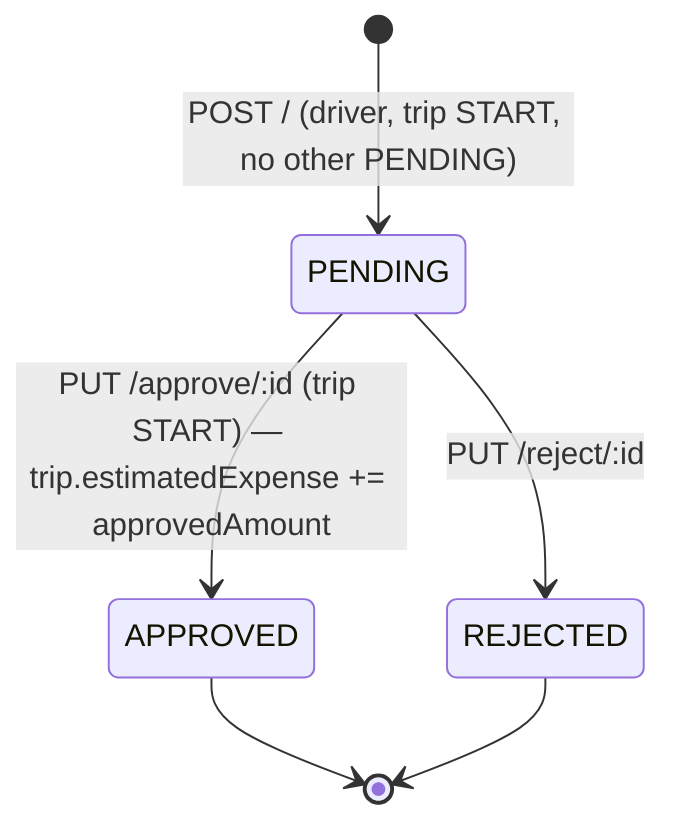

# Expense Request

Expense-extension workflow. While a trip is running, a DRIVER asks for more expense money than the trip's `estimatedExpense`; managers / finance approve (adding the approved amount to `trip.estimatedExpense`) or reject. Every create / approve / reject pushes a Socket.IO event to connected SUPERADMIN, ADMIN, FINANCEOFFICER and TRIPMANAGER users. The list of pending requests is served by the [Notification](notification.md) module, not here.

Shared concepts (auth middleware, `CommonResponse`, error middleware, cache util, `getActiveSocketIdsByRoles`, enums) are in [README.md](README.md).

## Files

| File | Responsibility |
|---|---|
| `src/modules/expenseRequest/expenseRequest.model.ts` | Mongoose model `ExpenseRequest` (named export) |
| `src/modules/expenseRequest/expenseRequest.route.ts` | Router; mounted at `/api/v1/expenseRequest` |
| `src/modules/expenseRequest/expenseRequest.validation.ts` | Joi: `saveExpenseRequestSchema`, `approveExpenseRequestSchema`, `rejectExpenseRequestSchema` |
| `src/modules/expenseRequest/expenseRequest.controller.ts` | Handlers, socket emits, approval audit log line |
| `src/modules/expenseRequest/expenseRequest.service.ts` | DB access + cache |
| `src/modules/expenseRequest/expenseRequest.util.ts` | Model → `ExpenseRequestByIdResponseDto` |
| `src/modules/expenseRequest/dto/ExpenseRequestByIdResponseDto.ts` | Response DTO |
| (external) `src/modules/notification/notification.util.ts` → `modelToExpensesExtensionResponseDto` | Payload builder for socket events |

## Data model

### `ExpenseRequest` (collection `expenserequests`)

Options: `timestamps: true`, `versionKey: false`. No indexes, hooks or virtuals.

| Field | Type | Required / default / ref | Meaning |
|---|---|---|---|
| `tripId` | ObjectId | required (`'Trip is required'`), ref `Trip` | Trip the extension is for. |
| `requestedAmount` | Number | required (`'Requested Amount is required'`) | Amount the driver asks for. |
| `description` | String | maxlength 500 | Reason. |
| `approvedAmount` | Number | default `0` | Amount granted on approval (may differ from requested). |
| `rejectRemark` | String | default `null`, maxlength 500 | Reason for rejection. |
| `status` | Number | default `WellKnownLeaveStatus.PENDING` (1) | Reuses the leave-status enum: `PENDING 1`, `APPROVED 2`, `REJECTED 3` (`CANCELLED 4` never set). |
| `createdBy` | ObjectId | ref `User` | Requesting driver. |
| `updatedBy` | ObjectId | ref `User` | Last approver/rejector. |

## Endpoints

| Method | Path | Roles allowed | Validation schema | Handler |
|---|---|---|---|---|
| POST | `/api/v1/expenseRequest/` | DRIVER | `saveExpenseRequestSchema` | `requestMoreExpenses` |
| PUT | `/api/v1/expenseRequest/approve/:id` | SUPERADMIN, ADMIN, TRIPMANAGER, FINANCEOFFICER | `approveExpenseRequestSchema` | `approveExpensesRequest` |
| PUT | `/api/v1/expenseRequest/reject/:id` | SUPERADMIN, ADMIN, TRIPMANAGER, FINANCEOFFICER | `rejectExpenseRequestSchema` | `rejectExpensesRequest` |
| GET | `/api/v1/expenseRequest/:id` | any authenticated user | — | `getExpenseExtension` |

Joi defaults apply (first error only, unknown keys rejected); errors → `BadRequestError(error.message)` (400).

## Endpoint logic

### POST `/api/v1/expenseRequest/` — `requestMoreExpenses` (`expenseRequest.controller.ts:20`)

Request body (`saveExpenseRequestSchema`):
- `tripId` string, required (messages say `'Type is required'` / `'Type is invalid'` — copy-paste)
- `requestedAmount` number, required (`'Requested Amount is required'` / `'Requested Amount is invalid'`)
- `description` string ≤ 500, null/'' allowed

Logic (no transaction)
1. Validate → 400.
2. `tripService.findByIdAndStatusIn(tripId, [START])`; none → `BadRequestError('Invalid trip or trip is not in started status!')`.
3. `expensesRequestService.findByTripIdAndStatusIn(tripId, [PENDING])` (cached). If any → `BadRequestError('You already have a pending expense request for this trip. If you need immediate assistance, please contact the administrator!')`.
4. Create `ExpenseRequest {tripId, requestedAmount, description, createdBy: auth.id, updatedBy: auth.id}` (status defaults PENDING), `save(…, null)` → clears cache prefix `expenseRequest-`.
5. `getActiveSocketIdsByRoles([SUPERADMIN, ADMIN, FINANCEOFFICER, TRIPMANAGER])`.
6. Reload with `findByIdAndStatusIn(newId, [PENDING])` (populates `tripId createdBy`).
7. If sockets exist and reload succeeded: emit **`new-expense-request`** to those socket ids with `{ message: "New expense request has been created for trip <tripConfirmedNumber> by <requestedUserName> ", data: ExpensesExtensionResponseDto }`.
8. `201 'Expense request saved successfully!'`, data `null`.

### PUT `/api/v1/expenseRequest/approve/:id` — `approveExpensesRequest` (`expenseRequest.controller.ts:101`)

Request: param `id`; body `approvedAmount` number, required (`'Approved Amount is required'` / `'Approved Amount is invalid'`).

Logic (transaction)
1. Validate → 400.
2. Start session + transaction.
3. `findByIdAndStatusIn(id, [PENDING, APPROVED, REJECTED])` (populates `tripId`, `createdBy`); none → `BadRequestError('No expense requests were not found.!')`.
4. Status APPROVED → `BadRequestError('Expense request already approved!')`; REJECTED → `BadRequestError('Expense request already rejected!')`.
5. `tripService.findByIdAndStatusIn(request.tripId._id, [START])`; none → `BadRequestError('Invalid trip or trip is not in started status!')`.
6. Set `approvedAmount`, `status = APPROVED`, `updatedBy`; `save(request, session)` (clears `expenseRequest-`).
7. Build log message `EXPENSE_REQUEST_APPROVED: Previously estimated expense : <old> | Approved additional amount : <amt> | New estimated expense : <old+amt> | Trip ID: <id> | Approved By: <userId> | Correlation ID: <req.correlationId>`.
8. `trip.estimatedExpense += approvedAmount`, `trip.updatedBy = auth.id`; `tripService.save(trip, session)` (Trip collection write; trip service does no cache clearing).
9. Sockets for the four roles; if any, emit **`expense-request-approved`** `{ message: '', data: ExpensesExtensionResponseDto(request) }`.
10. `helperUtil.consoleLogMessage('info', logMessage)` (stdout only, no DB audit record).
11. `200 'Expense request approved successfully!'`, data `null`; then `commitTransaction()`.
12. Error: abort + rethrow; `endSession()` in `finally`.

### PUT `/api/v1/expenseRequest/reject/:id` — `rejectExpensesRequest` (`expenseRequest.controller.ts:200`)

Request: param `id`; body `rejectRemark` string ≤ 500, null/'' allowed (optional).

Logic (no transaction)
1. Validate → 400.
2. Load with `[PENDING, APPROVED, REJECTED]`; none → `BadRequestError('No expense requests were found.!')`.
3. Already APPROVED / REJECTED → same messages as approve.
4. Set `status = REJECTED`, `updatedBy`, `rejectRemark`; `save(…, null)` (clears `expenseRequest-`).
5. Emit **`expense-request-rejected`** `{ message: '', data: ExpensesExtensionResponseDto }` to the four roles if any socket.
6. `200 'Expense request rejected successfully!'`, data `null`.

Trip status is not checked on reject.

### GET `/api/v1/expenseRequest/:id` — `getExpenseExtension` (`expenseRequest.controller.ts:268`)

1. Load with `[PENDING, APPROVED, REJECTED]` (populated); none → `BadRequestError('No expense requests were found.!')`.
2. `200`, data = `modelToExpensesRequestByIdResponseDto(request)`.

## Service layer (`expenseRequest.service.ts`)

| Function | Query / behaviour |
|---|---|
| `save(doc, session)` | Clears keys with prefix `expenseRequest-`, then `doc.save({session})` / `doc.save()`. |
| `findByTripIdAndStatusIn(tripId, status[])` | Cached: key `expenseRequest-` + `tripId` + `JSON.stringify(status)`, TTL `ONE_WEEK`. `ExpenseRequest.find({tripId, status: {$in}})`. Returns array. |
| `findByIdAndStatusIn(id, status[])` | `ExpenseRequest.findOne({_id, status: {$in}}).populate('tripId createdBy')`. Not cached. |

## Utilities / DTOs

`modelToExpensesRequestByIdResponseDto(req)` (`expenseRequest.util.ts`) → `ExpenseRequestByIdResponseDto`:

| Output | Source |
|---|---|
| `_id` | `req._id` |
| `tripId` | `req.tripId._id` or `''` |
| `typeName` | constant `'Expense Extension Request'` |
| `description` | `req.description` or `''` |
| `requestedAmount` | `req.requestedAmount` or `0` |
| `requestedUserId` | `req.createdBy._id` or `''` |
| `requestedUserName` | `req.createdBy.fullName` or `''` |
| `bankName`, `bankId`, `branch`, `accountNumber`, `accountHolderName`, `accountHolderAddress` | same-named fields on `req.createdBy` (User) or `''` |
| `tripConfirmedNumber` | `req.tripId.tripConfirmedNumber` |
| `createdAt` | `req.createdAt` |

`modelsToExpensesRequestByIdResponseDto(arr)` — maps the above over an array (unused in this module).

Socket payload `notificationUtil.modelToExpensesExtensionResponseDto(req)` → `{_id, tripId, type: WellKnownNotificationType.ExpenseExtensionRequest (1), typeName: 'Expense Extension Request', description, requestedAmount, requestedUserId, requestedUserName: "<fullName> (<userName>)", tripConfirmedNumber, createdAt}`.

## Business rules

- Only DRIVERs create requests; only for trips in START; max one PENDING request per trip.
- Approve/reject only from PENDING; terminal states are APPROVED and REJECTED (no cancel/edit endpoint).
- Approve requires trip still in START and atomically (same transaction) adds `approvedAmount` to `trip.estimatedExpense`. `approvedAmount` is free (not bounded by `requestedAmount`).
- Trip module blocks reverting a trip START → PENDING while any PENDING or APPROVED request exists for it.
- Socket events: `new-expense-request`, `expense-request-approved`, `expense-request-rejected` → roles SUPERADMIN(1), ADMIN(2), FINANCEOFFICER(4), TRIPMANAGER(5). The requesting driver is not notified.

## Cross-module dependencies

- **Trip**: `tripService.findByIdAndStatusIn` (status gate), `tripService.save` (writes `estimatedExpense`, `updatedBy`).
- **Notification**: `notificationUtil.modelToExpensesExtensionResponseDto` for socket payloads; `notification.service.getPendingExpenseRequest` reads `ExpenseRequest` (status PENDING, populated) for the notifications list.
- **Socket config**: `getActiveSocketIdsByRoles`, `io`.
- **Expenses**: indirect — the increased `estimatedExpense` changes `remainingTripExpensesAmount` and driver-salary settlement.
- **Trip** calls `expenseRequestService.findByTripIdAndStatusIn(tripId, [PENDING, APPROVED])` when reverting a trip to PENDING.
- Cache prefix `CACHE.PREFIX.EXPENSES_REQUEST` (`expenseRequest-`).

## Known issues / notes

- `expenseRequest.controller.ts:184-191` — 200 response sent and socket event emitted (`:176`) **before** `commitTransaction()`; a failed commit leaves clients notified of an approval that did not persist.
- `expenseRequest.controller.ts:32-40` — no check that the requesting driver is assigned to the trip.
- `expenseRequest.validation.ts:9,21` — `requestedAmount`/`approvedAmount` accept 0 and negative values; a negative approval reduces `estimatedExpense`.
- `expenseRequest.controller.ts:155,157` — if `trip.estimatedExpense` were missing, the sum becomes `NaN` (field is required in Trip schema, so unlikely).
- `expenseRequest.controller.ts:200-266` — reject has no transaction and no trip-status check.
- `expenseRequest.controller.ts:127` — message typo `'No expense requests were not found.!'`.
- `expenseRequest.validation.ts:4-7` — `tripId` messages say "Type".
- `expenseRequest.service.ts:15-30` — pending-check uses a 1-week cache; cache is cleared on every save in this service, but a race between two concurrent creates can still produce two PENDING requests (no unique index / transaction).
- `notification.util.ts:18-21` — `fullName + ' ' + '(userName)' || ''` never falls back (string concat is always truthy); renders `"undefined (undefined)"` if `createdBy` is missing.
- `expenseRequest.util.ts:26-32` — `modelsToExpensesRequestByIdResponseDto` unused.
- Approval audit is only a console log line (`helperUtil.consoleLogMessage`), not persisted.
