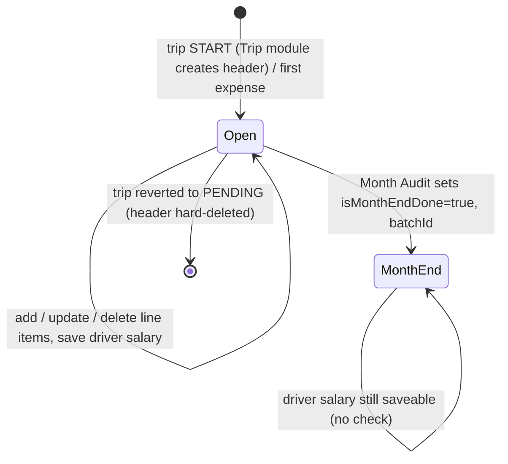

# Expenses

Per-trip expense ledger. One `Expenses` header document exists per trip; it holds the expense line items a driver / manager records while the trip runs, and the per-driver salary calculation saved after the trip finishes. The module itself has **no expense-limit enforcement** — the "limit" is the trip's `estimatedExpense`, which is only used to compute remaining balance and the driver-salary settlement. Raising that limit is done through the [Expense Request](expenseRequest.md) module (approval adds to `trip.estimatedExpense`).

Shared concepts (auth middleware, `CommonResponse`, error middleware, cache util, enums) are described in [README.md](README.md).

## Files

| File | Responsibility |
|---|---|
| `src/modules/expenses/expenses.model.ts` | Mongoose schema `Expenses` (header + `expenses[]` line items + `driverSalaries[]`) |
| `src/modules/expenses/expenses.route.ts` | Router; mounted at `/api/v1/expense` (`applicationRoutes.expenses.base`) |
| `src/modules/expenses/expenses.validation.ts` | Joi schemas `saveExpenseSchema`, `updateExpenseSchema`, `saveDriverSalarySchema` |
| `src/modules/expenses/expenses.controller.ts` | Handlers + private helpers `calculateDriverSalary`, `calcRemainingExpenses` |
| `src/modules/expenses/expenses.service.ts` | DB access + cache handling |
| `src/modules/expenses/expenses.util.ts` | Model → `TripExpensesResponseDto` mapper |
| `src/modules/expenses/dto/tripExpensesResponseDto.ts` | Response DTO interface |

## Data model

### `Expenses` (collection `expenses`)

Options: `timestamps: true` (`createdAt`, `updatedAt`), `versionKey: false`. No indexes defined (not even on `tripId`), no hooks, no virtuals.

| Field | Type | Required / default / ref | Meaning |
|---|---|---|---|
| `tripId` | ObjectId | required (`'Trip is required'`), ref `Trip` | Owning trip. One header per trip by convention (not enforced by an index). |
| `expenses` | array of subdocs | — | Expense line items (see below). |
| `isMonthEndDone` | Boolean | default `false` | Set to `true` by Month Audit when the trip's month is closed. Blocks add/update/delete of line items. |
| `batchId` | Number | default `0` | Month-audit batch id, set by Month Audit together with `isMonthEndDone`. |
| `driverSalaries` | array of subdocs | — | One entry per driver of the trip (see below). |
| `status` | Number | default `WellKnownStatus.ACTIVE` (1) | Header status. Only `ACTIVE` headers are ever read. Header is never soft-deleted; it is hard-deleted when a trip is moved back to PENDING. |
| `createdBy` | ObjectId | ref `User` | |
| `updatedBy` | ObjectId | ref `User` | |

`expenses[]` subdocument (has its own `_id`):

| Field | Type | Required / default | Meaning |
|---|---|---|---|
| `typeId` | Number | required (`'Type is required'`) | Expense type id (client-defined list; not validated against any enum server-side). |
| `typeName` | String | — | Display name of the type, stored as sent. |
| `amount` | Number | required (`'Amount is required'`) | Amount. |
| `description` | String | maxlength 500 | |
| `date` | Date | required (`'Date is required'`) | Expense date. |
| `receiptUrl` | String | — | URL/path of uploaded receipt (uploaded separately via Store module, upload type `ExpensesRecept` = 7). |
| `status` | Number | required, default `ACTIVE` | `ACTIVE` (1) or `DELETED` (3) — soft delete. |
| `createdBy`, `updatedBy` | ObjectId | ref `User` | |
| `createdAt`, `updatedAt` | Date | default `Date.now` | Manually maintained (not Mongoose timestamps). |

`driverSalaries[]` subdocument (has its own `_id`):

| Field | Type | Default | Meaning |
|---|---|---|---|
| `driver` | ObjectId | ref `User` | Driver user id. |
| `salaryPerDay` | Number | — | |
| `noOfDays` | Number | — | |
| `totalSalary` | Number | — | Result of `calculateDriverSalary` (see Business rules). |
| `totalAddition` | Number | — | Extra amount added to salary. |
| `totalDeduction` | Number | — | Amount deducted from salary. |
| `remainingExpenses` | Number | — | `trip.estimatedExpense − sum(active expense amounts)` at time of save. |
| `isRemainingToDriver` | Boolean | `false` | If true and remaining > 0, the remaining cash is kept by the driver and deducted from salary. |
| `createdBy`, `updatedBy` | ObjectId | ref `User` | |
| `createdAt`, `updatedAt` | Date | `Date.now` | Manually maintained. |

A legacy single `driverSalary` object is commented out in the schema (`expenses.model.ts:86-137`).

## Endpoints

| Method | Path | Roles allowed | Validation schema | Handler |
|---|---|---|---|---|
| POST | `/api/v1/expense/:tripId` | SUPERADMIN, ADMIN, TRIPMANAGER, DRIVER | `saveExpenseSchema` | `saveExpense` |
| PUT | `/api/v1/expense/:tripId/:expenseId` | SUPERADMIN, ADMIN, TRIPMANAGER, DRIVER | `updateExpenseSchema` | `updateExpense` |
| DELETE | `/api/v1/expense/:tripId/:expenseId` | SUPERADMIN, ADMIN, TRIPMANAGER, DRIVER | — | `deleteExpense` |
| GET | `/api/v1/expense/:tripId` | any authenticated user (`authorize([])`) | — | `getExpenseByTripId` |
| GET | `/api/v1/expense/:tripId/:expenseId` | any authenticated user | — | `getExpenseByTripIdAndExpenseId` |
| POST | `/api/v1/expense/saveSalary/:tripId` | SUPERADMIN, ADMIN, TRIPMANAGER | `saveDriverSalarySchema` | `saveDriverSalary` |

Note: `POST /saveSalary/:tripId` and `POST /:tripId` do not collide only because `/:tripId` matches a single segment.

All Joi schemas use defaults: `abortEarly: true` (first error only) and unknown keys rejected (`"<key>" is not allowed`). Joi errors are thrown as `BadRequestError(error.message)` (400).

## Endpoint logic

### POST `/api/v1/expense/:tripId` — `saveExpense` (`expenses.controller.ts:16`)

Request
- Params: `tripId`.
- Body (`saveExpenseSchema`):
  - `typeId` number, required (`'Type is required'` / `'Type is invalid'`)
  - `typeName` string, optional (empty string not allowed by Joi)
  - `amount` number, required (`'Amount is required'` / `'Amount is invalid'`) — sign not checked
  - `description` string ≤ 500, null/'' allowed
  - `date` date, required (`'Date is required'` / `'Date is invalid'`)
  - `receiptUrl` string, null/'' allowed, optional

Logic
1. Validate body → `BadRequestError(error.message)`.
2. Start Mongoose session + transaction.
3. `tripService.findByIdAndStatusIn(tripId, [START, FINISHED])`; none → `BadRequestError('No trip found!')`.
4. `expensesService.findByTripIdAndStatusIn(tripId, [ACTIVE])` (populates `tripId`).
5. If no header: build `new Expenses()` with `tripId`, empty `expenses`, `createdBy/updatedBy = auth.id` (also sets non-schema `driverSalary = null`, ignored) and save it in the session. Else if header `isMonthEndDone` → `BadRequestError('Cannot add new expense after month end!')`.
6. If `auth.role == DRIVER` and trip status is `FINISHED` → `BadRequestError('Cannot add new expense after trip finished!')`.
7. Push line item `{typeId, typeName, amount, description, date, receiptUrl, status: ACTIVE, createdBy, updatedBy}`.
8. `expensesService.save(expense, session)` — clears cache prefix `expenses-`.
9. Send `201 'Expense saved successfully!'`, data `null`; then `commitTransaction()`.
10. On error: `abortTransaction()` and rethrow; `endSession()` in `finally`.

Normally the header already exists: Trip module creates an empty `Expenses` header when a trip is started (`trip.controller.ts` status change to START). Step 5 is a fallback.

### PUT `/api/v1/expense/:tripId/:expenseId` — `updateExpense` (`expenses.controller.ts:101`)

Request: params `tripId`, `expenseId` (line-item `_id`); body `updateExpenseSchema` (identical rules to save).

Logic (no transaction)
1. Validate body → 400.
2. Trip must be `START`: else `BadRequestError('No trip found or trip not in started status!')`.
3. Header (ACTIVE) required: else `BadRequestError('No expense header found for this trip!')`; `isMonthEndDone` → `BadRequestError('Cannot update expense after month end!')`.
4. Find line item by `exp.id === expenseId` (status not checked); none → `BadRequestError('Expense not found!')`.
5. Overwrite `typeId, typeName, amount, description, date, receiptUrl`; set `updatedBy = auth.id`, `updatedAt = now`.
6. `expensesService.save(expense, null)` (clears `expenses-`).
7. `200 'Expense updated successfully!'`, data `null`.

### DELETE `/api/v1/expense/:tripId/:expenseId` — `deleteExpense` (`expenses.controller.ts:167`)

Logic (no transaction, soft delete)
1. Trip must be `START` → else `BadRequestError('No trip found or trip not in started status!')`.
2. Header required → `'No expense header found for this trip!'`; month end → `'Cannot delete expense after month end!'`.
3. Find line item by id (status not checked) → `'Expense not found!'`.
4. Set `status = DELETED`, `updatedBy`, `updatedAt`.
5. Save (clears `expenses-`); `200 'Expense deleted successfully!'`, data `null`.

### GET `/api/v1/expense/:tripId` — `getExpenseByTripId` (`expenses.controller.ts:222`)

1. `findByTripIdAndStatusIn(tripId, [ACTIVE])` (populated `tripId`).
2. If found:
   - keep only line items with `status === ACTIVE`;
   - `totalTripExpensesAmount = Σ amount`;
   - `tripExpensesAmount = tripId.estimatedExpense`;
   - `remainingTripExpensesAmount = tripExpensesAmount − totalTripExpensesAmount` (can be negative);
   - map via `ExpensesModelToTripExpensesResponseDto`.
3. `200`, message `''`, data = DTO or `null` when no header.

Response DTO: `{ _id, tripId, expenses[] (active only, raw subdocs), driverSalaries[] (raw), isMonthEndDone, tripExpensesAmount, totalTripExpensesAmount, remainingTripExpensesAmount }`.

### GET `/api/v1/expense/:tripId/:expenseId` — `getExpenseByTripIdAndExpenseId` (`expenses.controller.ts:269`)

1. Load ACTIVE header for trip.
2. Find line item with `id === expenseId` and `status === ACTIVE`.
3. `200`, data = raw subdocument or `null` (never 404).

### POST `/api/v1/expense/saveSalary/:tripId` — `saveDriverSalary` (`expenses.controller.ts:299`)

Request
- Params: `tripId`.
- Body (`saveDriverSalarySchema`):
  - `driver` string, required (`'Driver Id is required'` / `'Driver Id is invalid'`)
  - `salaryPerDay` number, required
  - `noOfDays` number, required
  - `totalAddition` number, optional
  - `totalDeduction` number, optional
  - `isRemainingToDriver` boolean, optional

Logic (no transaction; upsert into `driverSalaries`)
1. Validate → 400.
2. Trip must be `FINISHED` → else `BadRequestError('Trip not found!')`.
3. ACTIVE header required → `BadRequestError('No expense header found for this trip!')`.
4. Driver must be in `trip.drivers` (`drivers[].driver.toString() === body.driver`; `isActive` flag ignored) → else `BadRequestError('Driver not found in trip!')`.
5. Look for existing salary entry for that driver (on `expense.toObject()`).
   - Not found: push new entry with `salaryPerDay`, `noOfDays`, `totalSalary = calculateDriverSalary(...)`, `totalAddition`, `totalDeduction`, `remainingExpenses = calcRemainingExpenses(...)`, `isRemainingToDriver`, `createdBy/updatedBy = auth.id`, `createdAt/updatedAt = now`.
   - Found: overwrite the same fields + `updatedBy`, `updatedAt` on the plain object and assign back by index into `expense.driverSalaries[index]`.
6. `expensesService.save(expense, null)` (clears `expenses-`).
7. `200 'Driver salary saved successfully!'`, data `null`.

`isMonthEndDone` is **not** checked here.

## Service layer (`expenses.service.ts`)

| Function | Query / behaviour |
|---|---|
| `save(expenses, session)` | Clears cache keys starting with `expenses-`, then `doc.save({session})` or `doc.save()`. |
| `findAndHardDeleteByTripId(tripId, session)` | Clears `expenses-`, then `Expenses.findOneAndDelete({tripId}, {session})`. Used by Trip when reverting a trip to PENDING. |
| `findByTripIdAndStatusIn(tripId, status[])` | `Expenses.findOne({tripId, status: {$in}}).populate('tripId')`. Not cached. |
| `findByTripIdsInAndStatusIn(tripIds[], status[])` | Cached. Key `expenses-` + `JSON.stringify(tripIds)` + `JSON.stringify(status)`, TTL `ONE_WEEK`. Query `Expenses.find({tripId: {$in}, status: {$in}})` (no populate). Used by Dashboard. |

## Utilities / DTOs

| Function | Input → output |
|---|---|
| `ExpensesModelToTripExpensesResponseDto(expense)` (`expenses.util.ts`) | Header doc (with `tripId` populated and computed props attached by controller) → `{_id, tripId: expense.tripId._id, expenses, driverSalaries, isMonthEndDone, tripExpensesAmount, totalTripExpensesAmount, remainingTripExpensesAmount}`. Throws if `tripId` is not populated. |
| `calculateDriverSalary(trip, expenses, salaryPerDay, noOfDays, totalAddition, totalDeduction, isRemainingToDriver)` (controller, private) | See Business rules. |
| `calcRemainingExpenses(trip, expenses)` (controller, private) | `(trip.estimatedExpense − Σ active amounts) || 0`. |

## Business rules

- One ACTIVE `Expenses` header per trip; created at trip start (Trip module) or lazily on first expense.
- Add expense: trip in START or FINISHED; drivers cannot add after FINISHED; nobody can add after month end.
- Update / delete expense: trip must be START (not FINISHED) and not month-end; delete is a soft delete (`status = DELETED`).
- Reads and all totals only count line items with `status = ACTIVE`.
- Remaining balance = `trip.estimatedExpense − Σ active amounts`. Increasing `estimatedExpense` happens only through approved Expense Requests.
- Driver salary can only be saved when trip is FINISHED and only for drivers listed on the trip. Re-saving for the same driver overwrites the entry.
- Salary formula (`calculateDriverSalary`, `expenses.controller.ts:413`):
  ```
  remaining = (trip.estimatedExpense − Σ active expense amounts) || 0
  total  = 0
  total += salaryPerDay × noOfDays          if both > 0
  total += totalAddition                     if > 0
  total -= totalDeduction                    if > 0
  if remaining > 0:  total -= remaining      only if isRemainingToDriver
  else:              total += |remaining|    (driver overspent: reimbursed; 0 adds nothing)
  ```
- A trip counts as "driver salary done" (Trip list, `trip.controller.ts`) when every `trip.drivers[].driver` has an entry in `driverSalaries`.



Line item: `ACTIVE (1) → DELETED (3)` (one-way; no restore endpoint).

## Cross-module dependencies

Reads / writes from this module:
- `trip.service.findByIdAndStatusIn` (Trip) — status gate; `trip.estimatedExpense`, `trip.drivers`.
- Enums `WellKnownTripStatus`, `WellKnownStatus`; `constants.USER.ROLES.DRIVER`; cache prefix `CACHE.PREFIX.EXPENSES` (`expenses-`).

Callers into this module:
- **Trip** (`trip.controller.ts`): creates header on START (`new Expenses(...)` + `expensesService.save`); on revert START→PENDING refuses if any active expense **and** any driver salary exist, then `findAndHardDeleteByTripId`; trip list computes `isDriverSalaryDone` from `driverSalaries`; other endpoints read totals via `findByTripIdAndStatusIn`.
- **Month Audit** (`monthAudit.controller.ts:288-300`): for FINISHED trips sets `isMonthEndDone = true`, `batchId`, `updatedBy` and saves in its session.
- **Report** (`report.service.ts`, `report.controller.ts`): reads `Expenses` directly / via `findByTripIdAndStatusIn` for monthly expense & driver-salary reports.
- **Dashboard** (`dashboard.controller.ts`): `findByTripIdAndStatusIn`, `findByTripIdsInAndStatusIn`.

## Known issues / notes

- `expenses.controller.ts:85-92` — response is sent **before** `commitTransaction()`. If commit fails, the client already received 201 and the rethrow hits an already-sent response.
- `expenses.controller.ts:59-66` — no check that a DRIVER is actually assigned to the trip; any driver can add/update/delete expenses on any started trip (`updateExpense`/`deleteExpense` also do not check ownership).
- `expenses.controller.ts:136-138`, `196-198` — update/delete look up the line item without checking `status`, so a DELETED item can be edited or "deleted" again.
- `expenses.controller.ts:114-116` vs `30-33` — save allows FINISHED trips (non-drivers) but update/delete require START, so admins can add but not correct expenses after trip finish.
- `expenses.controller.ts:299-411` — `saveDriverSalary` does not check `isMonthEndDone`; salaries can be changed after month close. No transaction.
- `expenses.controller.ts:328-330` — driver membership check ignores `drivers[].isActive`.
- `expenses.validation.ts:11,39` — `amount`, `salaryPerDay`, `noOfDays`, `totalAddition`, `totalDeduction` accept negative numbers.
- `expenses.controller.ts:50` — sets non-schema field `driverSalary` (dead; schema field commented out at `expenses.model.ts:88-137`).
- `expenses.controller.ts:433`, `469` — `(a − b) || 0` turns `NaN` into 0 but also any legitimate 0; harmless but `remaining == 0` then falls into the `else` branch (adds 0).
- `expenses.model.ts` — no index on `tripId`, no unique constraint; concurrent first-expense saves on a trip without header can create two headers.
- `expenses.service.ts:6-7`, `16-17` — cache is cleared before the write/commit; a concurrent read between clear and commit can re-cache stale data for a week (`findByTripIdsInAndStatusIn`).
- `expenses.controller.ts:256-263` — leftover commented DTO notes.
