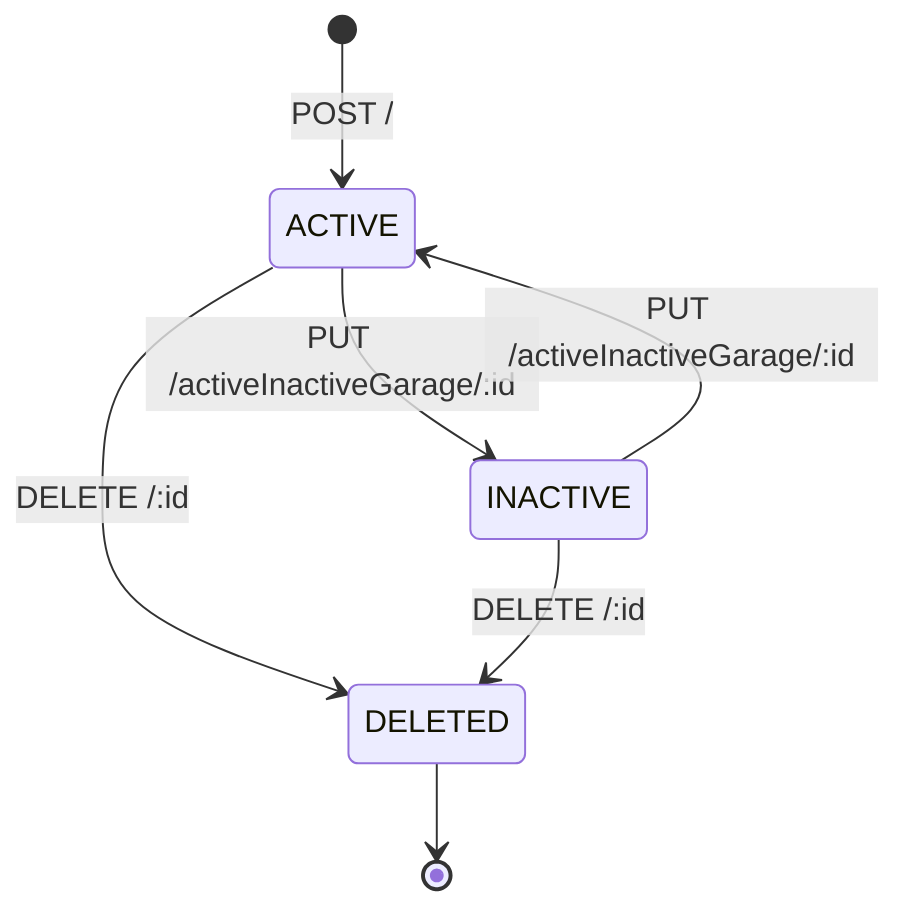

# Garage

Master data for garages (repair shops) with contact details, map link and a list of specializations. Garages are referenced by vehicle maintenance records and appear in the "Recommended Garage" / garage-management menus.

Shared infrastructure (auth middleware, `CommonResponse`, error middleware, cache util, enums) is described in [README.md](./README.md).

## Files

| File | Responsibility |
|---|---|
| `src/modules/garage/garage.model.ts` | Mongoose schema/model `Garage` |
| `src/modules/garage/garage.route.ts` | Router + role guards |
| `src/modules/garage/garage.validation.ts` | Joi `garageRequestSchema` (create and update) |
| `src/modules/garage/garage.controller.ts` | Handlers |
| `src/modules/garage/garage.service.ts` | Queries + cache |
| `src/modules/garage/garage.util.ts` | Model → `GarageResponseDto` |
| `src/modules/garage/dto/garageResponseDto.ts` | DTO interface |

## Data model

### `Garage` (collection `garages`)

Options: `timestamps: true`, `versionKey: false`. No indexes, hooks or virtuals.

| Field | Type | Required / default / ref | Meaning |
|---|---|---|---|
| `name` | String | required, maxlength 100 | Garage name (not unique) |
| `address` | String | maxlength 300 | Address |
| `city` | String | maxlength 100 | City |
| `contactNumber1` | String | maxlength 14 | Phone 1 |
| `contactNumber2` | String | maxlength 14 | Phone 2 |
| `googleMapUrl` | String | default `null` | Map link |
| `specializations` | [{ `id`: Number required, `name`: String required maxlength 100 }] | subdocuments (with own `_id`) | Services offered. Ids/names come from the client; no server-side master list |
| `description` | String | maxlength 500 | Notes |
| `status` | Number | required, default ACTIVE (1) | `WellKnownStatus` 1 ACTIVE, 2 INACTIVE, 3 DELETED |
| `createdBy` / `updatedBy` | ObjectId | ref `User` | Audit users |

## Endpoints

Base: `/api/v1/garage`. `WRITE_ROLES` below = SUPERADMIN(1), ADMIN(2), TRIPMANAGER(5), DRIVERASSISTANT(6).

| Method | Path | Roles allowed | Validation schema | Handler |
|---|---|---|---|---|
| POST | `/api/v1/garage/` | WRITE_ROLES | `garageRequestSchema` | `createGarage` |
| GET | `/api/v1/garage/` | any authenticated | – | `getAllGarages` |
| GET | `/api/v1/garage/:id` | any authenticated | – | `getGarageById` |
| PUT | `/api/v1/garage/:id` | WRITE_ROLES | `garageRequestSchema` | `updateGarage` |
| DELETE | `/api/v1/garage/:id` | WRITE_ROLES | – | `deleteGarage` |
| PUT | `/api/v1/garage/activeInactiveGarage/:id` | WRITE_ROLES | – | `activeInactiveGarage` |

## Endpoint logic

Joi errors → `BadRequestError(error.message)` (400); converted value is discarded. Mongoose validation errors → 400 (first message). Invalid ObjectId → `CastError` → 404.

### Request body (`garageRequestSchema`)

| Field | Rule / messages |
|---|---|
| `name` | string, max 100, required (`Garage Name is required`) |
| `address` | string, max 300, `''`/null allowed |
| `city` | string, max 100, `''`/null allowed |
| `contactNumber1`, `contactNumber2` | string, max 14, `''`/null allowed |
| `googleMapUrl` | string, `''`/null allowed |
| `specializations` | array, min 1, required (`At least one specialization is required` / `Specializations are required`); items `{ id: number required, name: string max 100 required }` |
| `description` | string, max 500, `''`/null allowed |

### POST `/` — `createGarage` (controller.ts:12)

1. Validate body.
2. New `Garage` with all body fields, `createdBy = updatedBy = auth.id` (status defaults ACTIVE).
3. `garageService.save(garage, null)` → clears cache prefix `garage-`, saves.
4. Response 201 `Garage created successfully!`, `data` = saved document.

No duplicate-name check.

### PUT `/:id` — `updateGarage` (controller.ts:59)

1. Validate body.
2. `findByIdAndStatusIn(id, [ACTIVE, INACTIVE])`; missing → `BadRequestError('Garage not found!')`.
3. Overwrite all body fields (including `specializations` array), `updatedBy = auth.id`.
4. Save (clears `garage-`).
5. Response 200 `Garage updated successfully!`, `data` = saved document.

### DELETE `/:id` — `deleteGarage` (controller.ts:110)

1. `findByIdAndStatusIn(id, [ACTIVE, INACTIVE])`; missing → `BadRequestError('Garage not found!')`.
2. `status = DELETED`, `updatedBy = auth.id`, save (clears `garage-`).
3. Response 200 `Garage deleted successfully!`, `data: null`.

No check for maintenance records that reference the garage (they keep the reference; populate still returns the soft-deleted document).

### GET `/` — `getAllGarages` (controller.ts:140)

1. `findAllAndStatusIn([ACTIVE, INACTIVE])`: cache key `garage-[1,2]`; on miss `find({status:{$in}})` populating `createdBy`/`updatedBy` with `select: "username fullName"`, `sort({createdAt:-1})`, cached ONE_WEEK.
2. Map with `modelToGarageResponseDtoList`.
3. Response 200, `data` = `GarageResponseDto[]` (INACTIVE garages included; no filter parameter).

### GET `/:id` — `getGarageById` (controller.ts:162)

1. `findByIdAndStatusIn(id, [ACTIVE, INACTIVE])` (no populate).
2. Response 200, `data` = raw document or `null` (no not-found error).

### PUT `/activeInactiveGarage/:id` — `activeInactiveGarage` (controller.ts:179)

Toggle; no request body/query.

1. `findByIdAndStatusIn(id, [ACTIVE, INACTIVE])`; missing → `BadRequestError('Garage not found!')`.
2. ACTIVE → INACTIVE, INACTIVE → ACTIVE; `updatedBy = auth.id`; save (clears `garage-`).
3. Message `Garage activated successfully!` if now ACTIVE else `Garage inactivated successfully!`.
4. Response 200 with message, `data: null`.

## Service layer (`garage.service.ts`)

| Function | Query / behaviour |
|---|---|
| `save(garage, session)` | `clearCacheByPrefixs('garage-')`; `save({session})` or `save()` |
| `findByIdAndStatusIn(id, status[])` | `Garage.findOne({_id:id, status:{$in}})` |
| `findAllAndStatusIn(status[])` | cached list (see GET `/`) |

## Utilities / DTOs

`modelToGarageResponseDto(garage) → GarageResponseDto`:

| DTO field | Source |
|---|---|
| `_id`, `name`, `address`, `city`, `contactNumber1`, `contactNumber2`, `googleMapUrl`, `status`, `createdAt`, `updatedAt` | same |
| `specializations` | `specializations.map(s => s.name).join(', ')` (string, ids dropped) |
| `statusName` | `WellKnownStatus[status]` |
| `createdBy` / `updatedBy` | populated user `_id` |
| `createdUser` / `updatedUser` | populated `fullName` (undefined if missing; no `''` fallback) |

`description` is not in the DTO. `modelToGarageResponseDtoList(garages[])` → maps each.

## Business rules

- Name and at least one specialization are mandatory.
- Only ACTIVE/INACTIVE garages can be read, updated, toggled or deleted; deleted garages are invisible to all endpoints.
- Vehicle maintenance accepts both ACTIVE and INACTIVE garages, so INACTIVE does not block new maintenance records.

## Cross-module dependencies

- Called by `vehicleMaintain/vehicleMaintenance.controller.ts:57`, `:144` (`garageService.findByIdAndStatusIn(garage, [ACTIVE, INACTIVE])`).
- `VehicleMaintenance.garage` refs `Garage`; populated in vehicleMaintenance service and `report/report.service.ts:89`, `:100` (garage `name` used in report descriptions).
- Menu entries in `util/data/menudata.ts` (garage management / recommended garage) point at this module.
- Cache prefix `garage-` cleared on every save. No socket events, no audit log entries.

## Known issues / notes

- `garage.service.ts:27-28` — populate selects `"username"`, but the User field is `userName`; only `fullName` is actually loaded (DTO only uses `fullName`, so no visible effect today).
- `garage.controller.ts:162-177` — GET by id returns 200 with `null` when not found; no user populate.
- `garage.util.ts:5-25` — `description` omitted from list DTO; `createdUser`/`updatedUser` have no `''` fallback.
- `garage.controller.ts:110-138` — delete does not check references from vehicle maintenance.
- `garage.validation.ts:25` — `googleMapUrl` not validated as a URI; contact numbers are free strings.
- `applicationRoutes.ts:183` — `monthlyExpenses.activeInactiveGarage` is a copy-paste route key unrelated to this module and never mounted.
- `garage.controller.ts:30-55`, `:78-107` — `try { ... } catch (e) { throw e }` wrappers are no-ops.
