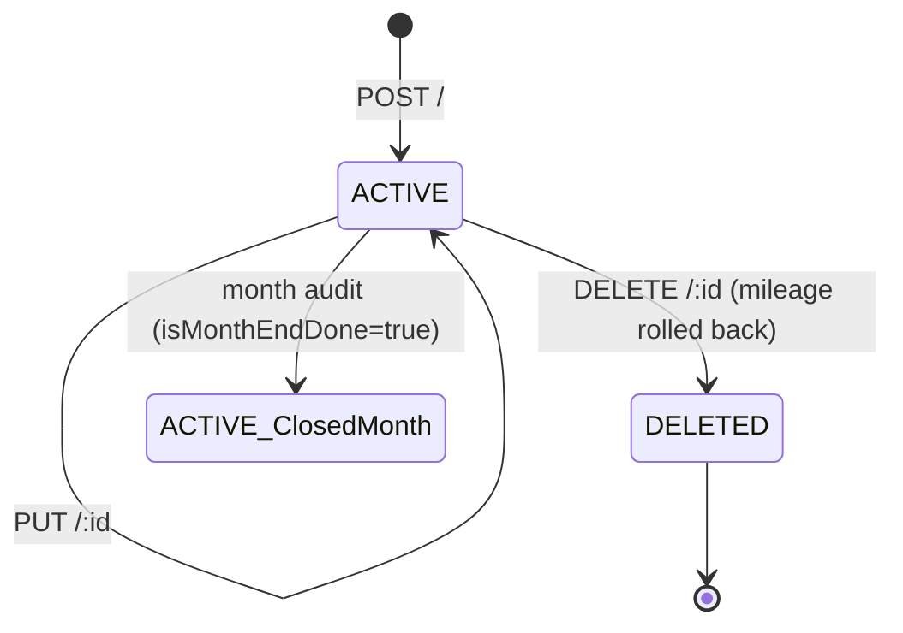

# Internal Trip

Records non-customer (internal/company) use of a vehicle by a driver over a date range — e.g. servicing runs or staff transport. An internal trip blocks the vehicle (and the driver, via the user module) from being offered for overlapping customer trips, and optionally advances the vehicle odometer from a meter reading. Records are closed by the month-end audit.

Shared infrastructure (auth middleware, `CommonResponse`, error middleware, cache util, enums) is described in [README.md](./README.md).

## Files

| File | Responsibility |
|---|---|
| `src/modules/internalTrip/internalTrip.model.ts` | Mongoose schema/model `InternalTrip` |
| `src/modules/internalTrip/internalTrip.route.ts` | Router + role guards |
| `src/modules/internalTrip/internalTrip.validation.ts` | Joi `internalTripSchema` (create and update) |
| `src/modules/internalTrip/internalTrip.controller.ts` | Handlers (transactions, vehicle mileage) |
| `src/modules/internalTrip/internalTrip.service.ts` | Queries, cache, overlap validation, month-end query |
| `src/modules/internalTrip/internalTrip.util.ts` | Model → `InternalTripResponseDto` |
| `src/modules/internalTrip/dto/internalTripResponseDto.ts` | DTO interface |

## Data model

### `InternalTrip` (collection `internaltrips`)

Options: `timestamps: true`, `versionKey: false`. No indexes, hooks or virtuals.

| Field | Type | Required / default / ref | Meaning |
|---|---|---|---|
| `startDate` | Date | required | Start |
| `endDate` | Date | required | End |
| `dateCount` | Number | required | Number of days (client-computed; not checked against dates) |
| `vehicle` | ObjectId | required, ref `Vehicle` | Vehicle used |
| `meterReading` | Number | default 0 | Odometer reading at end; when > 0 the vehicle's `currentMileage` is advanced to it |
| `calcDistance` | Number | default 0 | `meterReading - vehicle.currentMileage` at the time it was applied; subtracted on delete |
| `driver` | ObjectId | required, ref `User` | Driver |
| `isMonthEndDone` | Boolean | default false | Set by month-end audit |
| `reason` | String | required, maxlength 500 | Purpose |
| `status` | Number | required, default ACTIVE (1) | `WellKnownStatus` 1 ACTIVE, 2 INACTIVE, 3 DELETED |
| `createdBy` / `updatedBy` | ObjectId | ref `User` | Audit users |

No `batchId` field (month audit sets one, but strict mode drops it — see Known issues).

## Endpoints

Base: `/api/v1/internalTrip`. All routes: SUPERADMIN(1), ADMIN(2), TRIPMANAGER(5), FINANCEOFFICER(4).

| Method | Path | Roles allowed | Validation schema | Handler |
|---|---|---|---|---|
| POST | `/api/v1/internalTrip/` | 1, 2, 5, 4 | `internalTripSchema` | `saveInternalTrip` |
| GET | `/api/v1/internalTrip/:id` | 1, 2, 5, 4 | – | `getInternalTripById` |
| PUT | `/api/v1/internalTrip/:id` | 1, 2, 5, 4 | `internalTripSchema` | `updateInternalTrip` |
| DELETE | `/api/v1/internalTrip/:id` | 1, 2, 5, 4 | – | `deleteInternalTripById` |
| GET | `/api/v1/internalTrip/getByVehicle/:id` | 1, 2, 5, 4 | – | `getInternalTripByVehicle` |

## Endpoint logic

Joi errors → `BadRequestError(error.message)` (400); converted value is discarded. Invalid ObjectId → `CastError` → 404. Thrown errors inside a transaction abort it and are rethrown; the session is always ended in `finally`.

### Request body (`internalTripSchema`)

| Field | Rule / messages |
|---|---|
| `startDate` | date, required (`Start Date is required!` / `Start Date is invalid!`) |
| `endDate` | date, required |
| `dateCount` | number, min 1, required (`Date Count cannot be less than 1`) |
| `vehicle` | string, required |
| `meterReading` | number, optional |
| `driver` | string, required |
| `reason` | string, 1–500, required |

No check that `endDate >= startDate`.

### POST `/` — `saveInternalTrip` (controller.ts:14)

1. Validate body.
2. `validateVehicleForDateRange(startDate, endDate, vehicle, '')`; true → `BadRequestError('Vehicle already has internal trip or an other trip for this date range!')`.
3. Start session + transaction.
4. Build `InternalTrip` from body (`startDate`, `endDate`, `dateCount`, `vehicle`, `meterReading`, `reason`, `driver`, `createdBy = updatedBy = auth.id`).
5. If `meterReading > 0`:
   1. `vehicleService.findByIdAndStatusIn(vehicle, [ACTIVE, INACTIVE])`; missing → `BadRequestError('Vehicle not found!')`.
   2. `vehicle.currentMileage >= meterReading` → `BadRequestError('Vehicle current mileage is greater than meter reading!')`.
   3. `calcDistance = meterReading - currentMileage`; store on trip; `vehicle.currentMileage += calcDistance`.
   4. `vehicleService.save(vehicle, session)` (clears cache `vehicle-`, `trip-`).
6. `internalTripService.save(trip, session)` (clears cache `internalTrip-`).
7. Commit. Response 201 `Internal trip created successfully!`, `data` = trip document.

If `meterReading` is absent/0, the vehicle is never loaded, so a non-existent vehicle id is accepted.

### PUT `/:id` — `updateInternalTrip` (controller.ts:102)

1. Validate body.
2. `findByIdAndStatusIn(id, [ACTIVE])`; missing → `BadRequestError('Internal trip not found!')`.
3. `validateVehicleForDateRange(startDate, endDate, body.vehicle, id)`; true → same overlap error as create.
4. Transaction:
   1. Overwrite `startDate`, `endDate`, `dateCount`, `reason`, `driver`, `updatedBy`. `vehicle` and `meterReading` are NOT updated.
   2. If stored `meterReading <= 0` and `body.meterReading > 0`: load stored vehicle (`[ACTIVE, INACTIVE]`, `Vehicle not found!`), same mileage check/error, set `calcDistance`, increase `vehicle.currentMileage`, `vehicleService.save(vehicle, session)`.
   3. `internalTripService.save(trip, session)`.
5. Commit. Response 200 `Internal trip Updated successfully!`, `data` = trip.

No `isMonthEndDone` check.

### GET `/:id` — `getInternalTripById` (controller.ts:195)

1. `findByIdAndStatusIn(id, [ACTIVE, INACTIVE])` (no populate).
2. Response 200, `data` = raw document or `null`.

### DELETE `/:id` — `deleteInternalTripById` (controller.ts:206)

1. `findByIdAndStatusIn(id, [ACTIVE])`; missing → `BadRequestError('Internal trip not found!')`.
2. `vehicleService.findByIdAndStatusIn(trip.vehicle, [ACTIVE, INACTIVE])`; missing → `BadRequestError('Vehicle not found!')` (even when `calcDistance` is 0).
3. Transaction: `status = DELETED`, `updatedBy`; `internalTripService.save(trip, session)`; `vehicle.currentMileage -= trip.calcDistance`; `vehicleService.save(vehicle, session)`.
4. Commit. Response 200 `Internal trip Deleted successfully!`, `data` = trip.

No `isMonthEndDone` check.

### GET `/getByVehicle/:id` — `getInternalTripByVehicle` (controller.ts:263)

1. `findAllByVehicleId(vehicleId)`: cache key `internalTrip-<vehicleId>`; on miss `find({vehicle, status: ACTIVE})` populating `driver` (`_id fullName`), `createdBy`/`updatedBy` (`_id userName`), `sort({startDate:-1})`; cached ONE_WEEK.
2. Map with `modelsToInternalTripResponseDto`.
3. Response 200, `data` = `InternalTripResponseDto[]`.

## Service layer (`internalTrip.service.ts`)

| Function | Query / behaviour |
|---|---|
| `save(doc, session)` | `clearCacheByPrefixs('internalTrip-')`; `save({session})` or `save()` |
| `findByIdAndStatusIn(id, status)` | `findOne({_id, status:{$in}})` |
| `findAllByVehicleId(vehicleId)` | cached list (see getByVehicle) |
| `findAllByEndMonthAndStatusIn(endMonth, year, status)` | Cache key `internalTrip-<endMonth><year><status JSON>` (ONE_WEEK). `endDate = new Date(); setFullYear(year); setMonth(endMonth)` → first day of that month 00:00 local. `find({createdAt:{$lt:endDate}, status:{$in}, isMonthEndDone:false})`. Called with 1-based `workingMonth`, so the bound is the 1st of the following month |
| `validateVehicleForDateRange(start, end, vehicleId, internalTripId)` | Returns `true` if (a) an ACTIVE internal trip for this vehicle (excluding `internalTripId` when given) overlaps, or (b) any `Trip` with status PENDING(1)/START(3)/FINISHED(4) has `vehicles` containing `vehicleId` (any `isActive` value) and overlaps. Overlap: `startDate ∈ [start, end)` OR `endDate ∈ [start, end)` OR (`startDate <= start` AND `endDate >= end`) |

## Utilities / DTOs

`modelToInternalTripResponseDto(trip)`:

| DTO field | Source |
|---|---|
| `_id`, `startDate`, `endDate`, `reason`, `createdAt`, `updatedAt` | same |
| `driver` | `driver.fullName` (throws if driver populate is null) |
| `isMonthEndDone` | `isMonthEndDone || false` |
| `createdBy` / `updatedBy` | user `_id` |
| `createdByUser` / `updatedByUser` | user `userName` |

Not in DTO: `vehicle`, `dateCount`, `meterReading`, `calcDistance`, `status`. `modelsToInternalTripResponseDto(trips[])` maps each.

## Business rules

- A vehicle cannot have overlapping ACTIVE internal trips, nor an internal trip overlapping a PENDING/START/FINISHED customer trip it is (or was) assigned to.
- Odometer: a positive `meterReading` must exceed the vehicle's `currentMileage`; the difference is stored as `calcDistance` and added to the vehicle in the same transaction. Delete subtracts `calcDistance`. The meter reading can be applied once, at create time or at the first update when none was recorded.
- Availability effects elsewhere: `vehicle.service.ts:95` and `user.service.ts:187` exclude vehicles/drivers on overlapping ACTIVE internal trips from trip-assignment lookups.
- Month end (monthAudit `createNewMonth`, `monthAudit.controller.ts:193-216`): ACTIVE/INACTIVE trips created before the 1st of the month after the working month get `isMonthEndDone = true`, `updatedBy` (and an ignored `batchId`).

## Cross-module dependencies

| Direction | Module | Detail |
|---|---|---|
| reads/writes | vehicle | `findByIdAndStatusIn`, `save(vehicle, session)` to change `currentMileage` (clears `vehicle-`, `trip-` caches) |
| reads | trip | `Trip` model in `validateVehicleForDateRange` |
| called by | monthAudit | `findAllByEndMonthAndStatusIn(workingMonth, workingYear, [ACTIVE, INACTIVE])` + `save(..., session)` |
| read by | vehicle | `vehicle.service.ts:95` availability lookup |
| read by | user | `user.service.ts:187` driver availability lookup |

Cache prefix `internalTrip-` cleared on every save. No socket events, no audit log entries.

## Known issues / notes

- `internalTrip.controller.ts:140-145` — update never writes `meterReading` (nor `vehicle`). After a reading is applied on update, the stored `meterReading` stays 0, so the next update that resends the same reading re-enters the mileage block and fails with `Vehicle current mileage is greater than meter reading!`; a higher reading would add mileage again and overwrite `calcDistance`.
- `internalTrip.controller.ts:121-127` — overlap check uses `body.vehicle`, but the stored vehicle is never changed; if they differ, the wrong vehicle is checked.
- `internalTrip.controller.ts:102-193`, `:206-261` — no `isMonthEndDone` guard on update/delete; closed months can be changed and mileage rolled back.
- `internalTrip.controller.ts:239` — delete subtracts `calcDistance` regardless of later mileage updates by trips; vehicle odometer can go below later readings.
- `internalTrip.controller.ts:23-35` — no driver availability/role check; a driver can be double-booked or a non-driver user assigned. Vehicle existence is only checked when `meterReading > 0`.
- `internalTrip.service.ts:110-128` — Trip overlap matches vehicles regardless of `vehicles.isActive` (a vehicle that was swapped off a trip still blocks), and includes FINISHED trips; vehicle availability lookup (`vehicle.service.ts:107-117`) uses only active entries and PENDING/START. Inconsistent rules.
- `internalTrip.service.ts:63-72` — month-end uses `createdAt`, not trip dates; `setMonth` on "today" can overflow on the 29th–31st. Result is cached for a week (Mongoose documents mutated by the caller).
- `monthAudit.controller.ts:210` — sets `internalTrip.batchId`, but the schema has no `batchId`; value is silently dropped.
- `internalTrip.controller.ts:195-204` — GET by id returns 200 with `null` when not found.
- `internalTrip.util.ts:10` — `driver.fullName` throws if the driver reference no longer resolves.
- `internalTrip.validation.ts` — no `endDate >= startDate` check; `dateCount` not reconciled with dates; error message `'Vehicle current mileage is greater than meter reading!'` is also thrown when equal.
