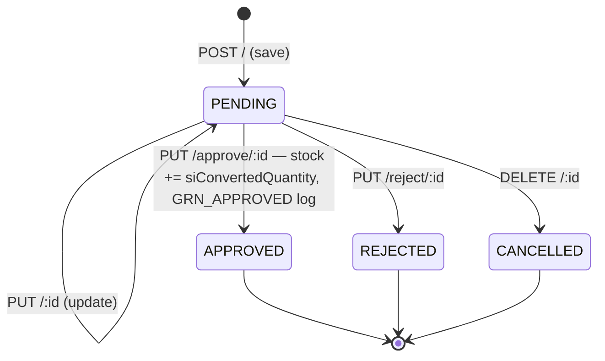

# Inventory (Product, GRN)

Stock master and goods-receipt flow. **Product** holds the item master, the current stock (`inventory`, stored in SI base units) and an append-only stock audit log (`inventoryLogs`). **GRN** (Good Receipt Note) records incoming stock; stock is only increased when a GRN is approved. Stock is decreased/returned by the [POS](pos.md) module and by trip cancellation in the Trip module. Measure units come from `src/util/data/measureUnitData.ts` (static data, see [README.md](README.md)).

## Files

| File | Responsibility |
|---|---|
| `src/modules/inventory/product/product.model.ts` | Mongoose model `InventoryProduct` |
| `src/modules/inventory/product/product.route.ts` | Router; mounted at `/api/v1/inventory/product` |
| `src/modules/inventory/product/product.validation.ts` | Joi `productSaveSchema` (used for create and update) |
| `src/modules/inventory/product/product.controller.ts` | Product handlers |
| `src/modules/inventory/product/product.service.ts` | Product DB access, duplicate check, cache |
| `src/modules/inventory/product/product.util.ts` | Model → `ProductResponseDto`; private SI → product-unit conversion |
| `src/modules/inventory/grn/grn.model.ts` | Mongoose model `GRN` |
| `src/modules/inventory/grn/grn.route.ts` | Router; mounted at `/api/v1/inventory/grn` |
| `src/modules/inventory/grn/grn.validation.ts` | Joi `grnSaveSchema`, `grnApproveRejectSchema`, `advanceSearchSchema` |
| `src/modules/inventory/grn/grn.controller.ts` | GRN handlers + local copies of unit-conversion functions (`:378-438`) |
| `src/modules/inventory/grn/grn.service.ts` | GRN DB access, next-number, advance search cache |
| `src/modules/inventory/grn/grn.util.ts` | Model → `GrnSearchResponseDto` / `GrnResponseDto` |
| `src/modules/inventory/dto/productResponseDto.ts` | `ProductResponseDto` |
| `src/modules/inventory/dto/grnResponseDto.ts` | `GrnResponseDto`, `GrnProductDto` |
| `src/modules/inventory/dto/grnSearchResponseDto.ts` | `GrnSearchResponseDto` |

## SI unit conversion

`measureUnitData.ts` (static):

| unitId | code | name | categoryId | isSaveWithSiUnit | isSiUnit | conversionToSi | isAllowDecimal |
|---|---|---|---|---|---|---|---|
| 1–10 | pc, pkt, box, btl, can, roll, set, item, unit, bag | countable | 1 | false | true | 1 | false |
| 11 | mg | Milligram | 2 | true | false | 0.001 | true |
| 12 | g | Gram | 2 | true | **true** | 1 | true |
| 13 | kg | Kilogram | 2 | true | false | 1000 | true |
| 14 | t | Tonne | 2 | true | false | 1000000 | true |
| 15 | ml | Milliliter | 3 | true | **true** | 1 | true |
| 16 | l | Liter | 3 | true | false | 1000 | true |
| 17 | cc | Cubic Centimeter | 3 | true | false | 1 | true |

Categories: 1 Countable, 2 Mass, 3 Volume.

Rules (implemented in `util/helper.util.ts` and duplicated in `grn.controller.ts`, `pos.controller.ts`):
- `fromMeasureUnitToSiMeasureUnit(unitId, qty)`: `isSaveWithSiUnit` false (countable) or unknown unit → `qty`; SI unit → `qty`; else `qty × conversionToSi`. **No category check.**
- `fromMeasureUnitToOtherMeasureUnit(from, to, qty)`: different `categoryId` → `BadRequestError('Invalid Measure Unit Conversion!')`; else `toSi(from, qty) / to.conversionToSi`.
- `fromSiMeasureUnitToOtherMeasureUnit(from, to, siQty)`: category check; `to.isSiUnit` → `siQty`; else `siQty / to.conversionToSi`.
- `product.util.ts` private `fromSiMeasureUnitToOtherMeasureUnit(toUnitId, siQty)`: unknown unit → `0`; SI unit → `siQty`; else `siQty / conversionToSi` (no category check).

Consequence: `InventoryProduct.inventory` and every `inventoryLogs` quantity are in grams (mass), millilitres (volume) or raw count (countable). The product list converts stock back to the product's own unit (e.g. kg) for display; the get-by-id endpoint does not.

`isAllowDecimal` is not enforced anywhere server-side.

---

# Product

## Data model

### `InventoryProduct` (collection `inventoryproducts`)

Options: `timestamps: true`, `versionKey: false`. No indexes (no unique constraints), hooks or virtuals.

| Field | Type | Required / default / ref | Meaning |
|---|---|---|---|
| `productName` | String | required (`'Product Name is required'`) | Unique (case-insensitive, among non-DELETED) by application check only. |
| `productShortCode` | String | required (`'Product Short Code is required'`) | Same uniqueness rule. |
| `measureUnit` | Number | required (`'Measure Unit is required'`) | `unitId` from `measureUnitData`. Fixed after creation (update ignores it). |
| `isReturnableProduct` | Boolean | required | Drives POS trip-end audit behaviour. |
| `unitPrice` | Number | required | Price per one `measureUnit` (e.g. per kg). |
| `description` | String | maxlength 500 | |
| `inventory` | Number | default `0` | Current stock in SI base unit. Changed only by GRN approve, POS, trip cancel. |
| `inventoryLogs` | array of subdocs | — | Stock audit log (below). |
| `status` | Number | required, default `ACTIVE` | `ACTIVE 1`, `INACTIVE 2`, `DELETED 3` (soft delete). |
| `createdBy`, `updatedBy` | ObjectId | ref `User` | |

`inventoryLogs[]` (own `_id`):

| Field | Type | Meaning |
|---|---|---|
| `inventoryLogType` | Number | `WellKnownGrnLogType`: `GRN_APPROVED 1`, `POS_TRANSACTION 2` (issue, void, trip-cancel return), `POS_TRANSACTION_RETURN 3` (trip-end audit return) |
| `inventoryLogDate` | Date | When the movement happened |
| `inventoryLogQuantity` | Number | Quantity moved (SI unit, always positive) |
| `beforeTransactionInventory` | Number | Stock before |
| `afterTransactionInventory` | Number | Stock after |
| `inventoryLogProductId` | ObjectId ref `InventoryProduct` | Product (self) |
| `inventoryLogCreatedBy` | ObjectId ref `User` | Actor |
| `message` | String | Human-readable description incl. SI unit code and GRN number / trip number |

## Endpoints

| Method | Path | Roles allowed | Validation schema | Handler |
|---|---|---|---|---|
| POST | `/api/v1/inventory/product/` | SUPERADMIN, ADMIN | `productSaveSchema` | `saveProduct` |
| PUT | `/api/v1/inventory/product/:id` | SUPERADMIN, ADMIN | `productSaveSchema` | `updateProduct` |
| PUT | `/api/v1/inventory/product/activeInactive/:id` | SUPERADMIN, ADMIN | — | `activeInactiveProduct` |
| GET | `/api/v1/inventory/product/:id` | any authenticated user | — | `getProductById` |
| DELETE | `/api/v1/inventory/product/:id` | SUPERADMIN, ADMIN | — | `deleteProductById` |
| GET | `/api/v1/inventory/product/` | any authenticated user | — | `getAllProducts` |
| GET | `/api/v1/inventory/product/productAuditLog/:id` | any authenticated user | — | `getProductAuditLog` |

`productSaveSchema` (Joi defaults: first error, unknown keys rejected):
- `productName` string required (`'Product Name is required'` / `'Product Name is invalid'`)
- `productShortCode` string required
- `measureUnit` number required (not checked against `measureUnitData`)
- `isReturnableProduct` boolean required
- `unitPrice` number required (sign not checked)
- `description` string ≤ 500, null/'' allowed

## Endpoint logic

### POST `/` — `saveProduct` (`product.controller.ts:16`)

1. Validate → `BadRequestError(error.message)`.
2. `productService.isShortCodeOrProductNameExists(shortCode, name, "")`. If a short-code match exists and equals case-insensitively → `BadRequestError('Product short code cannot be duplicate!')`; else if a name match equals case-insensitively → `BadRequestError('Product name cannot be duplicate!')`.
3. Transaction: `new InventoryProduct({productName, productShortCode, measureUnit, isReturnableProduct, inventoryLogs: [], unitPrice, createdBy, updatedBy, description, status: ACTIVE})`; `productService.save` (clears cache prefix `product-`); commit.
4. `201 'Product saved successfully!'`, data = raw product document (stock `0`).

### PUT `/:id` — `updateProduct` (`product.controller.ts:85`)

1. Validate with `productSaveSchema` (so `measureUnit` must be sent).
2. Load with status `[ACTIVE, INACTIVE]`; none → `NotFoundError('Product not found for update!')` (404).
3. Duplicate check excluding `id` (same messages as create).
4. Transaction: set `productName`, `productShortCode`, `isReturnableProduct`, `unitPrice`, `description`, `updatedBy`. **`measureUnit` is not updated.** Save (clears `product-`), commit.
5. `200 'Product updated successfully!'`, data = raw document.

### PUT `/activeInactive/:id` — `activeInactiveProduct` (`product.controller.ts:161`)

1. Load `[ACTIVE, INACTIVE]`; none → `NotFoundError('Product not found for update!')`.
2. Toggle: ACTIVE → INACTIVE (`'Product inactivated successfully!'`), else → ACTIVE (`'Product activated successfully!'`); set `updatedBy`.
3. Transaction save (clears `product-`); `200`, data = raw document.

### DELETE `/:id` — `deleteProductById` (`product.controller.ts:206`)

1. Load `[ACTIVE, INACTIVE]`; none → `NotFoundError('Product not found for update!')`.
2. `status = DELETED`, `updatedBy`; transaction save (clears `product-`).
3. `200 'Product deleted successfully!'`, data = raw document. No stock / open-GRN / open-POS checks.

### GET `/:id` — `getProductById` (`product.controller.ts:152`)

`findByIdAndStatusIn(id, [ACTIVE, INACTIVE])` → `200`, data = raw document (including `inventoryLogs`, `inventory` in SI units) or `null` (no 404).

### GET `/` — `getAllProducts` (`product.controller.ts:243`)

1. Query `isWithInactive === 'true'` → statuses `[ACTIVE, INACTIVE]`, otherwise `[ACTIVE]`.
2. `findAllAndByStatusIn(statuses)` (cached, excludes `inventoryLogs`, populates `createdBy`/`updatedBy` `userName`).
3. `200`, data = `modelsToProductResponseDtos(products)`.

### GET `/productAuditLog/:id` — `getProductAuditLog` (`product.controller.ts:260`)

1. `findProductLogsByProductId(id)` — any status; selects `inventoryLogs`, populates `inventoryLogs.inventoryLogCreatedBy` (`userName`).
2. Sort logs by `inventoryLogDate` descending.
3. `200`, data = sorted array (or `undefined` if product missing).

## Service layer (`product.service.ts`)

| Function | Query / behaviour |
|---|---|
| `save(product, session)` | Clears keys with prefix `product-`; `save({session})` / `save()`. |
| `isShortCodeOrProductNameExists(shortCode, name, productId)` | Two parallel `findOne`s with optional `_id: {$ne: productId}`, `status: {$ne: DELETED}`, regex `^<value>$` with `$options: 'i'`, collation `{locale: 'en', strength: 2}`. Returns `{productDuplicate, shortCodeDuplicate}`. Input is not regex-escaped. |
| `findByIdAndStatusIn(id, status[])` | `InventoryProduct.findOne({_id, status: {$in}})`. Not cached; no session parameter. |
| `findAllAndByStatusIn(status[])` | Cached: key `product-` + `JSON.stringify(status)`, TTL `ONE_WEEK`. `find({status: {$in}}, {inventoryLogs: 0})` + populate `createdBy`, `updatedBy` (`userName`). |
| `findProductsLogByProductId(productId)` | `findOne({_id}).select('inventoryLogs')`, sorts desc, returns array. **Unused.** |
| `findProductLogsByProductId(productId)` | `findOne({_id}).select('inventoryLogs').populate('inventoryLogs.inventoryLogCreatedBy', 'userName')`. |

## Utilities / DTOs (`product.util.ts`)

`modelToProductResponseDto(p)` → `ProductResponseDto`:

| Output | Source |
|---|---|
| `_id`, `productName`, `productShortCode`, `measureUnit`, `isReturnableProduct`, `unitPrice`, `description`, `status`, `createdAt`, `updatedAt` | same fields |
| `measureUnitDetails` | full unit object from `measureUnitData` for `p.measureUnit` |
| `inventory` | `p.inventory` converted SI → product unit (e.g. 2500 g → 2.5 for a kg product; `0` if unit unknown) |
| `statusName` | `WellKnownStatus[p.status]` (`'ACTIVE'`, …) |
| `createdBy` / `updatedBy` | populated `_id` or `''` |
| `createdUser` / `updatedByUser` | populated `userName` or `''` |

`modelsToProductResponseDtos(arr)` maps the list.

---

# GRN

## Data model

### `GRN` (collection `grns`)

Options: `timestamps: true`, `versionKey: false`. No indexes (no unique index on `grnNumber`), hooks or virtuals.

| Field | Type | Required / default / ref | Meaning |
|---|---|---|---|
| `grnNumber` | Number | required | Sequential number (max existing + 1). |
| `grnNumberWithPrefix` | String | required | `'GRN-'` (`constants.NUMBERPREFIX.GRN`) + number zero-padded to 3 (`GRN-001`, `GRN-1234`). |
| `grnDate` | Date | required | Server time at creation. |
| `grnRemarks` | String | maxlength 500 | |
| `products` | array of subdocs | — | Lines (below). |
| `status` | Number | default `PENDING` | `WellKnownGrnStatus`: `PENDING 1`, `APPROVED 2`, `REJECTED 3`, `CANCELLED 4`. |
| `createdBy` | ObjectId | ref `User` | |
| `approvedBy` / `rejectedBy` | ObjectId | ref `User`, default `null` | |
| `approvedDate` / `rejectedDate` | Date | default `null` | |
| `approvedRejectedRemarks` | String | maxlength 500 | Remark given on approve or reject. |
| `updatedBy` | ObjectId | ref `User` | |

`products[]` (own `_id`):

| Field | Type | Required | Meaning |
|---|---|---|---|
| `productId` | ObjectId ref `InventoryProduct` | required (`'Product is required'`) | |
| `enteredMeasureUnitId` | Number | required (`'Unit is required'`) | Unit the quantity was entered in. |
| `actualMeasureUnitId` | Number | required (`'Unit is required'`) | Product's `measureUnit` at GRN time. |
| `siConvertedQuantity` | Number | — | `fromMeasureUnitToSiMeasureUnit(entered, quantity)`; amount added to stock on approval. |
| `quantity` | Number | required (`'Quantity is required'`) | As entered. |
| `remarks` | String | maxlength 500 | |

## Endpoints

Route registration order matters: `GET /getNextGrnNumber` is registered before `GET /:id`.

| Method | Path | Roles allowed | Validation schema | Handler |
|---|---|---|---|---|
| GET | `/api/v1/inventory/grn/getNextGrnNumber` | any authenticated user | — | `getNextGrnNumber` |
| POST | `/api/v1/inventory/grn/` | SUPERADMIN, ADMIN, FINANCEOFFICER, TRIPMANAGER | `grnSaveSchema` | `saveGrn` |
| POST | `/api/v1/inventory/grn/advanceSearch` | SUPERADMIN, ADMIN, FINANCEOFFICER, TRIPMANAGER | `advanceSearchSchema` | `grnAdvanceSearch` |
| PUT | `/api/v1/inventory/grn/:id` | SUPERADMIN, ADMIN, FINANCEOFFICER, TRIPMANAGER | `grnSaveSchema` | `updatedGrn` |
| PUT | `/api/v1/inventory/grn/approve/:id` | SUPERADMIN, ADMIN | `grnApproveRejectSchema` | `approveGrn` |
| PUT | `/api/v1/inventory/grn/reject/:id` | SUPERADMIN, ADMIN | `grnApproveRejectSchema` | `rejectGrn` |
| DELETE | `/api/v1/inventory/grn/:id` | SUPERADMIN, ADMIN | — | `cancelGrn` |
| GET | `/api/v1/inventory/grn/:id` | SUPERADMIN, ADMIN, FINANCEOFFICER, TRIPMANAGER | — | `getGrnById` |

Validation schemas (Joi defaults: first error, unknown keys rejected → `BadRequestError`):
- `grnSaveSchema`: `grnRemarks` string ≤ 500, null/'' allowed; `products` array (not required) of `{ _id: string required ('Id is required'), productId: string required ('Product is required'), enteredMeasureUnitId: number required ('Unit is required'), quantity: number required ('Quantity is required'), remarks: string ≤ 500 null/'' }`. The client must send an `_id` string per line even on create; it is ignored.
- `grnApproveRejectSchema`: `remark` string ≤ 500, null/'' allowed.
- `advanceSearchSchema`: `startDate` date required (`'Start Date is required!'`), `endDate` date required, `status` number required.

## Endpoint logic

### GET `/getNextGrnNumber` — `getNextGrnNumber` (`grn.controller.ts:370`)

`grnService.getNextGrnNumber()` → `'GRN-' + n.padStart(3, '0')`; `200`, data = string. Preview only — nothing is reserved.

### POST `/` — `saveGrn` (`grn.controller.ts:23`)

1. Validate → 400.
2. `nextGrnNumber = getNextGrnNumber()` (max `grnNumber` across all statuses + 1, or 1); build prefixed number.
3. `products.length > 0` else `BadRequestError('Please add at least one product to proceed!')`.
4. For each line: `findByIdAndStatusIn(productId, [ACTIVE])`; none → `NotFoundError('Selected product not found!')` (404). Build `{productId, enteredMeasureUnitId, actualMeasureUnitId: product.measureUnit, siConvertedQuantity: fromMeasureUnitToSiMeasureUnit(entered, quantity), quantity, remarks}`. Entered unit is **not** checked against the product's unit category.
5. Transaction: `new Grn({grnNumber, grnNumberWithPrefix, grnDate: new Date(), grnRemarks, products, status: PENDING, createdBy, updatedBy})`; `grnService.save` (clears `grn-`); commit.
6. `201 'Good Receipt Note saved successfully!'`, data = raw GRN document. Stock unchanged.

### PUT `/:id` — `updatedGrn` (`grn.controller.ts:99`)

1. Validate → 400.
2. `findByIdAndStatusIn(id, [PENDING])`; none → `NotFoundError('Pending Good Receipt Note not found for update!')`.
3. Same `products.length` check and per-line product lookup as create; line object built as `{productId, enteredMeasureUnitId: product.enteredUnitId, actualMeasureUnitId, siConvertedQuantity, remarks}` (see Known issues: wrong field + missing `quantity`).
4. Transaction: replace `grnRemarks`, `products`, `updatedBy`; save (clears `grn-`); commit.
5. `201 'Good Receipt Note updated successfully!'`.

As written, step 4 always fails Mongoose validation (`enteredMeasureUnitId` and `quantity` are required and undefined) → error middleware returns 400 with `'Unit is required'` / `'Quantity is required'`.

### PUT `/approve/:id` — `approveGrn` (`grn.controller.ts:169`)

1. Validate `remark` → 400.
2. `findByIdAndStatusIn(id, [PENDING])`; none → `NotFoundError('Pending Good Receipt Note not found for approval!')`.
3. Transaction:
   1. `approvedBy = auth.id`, `approvedDate = now`, `updatedBy`, `approvedRejectedRemarks = remark`, `status = APPROVED`; save (clears `grn-`).
   2. For each line: `productService.findByIdAndStatusIn(productId, [ACTIVE])` (read outside the session). If not found → **skipped silently**. Else: `before = inventory`; `inventory += siConvertedQuantity`; `updatedBy`; compute SI unit code (SI unit of category if `isSaveWithSiUnit`, else product unit code); push log `{inventoryLogType: GRN_APPROVED (1), inventoryLogDate: now, inventoryLogQuantity: siConvertedQuantity, inventoryLogProductId, beforeTransactionInventory, afterTransactionInventory, inventoryLogCreatedBy, message: 'Inventory updated: <qty><code> added for product "<name>" via approved GRN <GRN-xxx>.'}`; `productService.save(product, session)` (clears `product-`).
   3. Commit.
4. `201 'Good Receipt Note approved successfully!'`, data = GRN document.

### PUT `/reject/:id` — `rejectGrn` (`grn.controller.ts:252`)

1. Validate `remark`.
2. PENDING only → else `NotFoundError('Pending Good Receipt Note not found for rejection!')`.
3. Transaction: `rejectedBy`, `rejectedDate = now`, `updatedBy`, `approvedRejectedRemarks = remark`, `status = REJECTED`; save (clears `grn-`); commit.
4. `201 'Good Receipt Note rejected successfully!'`. Stock unchanged.

### DELETE `/:id` — `cancelGrn` (`grn.controller.ts:300`)

1. PENDING only → else `NotFoundError('Pending Good Receipt Note not found for cancel!')`.
2. Transaction: `updatedBy`, `status = CANCELLED`; save (clears `grn-`); commit.
3. `201 'Good Receipt Note cancelled successfully!'`.

### GET `/:id` — `getGrnById` (`grn.controller.ts:338`)

1. `findByIdAndStatusInWithData(id, [PENDING, APPROVED, REJECTED, CANCELLED])` (populates full product per line); none → `NotFoundError('Good Receipt Note not found!')`.
2. `200`, data = `modelToGrnResponseDto(grn)`.

### POST `/advanceSearch` — `grnAdvanceSearch` (`grn.controller.ts:350`)

1. Validate → 400.
2. `grnService.advanceSearch(startDate, endDate, status)` with raw body values:
   - cache key `grn-` + `startDate` + `endDate` + `status`, TTL `ONE_WEEK`;
   - `status === -1` → `[PENDING, APPROVED, REJECTED]` (CANCELLED excluded), else `[status]`;
   - range `grnDate ∈ [startDate 00:00:00.000, endDate 23:59:59.999]` in server local time;
   - populate `products.productId` (`productName`), `createdBy`, `approvedBy`, `rejectedBy` (`userName`).
3. `200`, data = `modelsToGrnSearchResponseDtos(grns)` or `[]`.

## Service layer (`grn.service.ts`)

| Function | Query / behaviour |
|---|---|
| `getNextGrnNumber()` | `GRN.findOne().sort({grnNumber: -1})` → `grnNumber + 1`, or `1` if none. |
| `save(grn, session)` | Clears `grn-` keys; `save({session})` / `save()`. |
| `findByIdAndStatusIn(id, status[])` | `GRN.findOne({_id, status: {$in}})`. |
| `advanceSearch(startDate, endDate, status)` | See endpoint above. |
| `findByIdAndStatusInWithData(id, status[])` | Same as `findByIdAndStatusIn` + `populate({path: 'products.productId', model: 'InventoryProduct'})`. |

## Utilities / DTOs (`grn.util.ts`)

`modelToGrnSearchResponseDto(grn)` → `GrnSearchResponseDto`:

| Output | Source |
|---|---|
| `_id`, `grnNumberWithPrefix`, `grnDate`, `grnRemarks`, `status`, `approvedRejectedRemarks` | same fields |
| `productsNames` | `products[].productId.productName` joined with `', '` |
| `statusName` | `WellKnownGrnStatus[status]` |
| `createdBy` / `createdByName` | `createdBy._id` / `createdBy.userName` |
| `approvedOrRejectedDate` | `approvedDate` if APPROVED, `rejectedDate` if REJECTED, else `null` |
| `approvedOrRejectedBy` / `approvedOrRejectedByName` | `approvedBy` / `rejectedBy` `_id` / `userName` by status, else `null` |

`modelsToGrnSearchResponseDtos(arr)` maps a list.

`modelToGrnResponseDto(grn)` → `{_id, grnNumberWithPrefix, grnDate, grnRemarks, approvedRejectedRemarks, status, products: [{_id, productName, productId, quantity, remarks, enteredMeasureUnitId, measureUnit: <unit object of enteredMeasureUnitId>}]}`.

## Business rules

- Product name and short code are unique among non-DELETED products, case-insensitive (application check only).
- A product's measure unit cannot change after creation; stock is kept in SI base units.
- Stock only changes through: GRN approval (+), POS issue (−), POS void (+), POS trip-end audit return (+), trip cancellation in Trip module (+). Every change appends an `inventoryLogs` entry with before/after values.
- GRNs can only reference ACTIVE products; only PENDING GRNs can be updated, approved, rejected or cancelled. Approve/reject/cancel are terminal.
- GRN numbers: max existing + 1, prefixed `GRN-`, padded to 3 digits; cancelled/rejected GRNs keep their numbers.

Product status: `ACTIVE ⇄ INACTIVE` (toggle), `ACTIVE|INACTIVE → DELETED` (soft delete, terminal).

## Cross-module dependencies

- Reads: `measureUnitData` (static), `helperUtil.getNameFromEnum`, enums `WellKnownStatus`, `WellKnownGrnStatus`, `WellKnownGrnLogType`, `constants.NUMBERPREFIX.GRN`, cache prefixes `product-`, `grn-`.
- Callers of `productService`:
  - **POS** (`pos.controller.ts`): `findByIdAndStatusIn`, `save` — issue, void, trip-end audit stock movements.
  - **Trip** (`trip.controller.ts` cancel flow): `findByIdAndStatusIn`, `save` — returns POS stock on trip cancel.
  - **Dashboard** (`dashboard.controller.ts:21`): `findAllAndByStatusIn([ACTIVE])` for inventory summary.
- GRN service is only used inside this module.

## Known issues / notes

- `grn.controller.ts:123-129` — update builds lines with `product.enteredUnitId` (Joi field is `enteredMeasureUnitId`) and omits `quantity`; Mongoose validation fails, so **GRN update always returns 400** (`'Unit is required'` / `'Quantity is required'`).
- `grn.controller.ts:200-231` — inside approval, products are re-read with `findByIdAndStatusIn` **without the session**; if a GRN has two lines for the same product, the second read does not see the first (uncommitted) increment and overwrites it → stock from earlier lines is lost (logs for both lines are still pushed). The Trip cancel loop has the same pattern for multiple POS lines of one product.
- `grn.controller.ts:201-202` — lines whose product became INACTIVE/DELETED after GRN creation are skipped silently while the GRN is still marked APPROVED.
- `grn.controller.ts:33-34`, `grn.service.ts:6-10` — GRN number computed outside the transaction with no unique index; concurrent saves can produce duplicate `grnNumber`/`grnNumberWithPrefix`.
- `grn.controller.ts:47` — `enteredMeasureUnitId` is not checked against the product's unit category; e.g. entering `pc` for a `kg` product stores the raw count as grams. Unknown unit ids are treated as SI (raw quantity).
- `grn.validation.ts:22`, `product.validation.ts:20` — GRN `quantity` and product `unitPrice` accept 0/negative values; a negative GRN line decreases stock on approval.
- `grn.validation.ts:9` — `products` not required; omitting it causes `TypeError` on `products.length` (500). Each line also requires a meaningless `_id`.
- `product.validation.ts:12` — `measureUnit` not validated against `measureUnitData`; an unknown unit makes `productMeasureUnit.isSaveWithSiUnit` throw a `TypeError` in GRN approval (`grn.controller.ts:207-209`) and POS (`pos.controller.ts:124-126`).
- `product.service.ts:24,30` — user input interpolated into `$regex` without escaping; names like `Coke (1L)` never match themselves (duplicate check bypassed) and inputs like `(` cause a 500.
- `product.controller.ts:34-44`, `109-119` — duplicate check is outside the transaction and there is no unique index; concurrent creates can duplicate names/codes.
- `product.controller.ts:125-130` — `measureUnit` is required by validation but silently ignored on update (intentional to protect SI stock, but undocumented to clients).
- `product.controller.ts:152-159` — get-by-id returns `200` with `null` instead of 404 and returns `inventory` in SI units (list endpoint returns product units).
- `product.controller.ts:206-241` — delete/inactivate allowed with stock on hand, pending GRNs or open POS lines (those POS lines then cannot be voided — POS looks up ACTIVE products only). Not-found message says "for update".
- `product.controller.ts:260-271` — audit log returns `200` with `undefined` data for an unknown id.
- `product.service.ts:69-75` — `findProductsLogByProductId` unused (and would throw for an unknown id).
- `grn.service.ts:32`, `product.service.ts` — product rename/save clears only `product-`; cached GRN search results (`grn-`, 1 week) keep showing old product names.
- `grn.service.ts:37` / `grn.controller.ts:351` — `status === -1` uses the raw body value; `"-1"` sent as a string passes Joi but matches nothing. `-1` excludes CANCELLED GRNs.
- `grn.service.ts:50-51` — day boundaries use server local time.
- `grn.controller.ts:239,157,288,326` — approve/update/reject/cancel respond `201 CREATED`.
- `grn.controller.ts:396-438` — `fromMeasureUnitToOtherMeasureUnit` and `fromSiMeasureUnitToOtherMeasureUnit` copies are unused; all three duplicate `util/helper.util.ts`.
- `grn.route.ts:54` — role list contains SUPERADMIN and ADMIN twice (harmless).
- `product.util.ts:43-58` — private conversion returns `0` for unknown units (silently hides stock).
