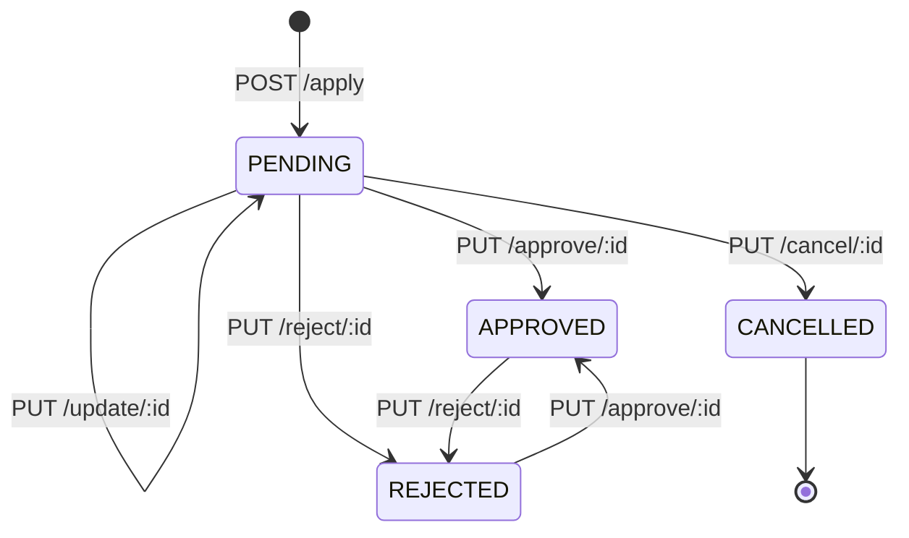

# Leave module

Staff leave requests: apply, update, cancel, approve/reject, list, per-user counts and remaining entitlement. ADMIN / FINANCEOFFICER / TRIPMANAGER are limited by `User.leaveCount` (yearly entitlement); DRIVER leaves are unlimited. Leaves are flagged `isMonthEndDone` by month-end ([monthAudit.md](monthAudit.md)). Shared plumbing: [README.md](README.md).

## Files

| File | Responsibility |
|---|---|
| `src/modules/leave/leave.route.ts` | Routes (`LeaveRouter`, mounted at `/api/v1/leave`). |
| `src/modules/leave/leave.controller.ts` | Handlers + private helpers `applyDriverLeave`, `applyAdminLeave`, `updateDriverLeave`, `updateAdminLeave`. |
| `src/modules/leave/leave.service.ts` | `Leave` queries, overlap check, approved-days aggregate (cached). |
| `src/modules/leave/leave.validation.ts` | Joi `leaveSchema`, `approveRejectLeaveSchema`. |
| `src/modules/leave/leave.model.ts` | `Leave` schema. |
| `src/modules/leave/leave.util.ts` | `Leave` → `LeaveResponseDto`. |
| `src/modules/leave/dto/leaveResponseDto.ts` | `LeaveResponseDto`. |
| `src/modules/leave/dto/leaveCountResponseDto.ts` | `LeaveCountResponseDto`. |

## Data model

### `Leave` → collection `leaves`

`timestamps: true`, `versionKey: false`. No indexes, hooks, virtuals.

| Field | Type | Constraints | Meaning |
|---|---|---|---|
| `startDate` | Date | required | First day of leave. |
| `endDate` | Date | required | Last day of leave. |
| `dateCount` | Number | required | Number of leave days (client-supplied, not derived from dates). |
| `reason` | String | required, maxlength 500 | |
| `status` | Number | required, default `WellKnownLeaveStatus.PENDING` (1) | 1 PENDING, 2 APPROVED, 3 REJECTED, 4 CANCELLED. No schema enum. |
| `appliedUser` | ObjectId | ref `User` | Requester (`req.auth.id`). |
| `approveBy` | ObjectId | ref `User`, default `null` | |
| `approveDate` | Date | — | |
| `approveRemark` | String | maxlength 500 | |
| `rejectBy` | ObjectId | ref `User`, default `null` | |
| `rejectDate` | Date | — | |
| `rejectReason` | String | maxlength 500 | |
| `createdBy` | ObjectId | ref `User` | |
| `isMonthEndDone` | Boolean | default `false` | Set by month-end close. Not checked by any leave endpoint. |
| `batchId` | Number | default 0 | Month-audit batch that closed it. |
| `updatedBy` | ObjectId | ref `User` | |

## Endpoints

| Method | Path | Roles allowed | Validation | Handler |
|---|---|---|---|---|
| POST | `/api/v1/leave/apply` | DRIVER, ADMIN, TRIPMANAGER, FINANCEOFFICER | `leaveSchema` | `applyLeave` |
| GET | `/api/v1/leave/leaveCount?year=` | any authenticated | none | `getLeaveCount` |
| GET | `/api/v1/leave/?year=` | any authenticated | none | `getAllLeaves` |
| GET | `/api/v1/leave/:id` | any authenticated | none | `getLeaveById` |
| PUT | `/api/v1/leave/approve/:id` | intended SUPERADMIN — **effectively any authenticated** (see Known issues #1) | `approveRejectLeaveSchema` | `approveLeave` |
| PUT | `/api/v1/leave/reject/:id` | intended SUPERADMIN — **effectively any authenticated** | `approveRejectLeaveSchema` | `rejectLeave` |
| PUT | `/api/v1/leave/cancel/:id` | any authenticated | none | `cancelLeave` |
| PUT | `/api/v1/leave/update/:id` | any authenticated | `leaveSchema` | `updateLeave` |
| POST | `/api/v1/leave/eligibleLeaves` | any authenticated | none | `getEligibleLeaves` |

`applicationRoutes.leave.getAllUserLeave` (`/user`) is defined but not registered. Validation is run inside the controllers (`schema.validate(req.body)`), failures → `BadRequestError(<Joi message>)`.

### Joi schemas (`leave.validation.ts`)

`leaveSchema` (object; unknown keys rejected — Joi default):
- `startDate`: date, required — `Start Date is required!` / `Start Date is invalid!`
- `endDate`: date, required — `End Date is required` / `End Date is invalid`
- `dateCount`: number ≥ 1, required — `Date Count is required` / `Date Count is invalid` / `Date Count cannot be less than 1`
- `reason`: string 1–500, required — `Reason is required` / `Reason is invalid` / `Reason cannot be less than 1 characters` / `Reason cannot be more than 500 characters`

No cross-field rule (endDate ≥ startDate, dateCount vs range).

`approveRejectLeaveSchema`: `remark` string max 500, required — `Remark is required` / `Remark is invalid` / `Remark cannot be more than 500 characters` (Joi `string()` still rejects `''` with its default "is not allowed to be empty" message despite `.min(0)`).

## Endpoint logic

### POST `/leave/apply` — `applyLeave` (`leave.controller.ts:18`)

Body: `startDate, endDate, dateCount, reason`.

1. Joi `leaveSchema` → `BadRequestError(message)`.
2. `checkUserAlreadyApplied(auth.id, startDate, endDate)` — any PENDING/APPROVED leave of the caller overlapping `[startDate, endDate]` → `BadRequestError('Leave is already applied for the given dates.')`.
3. Start transaction.
4. If `auth.role === DRIVER` → `applyDriverLeave`: new `Leave { startDate, endDate, dateCount, reason, appliedUser = createdBy = updatedBy = auth.id }`, save. No entitlement check.
5. Else `applyAdminLeave`:
   1. `userService.findById(auth.id)`.
   2. `fromYear = new Date(startDate).getFullYear()`.
   3. `getTotalLeaveDaysFromYear(auth.id, fromYear)` = sum of `dateCount` of the user's **APPROVED** leaves fully within that calendar year (cached).
   4. If `approved >= user.leaveCount` or `approved + dateCount > user.leaveCount` → `BadRequestError('You have exceeded the leave limit for <year> year!')`. PENDING leaves are not counted.
   5. Create and save the leave as in step 4.
6. Commit (abort + rethrow on error).

Response 201, `Leave applied successfully!`, `data` = raw saved `Leave` document.

### PUT `/leave/update/:id` — `updateLeave` (`leave.controller.ts:142`)

Body: same as apply.

1. Joi `leaveSchema`.
2. `checkUserAlreadyAppliedForUpdate(auth.id, id, startDate, endDate)` (excludes this leave) → `BadRequestError('Leave is already applied for the given dates.!')`.
3. `findByIdAndStatusIn(id, [PENDING])` → `NotFoundError('Leave not found!')`. Only PENDING leaves can be edited. **Ownership is not checked.**
4. Transaction; DRIVER → `updateDriverLeave` (overwrite `startDate, endDate, dateCount, reason, updatedBy`, save).
5. Others → `updateAdminLeave`:
   1. Load user, `approved = getTotalLeaveDaysFromYear(auth.id, year(startDate))`.
   2. If `approved == 0 && approved - leave.dateCount + dateCount <= user.leaveCount` → `BadRequestError('You have exceeded the leave limit for <year> year!')` (**inverted condition — see Known issues #2**).
   3. Else if `approved - leave.dateCount + dateCount > user.leaveCount` → same error.
   4. Overwrite fields and save.
6. Commit / abort.

Response 200, `Leave updated successfully!`, `data` = the mutated `leave` document (populated `appliedUser`, `approveBy`, etc.; not the DTO).

### GET `/leave/` — `getAllLeaves` (`leave.controller.ts:285`)

Query: `year` (default current year).

Role → scope:
- DRIVER, ADMIN, FINANCEOFFICER, TRIPMANAGER: `findAllByUserIdYearAndStatus(auth.id, year, [APPROVED, REJECTED, PENDING])` — own leaves.
- SUPERADMIN: `findAllByUserIdYearAndStatus('', year, [...])` — everyone's. Then for each leave whose `appliedUser.role.id` is ADMIN/FINANCEOFFICER/TRIPMANAGER, set `leave.availableLeaveCount = appliedUser.leaveCount - getTotalLeaveDaysFromYear(appliedUser._id, year)`.
- DRIVERASSISTANT, TRIPASSISTANT: `[]`.

CANCELLED leaves are never listed. Sorted `status` asc, then `createdAt` desc. Response 200, `LeaveResponseDto[]`.

### GET `/leave/:id` — `getLeaveById` (`leave.controller.ts:394`)

`findByIdAndStatusIn(id, [APPROVED, REJECTED, PENDING])` → `NotFoundError('Leave not found!')`; map to DTO (`appliedUserRole` is `''` because `role` is not populated here). Any authenticated user can read any leave.

### PUT `/leave/approve/:id` — `approveLeave` (`leave.controller.ts:410`)

Body: `remark`.

1. Joi `approveRejectLeaveSchema`.
2. `findByIdAndStatusIn(id, [PENDING, REJECTED])` → `NotFoundError('Leave not found!')`. (A REJECTED leave can be re-approved.)
3. `userService.findByIdWithGenderRole(leave.appliedUser._id)`; `fromYear = year(leave.startDate)`.
4. If applicant role is ADMIN/FINANCEOFFICER/TRIPMANAGER: `approved + leave.dateCount > applicant.leaveCount` → `BadRequestError('This user have exceeded the leave limit for <year> year!')`.
5. Transaction: `status = APPROVED`, `approveBy = updatedBy = req.auth.id`, `approveDate = now`, `approveRemark = remark`; clear `rejectBy = null`, `rejectDate = null`, `rejectReason = ''`; save; commit.
6. After commit: `clearTotalLeaveDaysCache(applicant._id, fromYear)` (deletes `leave-totalLeaveDays-<userId>-<year>`).

Response **201**, `Leave approved successfully!`, `LeaveResponseDto`. Crashes with `TypeError` if the applicant user is no longer ACTIVE (`appliedUser._id` on null at line 481).

### PUT `/leave/reject/:id` — `rejectLeave` (`leave.controller.ts:494`)

Body: `remark`.

1. Joi.
2. `findByIdAndStatusIn(id, [PENDING, APPROVED])` → `NotFoundError('Leave not found!')`. (An APPROVED leave can be rejected.)
3. Transaction: `status = REJECTED`, `rejectBy = updatedBy = req.auth.id`, `rejectDate = now`, `rejectReason = remark`; clear `approveBy = null`, `approveDate = null`, `approveRemark = ''`; save; commit.

Response 201, `Leave rejected successfully!`, DTO. The approved-days cache is **not** cleared (Known issues #4).

### PUT `/leave/cancel/:id` — `cancelLeave` (`leave.controller.ts:549`)

1. `findByIdAndStatusIn(id, [PENDING])` → `NotFoundError('Leave not found!')`.
2. Transaction: `status = CANCELLED`, `updatedBy = req.auth.id`, save.

Response 201, `Leave cancelled successfully!`, DTO. No ownership check — any authenticated user can cancel any pending leave.

### GET `/leave/leaveCount` — `getLeaveCount` (`leave.controller.ts:586`)

Query: `year` (default current year). All values are **sums of `dateCount` (days)**, not number of requests.

- ADMIN/FINANCEOFFICER/TRIPMANAGER: `approveLeaveCount`, `rejectLeaveCount`, `pendingLeaveCount` via `countByYearUserIdAndStatusIn(auth.id, year, [status])`; `yearlyEligibleLeaveCount = user.leaveCount`; `remainingLeaveCount = user.leaveCount - getTotalLeaveDaysFromYear(auth.id, year)`.
- DRIVER: the three sums only; remaining/eligible = 0.
- Others (incl. SUPERADMIN): all 0 (the SUPERADMIN branch is commented out).

Response 200, `LeaveCountResponseDto { approveLeaveCount, rejectLeaveCount, pendingLeaveCount, remainingLeaveCount, yearlyEligibleLeaveCount }`.

### POST `/leave/eligibleLeaves` — `getEligibleLeaves` (`leave.controller.ts:718`)

No body.
1. `getCompanyWorkingInfo()` → none → `BadRequestError('Company not found!')`.
2. `findByIdWithGenderRole(auth.id)`; `remaining = user.leaveCount - getTotalLeaveDaysFromYear(auth.id, workingInfo.workingYear)`.

Response 200, `data` = number (NaN → serialised `null` when `leaveCount` is unset, e.g. drivers).

## Service layer (`leave.service.ts`)

| Function | Query |
|---|---|
| `checkUserAlreadyApplied(userId, from, to)` | `Leave.find({ appliedUser, status ∈ {PENDING, APPROVED}, $or: [start ≤ to && end ≥ from, start ∈ [from,to], end ∈ [from,to]] })` → `length > 0`. (First `$or` branch already covers the others.) |
| `checkUserAlreadyAppliedForUpdate(userId, leaveId, from, to)` | Same + `_id: { $ne: leaveId }`. |
| `save(leave, session)` | `leave.save({session})` / `save()`. No cache clearing. |
| `getTotalLeaveDaysFromYear(userId, year)` | Cache key `leave-totalLeaveDays-<userId>-<year>`, TTL `THREE_MONTHS`. Miss → `Leave.find({ appliedUser, startDate ≥ Jan 1, endDate ≤ Dec 31 00:00 (local), status: APPROVED })` → Σ `dateCount`; always cached (also 0). |
| `findAllByUserIdYearAndStatus(userId, year, status[])` | `Leave.find({ [appliedUser], startDate ≥ Jan 1, endDate ≤ Dec 31, status ∈ })`, sort `{status:1, createdAt:-1}`, populate `appliedUser` (+ nested `role`), `approveBy`, `rejectBy`, `createdBy`, `updatedBy`. `appliedUser` filter omitted when `userId` falsy. |
| `findByIdAndStatusIn(id, status[])` | `Leave.findOne({ _id, status ∈ }).populate('appliedUser approveBy rejectBy createdBy updatedBy')`. |
| `countByYearUserIdAndStatusIn(userId, year, status[])` | `Leave.find({ status ∈, year range, [appliedUser] })` → Σ `dateCount`. |
| `countByMonthYearUserIdAndStatusIn(userId, year, month, status[])` | `countDocuments` with `startDate ≥ new Date(year, month, 1)`, `endDate ≤ new Date(year, month, 31)`. **Unused** (only in commented code). |
| `findAllLeavesByMonthYearAndStatusIn(year, month, status[])` | `Leave.find({ status ∈, startDate ∈ [new Date(year, month, 1), new Date(year, month+1, 0)] })` with the same populates. `month` treated as **0-based** (see monthAudit Known issues). Used only by month-audit. |
| `clearTotalLeaveDaysCache(userId, year)` | `deleteCache('leave-totalLeaveDays-<userId>-<year>')`. |

Cache: only `leave-totalLeaveDays-*`. Also flushed whenever any `User` is saved or a month audit is saved (they clear every prefix).

## Utilities / DTOs

`leaveModelToLeaveResponseDto(leave)` → `{ _id, startDate, endDate, dateCount, reason, status, statusName: WellKnownLeaveStatus[status] ('PENDING'|'APPROVED'|'REJECTED'|'CANCELLED'), appliedUser: appliedUser._id, appliedUserName: appliedUser.fullName || '', appliedUserRole: appliedUser.role?.name || '', availableLeaveCount: leave.availableLeaveCount || '', approveBy: approveBy?._id || null, approvedUser: approveBy?.fullName || '', approveDate || null, approveRemark || '', rejectBy?._id || null, rejectedUser, rejectDate || null, rejectReason || '', isMonthEndDone: boolean, createdBy, createdUser, updatedBy, updatedUser, createdAt, updatedAt }`. Requires `appliedUser` populated (throws otherwise). `availableLeaveCount` of `0` becomes `''`.

`leaveModelToLeaveResponseDtos(leaves)` → map.

`LeaveCountResponseDto` → `{ approveLeaveCount, rejectLeaveCount, pendingLeaveCount, remainingLeaveCount, yearlyEligibleLeaveCount }` (numbers).

## Business rules

- Who can apply: DRIVER, ADMIN, TRIPMANAGER, FINANCEOFFICER. SUPERADMIN, DRIVERASSISTANT, TRIPASSISTANT cannot.
- No two PENDING/APPROVED leaves of the same user may overlap.
- Entitlement (`User.leaveCount`, per calendar year of `startDate`) is enforced for ADMIN/FINANCEOFFICER/TRIPMANAGER at apply, update and approve, counting **approved** days only. Drivers have no limit. A leave spanning two years is counted in neither year's total (year filter requires both dates within the year).
- Only PENDING leaves can be updated or cancelled. Approve accepts PENDING/REJECTED; reject accepts PENDING/APPROVED; CANCELLED is terminal.
- Remaining days = `leaveCount − Σ approved dateCount` (year of the working month for `eligibleLeaves`, query year for `leaveCount`).
- No socket notifications or audit logs. The notification module separately lists PENDING leaves starting within 3 days (`notification.service.ts:75`).

`isMonthEndDone` is set orthogonally by month-end and does not block any transition.

## Cross-module dependencies

- Uses: [user](user.md) service (`findById`, `findByIdWithGenderRole` → `leaveCount`, role), `companyWorkingInfoService` ([common](common.md)) for `eligibleLeaves`, cache util.
- Used by: [monthAudit](monthAudit.md) (`findAllLeavesByMonthYearAndStatusIn`, `save`, `getTotalLeaveDaysFromYear`, `leaveUtil`, `LeaveResponseDto`), `notification.service.ts` (`Leave` model). `vehicle.controller.ts:8` imports `leaveService` but never uses it.
- **Trips do not consult leaves**: driver availability (`GET /user/getDriversForTrip`) ignores approved leave.

## Known issues / notes

1. **Approve/reject have no role guard**: `authorize(constants.USER.ROLES.SUPERADMIN)` passes a number, not an array; `rolesArray.length` is `undefined` so the role check is skipped and any authenticated user can approve or reject any leave, including their own (`leave.route.ts:51,57`). Fix: `authorize([constants.USER.ROLES.SUPERADMIN])`.
2. **`updateAdminLeave` inverted check**: when the user has 0 approved days and the new count is within the limit, it throws "exceeded the leave limit" (`leave.controller.ts:253-260`). It also subtracts `leave.dateCount` of a PENDING leave from an APPROVED-only total (`:255,262`), allowing over-allocation by the old count.
3. No ownership checks: `updateLeave`, `cancelLeave`, `getLeaveById` act on any leave id (`leave.controller.ts:167,553,397`). `updateLeave` also applies the caller's (not the owner's) entitlement.
4. `rejectLeave` of an APPROVED leave does not call `clearTotalLeaveDaysCache`, so the applicant's approved total stays inflated for up to 3 months (`leave.controller.ts:530-546`).
5. `applyAdminLeave`/`approveLeave` ignore PENDING leaves when checking entitlement, so many pending requests can be filed beyond the limit (`leave.controller.ts:115-127`, `leave.service.ts:71`).
6. If `User.leaveCount` is unset, comparisons with `undefined` are false and the limit is never enforced (`leave.controller.ts:120-123`); `eligibleLeaves` returns NaN/null.
7. Year filters use `endDate ≤ new Date(year, 11, 31)` (midnight local) — a leave ending on Dec 31 with a time component, or spanning New Year, is excluded from totals and lists (`leave.service.ts:68-69,93-94,148-149`).
8. Overlap check runs outside the transaction (race on concurrent applies); single-document transactions add no value (`leave.controller.ts:29-42`).
9. `updateLeave` returns the raw document, others return DTOs; approve/reject/cancel return 201 instead of 200 (`leave.controller.ts:209-215,485-490`).
10. `approveLeave` crashes if the applicant is no longer ACTIVE (`appliedUser` null → `appliedUser._id`) (`leave.controller.ts:431-483`).
11. `countByMonthYearUserIdAndStatusIn` unused; `getAllUserLeave` route constant unused; `companyWorkingInfoService` import in `getLeaveCount` only used in commented code (`leave.service.ts:163`, `applicationRoutes.ts:45`, `leave.controller.ts:590-595`).
12. `getAllLeaves` for SUPERADMIN calls `getTotalLeaveDaysFromYear` per leave (N+1, mitigated by cache) (`leave.controller.ts:352-381`).
13. Month-end flag is not enforced: closed (`isMonthEndDone`) leaves can still be approved/rejected.
