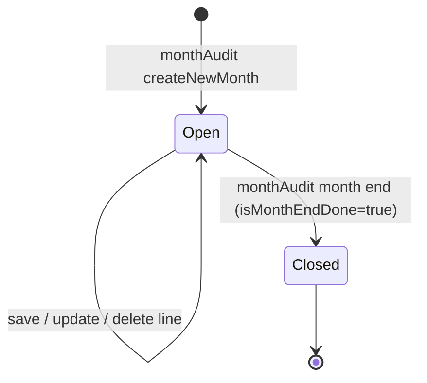

# Monthly Expenses

Company overhead expenses that are not tied to a trip (rent, utilities, salaries, etc.). One `MonthlyExpenses` header document exists per working month — created by the month-audit module when a new month is opened — and holds an embedded array of expense lines plus a cached `totalExpenses`. This module adds/edits/soft-deletes lines, searches headers by month range and returns one month with its lines. Headers are locked once the month-end audit closes them.

Shared infrastructure (auth middleware, `CommonResponse`, error middleware, cache util, enums, audit/correlation-id middleware) is described in [README.md](./README.md).

## Files

| File | Responsibility |
|---|---|
| `src/modules/monthlyExpenses/monthlyExpenses.model.ts` | Mongoose schema/model `MonthlyExpenses` (header + embedded `expenses[]`) |
| `src/modules/monthlyExpenses/monthlyExpenses.route.ts` | Router + role guards |
| `src/modules/monthlyExpenses/monthlyExpenses.validation.ts` | Joi `createNewExpensesSchema`, `advanceSearchSchema` |
| `src/modules/monthlyExpenses/monthlyExpenses.controller.ts` | Handlers (transactions, total recalculation, console audit log) |
| `src/modules/monthlyExpenses/monthlyExpenses.service.ts` | Queries + cache, month-end query |
| `src/modules/monthlyExpenses/monthlyExpenses.util.ts` | Header → `MonthlyExpensesResponseDto` |
| `src/modules/monthlyExpenses/dto/monthlyExpensesResponseDto.ts` | DTO interface |

## Data model

### `MonthlyExpenses` (collection `monthlyexpenses`)

Options: `timestamps: true`, `versionKey: false`. No indexes (no unique index on `month`), hooks or virtuals.

| Field | Type | Required / default / ref | Meaning |
|---|---|---|---|
| `month` | Date | required | First day of the month, `Date.UTC(year, month-1, 1)` (set by monthAudit) |
| `year` | Number | required | Year |
| `monthName` | Number | required | Month number 1–12 (despite the name) |
| `expenses` | [ExpenseLine] | embedded subdocuments with `_id` | Expense lines (below) |
| `totalExpenses` | Number | default 0 | Sum of `amount` of ACTIVE lines; recomputed on every line change |
| `status` | Number | required, default ACTIVE (1) | `WellKnownStatus` |
| `isMonthEndDone` | Boolean | default false | Set by month-end audit; header becomes read-only |
| `batchId` | Number | default 0 | Month-audit batch that closed it |
| `createdBy` / `updatedBy` | ObjectId | ref `User` | Audit users |

#### ExpenseLine (`expenses[]`)

| Field | Type | Required / default / ref | Meaning |
|---|---|---|---|
| `_id` | ObjectId | auto | Line id used in update/delete paths |
| `expenseType` | String | required | Expense type id (Joi requires a number; stored as string) |
| `expenseTypeName` | String | required | Display name (client-supplied; no server-side master list) |
| `date` | Date | required | Expense date |
| `description` | String | required, maxlength 500 | Description |
| `amount` | Number | required | Amount |
| `status` | Number | required, default ACTIVE | `WellKnownStatus`; DELETED lines are excluded from totals |
| `createdAt` / `updatedAt` | Date | default `Date.now` | Set manually by controller |
| `createdBy` / `updatedBy` | ObjectId | required, ref `User` | Audit users |

## Endpoints

Base: `/api/v1/monthlyExpenses`. All routes: SUPERADMIN(1), ADMIN(2), TRIPMANAGER(5), FINANCEOFFICER(4).

| Method | Path | Roles allowed | Validation schema | Handler |
|---|---|---|---|---|
| POST | `/api/v1/monthlyExpenses/advanceSearch` | 1, 2, 5, 4 | `advanceSearchSchema` | `advanceSearchMonthlyExpense` |
| POST | `/api/v1/monthlyExpenses/save/:id` | 1, 2, 5, 4 | `createNewExpensesSchema` | `saveMonthlyExpense` |
| GET | `/api/v1/monthlyExpenses/:id` | 1, 2, 5, 4 | – | `getMonthlyExpenseById` |
| PUT | `/api/v1/monthlyExpenses/update/:id/expense/:expenseId` | 1, 2, 5, 4 | `createNewExpensesSchema` | `updateMonthlyExpense` |
| DELETE | `/api/v1/monthlyExpenses/delete/:id/expense/:expenseId` | 1, 2, 5, 4 | – | `deleteMonthlyExpense` |

`:id` = header (`MonthlyExpenses._id`), `:expenseId` = line `_id`. There is no endpoint to create a header; see monthAudit.

## Endpoint logic

Joi errors → `BadRequestError(error.message)` (400); converted value is discarded. Mongoose validation errors (e.g. description > 500) → 400. Invalid ObjectId → `CastError` → 404. Transactions abort on error and the session is ended in `finally`.

### Request bodies

`createNewExpensesSchema` (save + update):

| Field | Rule / messages |
|---|---|
| `expenseType` | number, required (`Expense type is required` / `Expense type is invalid`) |
| `date` | date, required |
| `expenseTypeName` | string, required |
| `description` | string, required (no max in Joi; model max 500) |
| `amount` | number, required |

`advanceSearchSchema`: `startMonth` date required (`Start Date is required!`), `endMonth` date required (`End Date is required`).

### POST `/save/:id` — `saveMonthlyExpense` (controller.ts:14)

1. Validate body.
2. `findByIdAndStatusIn(id, [ACTIVE, INACTIVE])`; missing → `NotFoundError('Monthly expense not found!')` (404); `isMonthEndDone` → `BadRequestError('Cannot update monthly expense after month end!')`.
3. Transaction:
   1. Push line `{expenseType, expenseTypeName, date, description, amount, status: ACTIVE, createdAt/updatedAt: now, createdBy/updatedBy: auth.id}`.
   2. `totalExpenses` = sum of `amount` over lines with `status === ACTIVE`.
   3. Build log string `MONTHLY_EXPENSES | Expense Created Amount: … | Added By: … | Previous Total Expenses: … | New Total Expenses: … | Correlation ID: …`.
   4. Set `totalExpenses`, `updatedBy`; `monthlyExpensesService.save(doc, session)` (clears cache prefix `monthlyExpenses-`).
4. Commit, then `helperUtil.consoleLogMessage('info', log)`.
5. Response 201 `Monthly expense saved successfully!`, `data` = full header document (including deleted lines).

### PUT `/update/:id/expense/:expenseId` — `updateMonthlyExpense` (controller.ts:91)

1. Validate body.
2. Header lookup/guards as in save (`Monthly expense not found!` 404, `Cannot update monthly expense after month end!` 400).
3. Transaction:
   1. Find line by `_id.toString() === expenseId`; missing → `NotFoundError('Expense not found in this monthly expense!')`.
   2. Overwrite `expenseType`, `expenseTypeName`, `description`, `amount`, `date`, `updatedAt = now`, `updatedBy`.
   3. Recompute `totalExpenses` (ACTIVE lines), log string `Expense Updated …`, set `totalExpenses`, `updatedBy`, save (clears `monthlyExpenses-`).
4. Commit, console log.
5. Response **201** `Expense updated successfully!`, `data` = header.

### DELETE `/delete/:id/expense/:expenseId` — `deleteMonthlyExpense` (controller.ts:166)

1. Header lookup/guards as above.
2. Transaction: find line (`Expense not found in this monthly expense!` 404); `status = DELETED`, `updatedAt`, `updatedBy`; recompute total; log string `Expense Deleted Amount: <line amount> …`; save.
3. Commit, console log.
4. Response **201** `Expense deleted successfully!`, `data` = header.

### POST `/advanceSearch` — `advanceSearchMonthlyExpense` (controller.ts:225)

1. Validate body.
2. `advanceSearch(startMonth, endMonth)`: cache key `monthlyExpenses-AdvanceSearch-<startMonth><endMonth>`; on miss `find({month:{$gte:startMonth, $lte:endMonth}}).populate('createdBy updatedBy').sort({startDate:1})`, cached ONE_WEEK. No status filter.
3. Map with `modelToMonthlyExpensesResponseDtoList`, sort by `month` descending.
4. Response 200, `data` = `MonthlyExpensesResponseDto[]` (header summary only, no lines).

### GET `/:id` — `getMonthlyExpenseById` (controller.ts:253)

1. `findByIdAndStatusIn(id, [ACTIVE, INACTIVE])` (no populate).
2. If found: drop lines with `status === DELETED` (in memory, not saved) and sort lines by `date` descending.
3. Response 200, `data` = header document or `null`.

## Service layer (`monthlyExpenses.service.ts`)

| Function | Query / behaviour |
|---|---|
| `save(doc, session)` | `clearCacheByPrefixs('monthlyExpenses-')`; `save({session})` or `save()` |
| `findByIdAndStatusIn(id, status)` | `findOne({_id, status:{$in}})` |
| `advanceSearch(startMonth, endMonth)` | cached range query (see advanceSearch) |
| `findAllByEndMonthAndStatusIn(endMonth, year, status)` | Cache key `monthlyExpenses-<endMonth><year><status JSON>` (ONE_WEEK). `endDate = new Date(); setFullYear(year); setMonth(endMonth)` → 1st of that month at 23:59:59.999 local; `find({month:{$lt:endDate}, status:{$in}, isMonthEndDone:false}).sort({startDate:1})`. Called with 1-based `workingMonth`, so the bound is the 1st of the following month |

## Utilities / DTOs

`modelToMonthlyExpensesResponseDto(header)`:

| DTO field | Source |
|---|---|
| `_id`, `month`, `totalExpenses`, `status`, `isMonthEndDone`, `batchId`, `createdAt`, `updatedAt` | same |
| `createdBy` / `updatedBy` | populated user `_id` |
| `createdByUser` / `updatedByUser` | populated `userName` or `''` |

`year`, `monthName` and `expenses` are not in the DTO. `modelToMonthlyExpensesResponseDtoList(list)` maps each.

## Business rules

- Headers are created only by monthAudit `createNewMonth` (`monthAudit.controller.ts:118-132`): `month = Date.UTC(year, month-1, 1)`, `monthName = month`, `year`, empty `expenses`, `totalExpenses 0`, ACTIVE, not closed.
- Lines can be added/edited/deleted only while the header is ACTIVE/INACTIVE and `isMonthEndDone = false`.
- `totalExpenses` = Σ `amount` of ACTIVE lines, recomputed on every change.
- Line delete is soft (`status = DELETED`); deleted lines stay in the array and are hidden only by GET `/:id` and by consumers that filter on ACTIVE.
- Month end (monthAudit, in its transaction, `monthAudit.controller.ts:218-238`): headers with `month` before the computed bound, ACTIVE/INACTIVE and not closed, get `isMonthEndDone = true`, `batchId`, `updatedBy`.
- Every line change writes a console audit line (`MONTHLY_EXPENSES | …`) after commit with the request's correlation id.

Line lifecycle: `ACTIVE` → `DELETED` (DELETE endpoint); no restore.

## Cross-module dependencies

| Direction | Module | Detail |
|---|---|---|
| creates/closes headers | monthAudit | `new MonthlyExpenses(...)` + `monthlyExpensesService.save`; `findAllByEndMonthAndStatusIn(workingMonth, workingYear, [ACTIVE, INACTIVE])` |
| reads | dashboard | `dashboard.controller.ts:197` `advanceSearch(firstOfStartMonth, lastOfEndMonth)` then sums ACTIVE lines whose `date` is within the requested range (shares the `monthlyExpenses-AdvanceSearch-*` cache) |
| reads | report | `report.service.ts:36` `findOne({month: Date.UTC(y, m, 1)})`, populates `expenses.createdBy`, returns ACTIVE lines for the monthly expenses report |

Cache prefix `monthlyExpenses-` cleared on every save. No socket events. Audit: console log only (no audit collection).

## Known issues / notes

- `monthlyExpenses.controller.ts:154`, `:213` — update and delete respond with `201 CREATED` instead of 200.
- `monthlyExpenses.service.ts:56` — `advanceSearch` has no `status` filter; DELETED headers are returned and counted by the dashboard.
- `monthlyExpenses.controller.ts:122-134`, `:184-192` — update/delete don't check the line's current status: a DELETED line can be edited, or "deleted" again (log reports its amount as deleted).
- `monthlyExpenses.controller.ts:44-57` — no check that the line `date` falls within the header's month.
- `monthlyExpenses.model.ts:22-25` vs `monthlyExpenses.validation.ts:5` — `expenseType` is a String in the model but a number in Joi.
- `monthlyExpenses.validation.ts:17` — no `max(500)` on `description`; longer values fail later with a Mongoose validation error (still 400, different message).
- `monthlyExpenses.service.ts:25-36` — month-end bound is the 1st of the next month at 23:59:59.999 local time; `month` values are UTC midnight, so in a UTC+ timezone the next month's header (if it already existed) would match. `setMonth` on "today" can overflow on the 29th–31st. `sort({startDate:1})` (also `:58`) sorts on a non-existent field. Result is cached for a week (Mongoose documents mutated by monthAudit).
- `monthlyExpenses.validation.ts:2` — unused `import { endianness } from 'os'`.
- `applicationRoutes.ts:183` — `monthlyExpenses.activeInactiveGarage` route key is a copy-paste leftover and not mounted.
- No unique index on `month`; duplicate headers for a month are possible if `createNewMonth` runs twice for the same month (report `findOne` would then pick an arbitrary one).
- `middleware/auditLog.middleware.ts:13` (shared) — reads `req.headers['X-Correlation-ID']`, but Node lower-cases header names, so a client-supplied correlation id is never used; the logged id is always random.
- `monthlyExpenses.controller.ts:253-270` — GET by id returns 200 with `null` when not found.
