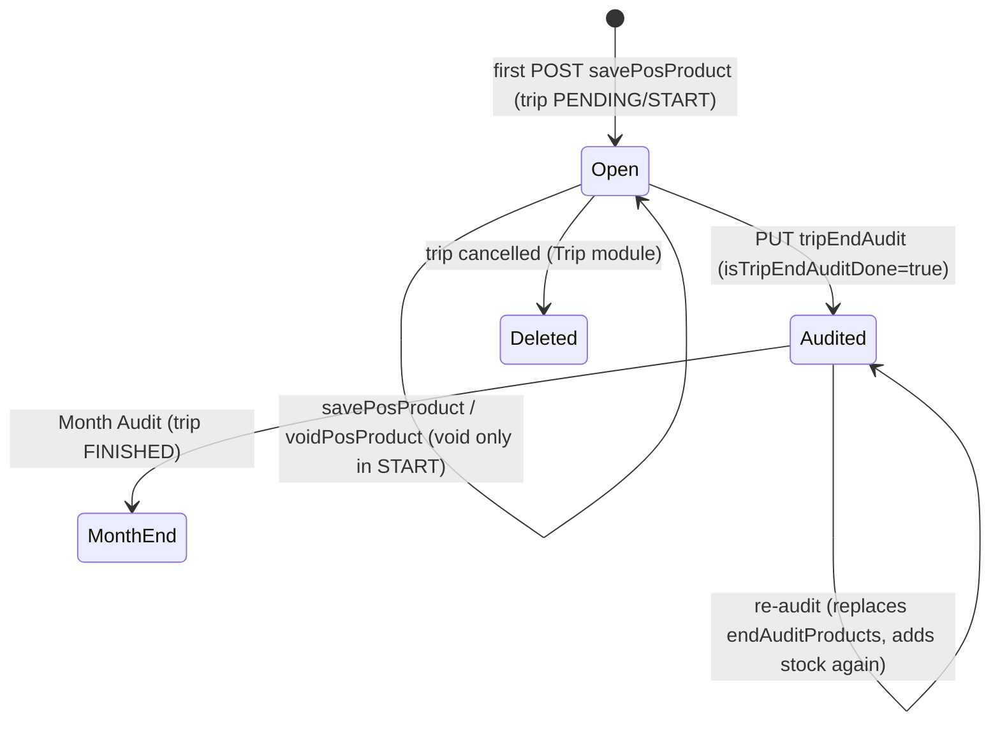

# POS (trip point-of-sale)

Issues inventory products to a trip (e.g. water bottles, snacks loaded into a vehicle), lets staff void an issued line while the trip runs, and records a trip-end audit of what came back. Every stock movement updates `InventoryProduct.inventory` and appends an `inventoryLogs` entry (`WellKnownGrnLogType.POS_TRANSACTION` / `POS_TRANSACTION_RETURN`). One `Pos` document per trip. Quantities are converted to the product's SI base unit using `util/data/measureUnitData.ts` (see [inventory.md](inventory.md#si-unit-conversion) and [README.md](README.md)).

## Files

| File | Responsibility |
|---|---|
| `src/modules/pos/pos.model.ts` | Mongoose model `Pos` |
| `src/modules/pos/pos.route.ts` | Router; mounted at `/api/v1/pos` |
| `src/modules/pos/pos.validation.ts` | Joi: `savePosProductSchema`, `tripEndAuditShema` |
| `src/modules/pos/pos.controller.ts` | Handlers + **local copies** of the three unit-conversion functions (`:520-580`) |
| `src/modules/pos/pos.service.ts` | DB access (no caching) |
| `src/modules/pos/pos.utils.ts` | Model → `PosGetByIdReponseDto` (uses `helperUtil.fromSiMeasureUnitToOtherMeasureUnit`) |
| `src/modules/pos/dto/posGetByIdReponseDto.ts` | `PosGetByIdReponseDto`, `PosProductDto` |

## Data model

### `Pos` (collection `pos`)

Options: `timestamps: true`, `versionKey: false`. No indexes, hooks, virtuals.

| Field | Type | Required / default / ref | Meaning |
|---|---|---|---|
| `tripId` | ObjectId | required (`'Trip is required'`), ref `Trip` | Owning trip (one POS doc per trip by convention). |
| `products` | array of subdocs | — | Issue lines (see below). |
| `totalAmount` | Number | default `0` | Σ over ACTIVE lines of `qty converted to product unit × unitPrice`. Recomputed on save/void. |
| `isTripEndAuditDone` | Boolean | default `false` | Set `true` by trip-end audit; Trip module requires it before finishing the trip. |
| `endAuditProducts` | array of subdocs | — | Audit result per line (see below). Replaced wholesale on each audit call. |
| `totalAfterAudit` | Number | default `0` | Never written by code. |
| `isMonthEndDone` | Boolean | default `false` | Set by Month Audit for FINISHED trips. Not checked by POS endpoints. |
| `batchId` | Number | default `0` | Month-audit batch id. |
| `status` | Number | default `WellKnownStatus.ACTIVE` | `DELETED` (3) when trip is cancelled (Trip module). |
| `createdBy`, `updatedBy` | ObjectId | ref `User` | |

`products[]` (own `_id` = the "POS transaction id" used by void/audit):

| Field | Type | Default / ref | Meaning |
|---|---|---|---|
| `product` | ObjectId | required, ref `InventoryProduct` | Product issued. |
| `isReturnableProduct` | Boolean | `false` | Snapshot of `product.isReturnableProduct` at issue time. |
| `unitPrice` | Number | `0` | Snapshot of `product.unitPrice` (price per product measure unit). |
| `productUnitOfMeasure` | Number | `0` | Snapshot of `product.measureUnit` (unitId). |
| `enteredUnitOfMeasure` | Number | `0` | Unit the user entered the quantity in. |
| `enteredQuantity` | Number | `0` | Quantity as entered. |
| `quantityWithSiUnitOfMeasure` | Number | `0` | Quantity converted to SI base unit (`fromMeasureUnitToSiMeasureUnit`). This is what is deducted from inventory. |
| `status` | Number | `ACTIVE` | `ACTIVE` or `DELETED` (voided / trip cancelled). |
| `createdBy`, `updatedBy` | ObjectId | ref `User` | |
| `createdAt`, `updatedAt` | Date | `Date.now` | Manually maintained. |

`endAuditProducts[]`:

| Field | Type | Default / ref | Meaning |
|---|---|---|---|
| `product` | ObjectId | required, ref **`Product`** (no such model — see issues) | Product id. |
| `transactionId` | ObjectId | — | `_id` of the `products[]` line audited. |
| `isReturnableProduct` | Boolean | `false` | Copied from the line. |
| `isReturned` | Boolean | `false` | From client. |
| `notReturnedReson` | String | `''` | Reason not returned (field name typo is in the schema). |
| `returnedquantity` | Number | `0` | Returned qty as entered. |
| `returnedUnitOfMeasure` | Number | `0` | Unit of returned qty. |
| `returnedQuantityWithSiUnitOfMeasure` | Number | `0` | Returned qty in SI unit; added back to inventory. |
| `createdBy` | ObjectId | ref `User` | |
| `createdAt` | Date | `Date.now` | |

## Endpoints

| Method | Path | Roles allowed | Validation schema | Handler |
|---|---|---|---|---|
| POST | `/api/v1/pos/savePosProduct/:tripId` | SUPERADMIN, ADMIN, TRIPMANAGER, FINANCEOFFICER | `savePosProductSchema` | `saveProductForPos` |
| DELETE | `/api/v1/pos/voidPosProduct/:id/trip/:tripId` | SUPERADMIN, ADMIN, TRIPMANAGER, FINANCEOFFICER | — | `voidProductInPos` |
| PUT | `/api/v1/pos/tripEndAudit` | SUPERADMIN, ADMIN, TRIPMANAGER, FINANCEOFFICER | `tripEndAuditShema` | `tripEndPosAudit` |
| GET | `/api/v1/pos/getPosByTrip/:tripId` | SUPERADMIN, ADMIN, TRIPMANAGER, FINANCEOFFICER | — | `getPosByTrip` |

Joi defaults apply (first error only, unknown keys rejected) → `BadRequestError(error.message)`.

## Endpoint logic

### POST `/api/v1/pos/savePosProduct/:tripId` — `saveProductForPos` (`pos.controller.ts:23`)

Request
- Params: `tripId`.
- Body: `productId` string required; `quantity` number required; `unitOfMeasure` number required (messages `'<field> is required'` / `'<field> is invalid'`). Sign/zero not checked.

Logic
1. Validate → 400.
2. `tripService.findByIdAndStatusIn(tripId, [PENDING, START])`; none → `BadRequestError('Pending or Started Trip not found!')`.
3. `siQty = fromMeasureUnitToSiMeasureUnit(unitOfMeasure, quantity)`.
4. `productService.findByIdAndStatusIn(productId, [ACTIVE])`; none → `BadRequestError('Product is not found!')`; `product.inventory < siQty` → `BadRequestError('You can not save pos transaction, because product inventory is not enough!')`.
5. `posService.findByTripIdAndStatusIn(tripId, [ACTIVE])` (populates `tripId` with `_id tripConfirmedNumber status`).
6. Start session + transaction.
7. Build line `{product: productId, isReturnableProduct, unitPrice, productUnitOfMeasure: product.measureUnit, enteredUnitOfMeasure: unitOfMeasure, enteredQuantity: quantity, quantityWithSiUnitOfMeasure: siQty, status: ACTIVE, createdBy, updatedBy}`.
   - No POS doc: `new Pos({tripId, products: [], totalAmount: 0, isTripEndAuditDone: false, endAuditProducts: [], totalConsumedAmount: 0 (not in schema, dropped), createdBy, updatedBy})`, push line, `totalAmount += fromMeasureUnitToOtherMeasureUnit(unitOfMeasure, product.measureUnit, quantity) × unitPrice`.
   - Existing: push line, recompute `totalAmount` from scratch over all ACTIVE lines using each line's stored entered unit / product unit / quantity / unitPrice.
   - `fromMeasureUnitToOtherMeasureUnit` throws `BadRequestError('Invalid Measure Unit Conversion!')` if entered and product units are in different categories (this is the only unit/category check; it happens inside the transaction so it aborts).
   - `posService.save(doc, session)`.
8. Compute SI unit code for messages: if product unit `isSaveWithSiUnit`, code of the SI unit of the same category (`g` / `ml`), else the product unit's own code.
9. `before = product.inventory; product.inventory -= siQty`; push `inventoryLogs` entry `{inventoryLogType: POS_TRANSACTION (2), inventoryLogDate: now, inventoryLogQuantity: siQty, beforeTransactionInventory, afterTransactionInventory, inventoryLogProductId, inventoryLogCreatedBy: auth.id, message: 'Inventory updated: <siQty><code> removed from product "<name>" via POS transaction to trip "<tripConfirmedNumber>".'}`; `productService.save(product, session)` (clears cache prefix `product-`).
10. Commit; `201 'Pos transaction saved successfully!'`, data = saved `Pos` document (raw).
11. Error → abort, rethrow; `endSession()`.

### DELETE `/api/v1/pos/voidPosProduct/:id/trip/:tripId` — `voidProductInPos` (`pos.controller.ts:169`)

Params: `id` = `products[]._id`, `tripId`.

1. Trip with status in `[PENDING, START, FINISHED, START]`; none → `BadRequestError('Trip not found!')`; status ≠ START → `BadRequestError('You can not void pos transaction, because trip is not in started status!')`.
2. Load ACTIVE POS for trip (not null-checked).
3. Start transaction.
4. Find line by `_id`; none → `BadRequestError('Pos transaction not found to void!')`. Line status is not checked.
5. Line: `status = DELETED`, `updatedBy`, `updatedAt = now`. Recompute `totalAmount` over ACTIVE lines. `posService.save(…, session)`.
6. `productService.findByIdAndStatusIn(line.product, [ACTIVE])`; none → `BadRequestError('Product not found!')` (rolls back).
7. `product.inventory += line.quantityWithSiUnitOfMeasure`; push log with type **`POS_TRANSACTION` (2)** (not RETURN), message `'Inventory updated: <qty><code> added to product "<name>" via voiding POS transaction in trip "<tripConfirmedNumber>".'`; save product in session (clears `product-`).
8. Commit; **`201`** `'Pos transaction void successfully!'`, data = POS doc.

### PUT `/api/v1/pos/tripEndAudit` — `tripEndPosAudit` (`pos.controller.ts:268`)

Request body (`tripEndAuditShema`):
- `tripId` string required.
- `auditRecords` array (not marked required) of objects:
  - `id` string required — `products[]._id`
  - `returnQuantity` number required
  - `returnUnitOfMeasure` number required
  - `isReturned` boolean required
  - `notReturnedReason` string, null/'' allowed

Logic
1. Validate → 400.
2. `posService.findByTripIdAndStatusInWIthProducts(tripId, [ACTIVE])` (lines filtered to ACTIVE, `products.product` populated with `_id productName isReturnableProduct`); none → `BadRequestError('Pos transaction not found for given trip!')`. Trip status is not checked.
3. Start transaction. Keep an in-memory list of already-loaded products so repeated products accumulate correctly.
4. For each `auditRecord`:
   1. Find ACTIVE line with `_id == id`; none → `BadRequestError('Pos transaction not found for given trip!')`.
   2. Load product (from in-memory list, else `findByIdAndStatusIn(line.product, [ACTIVE])`); none → `BadRequestError('Product not found!')`.
   3. `returnedSi = fromMeasureUnitToSiMeasureUnit(returnUnitOfMeasure, returnQuantity)`; compute SI unit code as in save.
   4. `line.quantityWithSiUnitOfMeasure < returnedSi` → `BadRequestError('Return quantity is more than available quantity for product "<name>"!')`.
   5. Build audit entry `{product, transactionId: line._id, isReturnableProduct: line.isReturnableProduct, isReturned, notReturnedReson, returnedquantity, returnedUnitOfMeasure, returnedQuantityWithSiUnitOfMeasure: returnedSi, createdBy, createdAt}`.
   6. Returnable line (`line.isReturnableProduct`):
      - fully returned (`returnedSi == issued`) or partially: both branches push the entry, `inventory += returnedSi`, push log `POS_TRANSACTION_RETURN (3)`; message differs — partial adds `"… and <issued−returned><code> left in product … Reason for not return: <reason|N/A>"`. Save product in session.
   7. Non-returnable line:
      - `returnedSi > 0`: push entry, `inventory += returnedSi`, log `POS_TRANSACTION_RETURN`, save product.
      - else: push entry only (no stock change).
      - In both non-returnable branches `notReturnedReson` is read from `auditRecord.notReturnedReson` (typo → always `undefined` → schema default `''`).
   8. Update in-memory product list.
5. If at least one entry: `pos.endAuditProducts = entries` (replaces any previous audit), `isTripEndAuditDone = true`, save in session, commit, `200 'Trip end pos audit done successfully!'`, data = POS doc.
6. If no entries: `InternalServerError('Something went wrong while end trip pos audit!')` (500), transaction aborted.

### GET `/api/v1/pos/getPosByTrip/:tripId` — `getPosByTrip` (`pos.controller.ts:488`)

1. `findByTripIdAndStatusInWIthProducts(tripId, [ACTIVE])`.
2. If none: trip in `[PENDING, START, FINISHED]` required → else `BadRequestError('Trip not found!')`; respond with `{tripId, products: [], tripConfirmedNumber, isTripEndAuditDone: false, status: 0}`.
3. Else respond `posUtils.modelToPosGetByIdReponseDto(pos)`.
4. `200`, message `''`.

## Service layer (`pos.service.ts`)

| Function | Query |
|---|---|
| `save(pos, session)` | `pos.save({session})` / `pos.save()`. No cache clearing (`CACHE.PREFIX.POS` is unused). |
| `findByTripIdAndStatusIn(tripId, status[])` | `Pos.findOne({tripId, status: {$in}}).populate({path: 'tripId', select: '_id tripConfirmedNumber status'})`. |
| `findByTripIdAndStatusInWIthProducts(tripId, status[])` | Same + `populate({path: 'products.product', model: 'InventoryProduct', select: '_id productName isReturnableProduct'})`; then filters `pos.products` in memory to `status === ACTIVE` (assigning the filtered array to the doc — saving that doc persists the removal of DELETED lines). |

## Utilities / DTOs

### Unit conversion (`pos.controller.ts:520-580`, duplicates of `util/helper.util.ts`)

| Function | Behaviour |
|---|---|
| `fromMeasureUnitToSiMeasureUnit(fromUnitId, qty)` | If unit `isSaveWithSiUnit`: SI unit → `qty`; else `qty × conversionToSi`. Countable units (`isSaveWithSiUnit: false`) and unknown ids → `qty`. |
| `fromMeasureUnitToOtherMeasureUnit(fromId, toId, qty)` | Different `categoryId` (incl. unknown id) → `BadRequestError('Invalid Measure Unit Conversion!')`; else `toSi(from, qty) / to.conversionToSi`. |
| `fromSiMeasureUnitToOtherMeasureUnit(fromId, toId, siQty)` | Category check as above; `to.isSiUnit` → `siQty`, else `siQty / to.conversionToSi`. Unused in the controller. |

### `modelToPosGetByIdReponseDto(pos)` (`pos.utils.ts`)

Per line (`products` already filtered to ACTIVE):
- If `pos.isTripEndAuditDone`: find audit entry where `transactionId == line._id`. If found:
  - `consumedSi = line.product.isReturnableProduct ? line.quantityWithSiUnitOfMeasure : line.quantityWithSiUnitOfMeasure − audit.returnedQuantityWithSiUnitOfMeasure`;
  - `siUnitId` = SI unit of the product unit's category if `isSaveWithSiUnit`, else the product unit itself.
- Output `PosProductDto`: `id` (line `_id`), `productName`, `product` (id), `isReturnableProduct`, `unitPrice`, `productUnitOfMeasure`, `enteredUnitOfMeasure`, `enteredQuantity`, `quantityWithSiUnitOfMeasure`, `status`, `productUnitOfMeasureCode`, `enteredUnitOfMeasureCode`, `productMeasureUnitDetails` (full unit object), `returnedQuantity`, `returnedUnitOfMeasure`, `returnedUnitOfMeasureCode`, `returnedQuantityWithSiUnitOfMeasure`, `consiumedQuantity` (= `helperUtil.fromSiMeasureUnitToOtherMeasureUnit(siUnitId, enteredUnitOfMeasure, consumedSi)`), `notReturnedReason`, `createdAt`. Audit fields are `0`/`''` when audit not done.

Header: `{_id, tripId: pos.tripId._id, tripConfirmedNumber, products, totalAmount, isTripEndAuditDone, totalConsumedAmount (always undefined — not in schema), endAuditProducts (raw), status}`.

## Business rules

- Stock is tracked in SI base units: grams for mass, millilitres for volume, raw count for countable units.
- Issue (save): trip PENDING or START; product ACTIVE; enough stock (SI compare); entered unit must be in the product unit's category. Stock is decremented immediately.
- Void: trip must be START; line marked DELETED, stock re-added, totals recomputed.
- Trip-end audit: returned quantities (≤ issued) are added back to stock with `POS_TRANSACTION_RETURN` logs; marks `isTripEndAuditDone`.
- Trip module: finishing a trip (→ FINISHED) is refused with `'Unable to finish trip because the trip end POS audit is not completed!'` when an ACTIVE POS exists and `isTripEndAuditDone` is false.
- Trip module: cancelling a PENDING trip re-adds stock of all ACTIVE lines (log type `POS_TRANSACTION`, message suffix `(Trip Cancellation)`), sets POS `status = DELETED` and all lines DELETED.
- Month Audit: FINISHED trips' POS gets `isMonthEndDone = true`, `batchId`.
- `totalAmount = Σ_ACTIVE (convert(enteredQty, enteredUnit → productUnit) × unitPrice)`.

Line: `ACTIVE → DELETED` (void or trip cancel).

## Cross-module dependencies

- **Trip**: `tripService.findByIdAndStatusIn` (status gates, `tripConfirmedNumber`).
- **Inventory / Product**: `productService.findByIdAndStatusIn`, `productService.save` (writes `inventory`, `inventoryLogs`; clears `product-` cache).
- **Static data**: `measureUnit` (`util/data/measureUnitData.ts`); `helperUtil.fromSiMeasureUnitToOtherMeasureUnit` in the DTO mapper.
- **Enums**: `WellKnownGrnLogType` (`POS_TRANSACTION = 2`, `POS_TRANSACTION_RETURN = 3`), `WellKnownStatus`, `WellKnownTripStatus`.
- Callers: **Trip** (`trip.controller.ts` cancel flow uses `findByTripIdAndStatusInWIthProducts` + `save`; finish flow checks `isTripEndAuditDone`), **Month Audit** (`monthAudit.controller.ts:302-312`).

## Known issues / notes

- `pos.validation.ts:9` / `pos.controller.ts:44-54` — `quantity` may be 0 or negative; a negative issue passes the stock check and **increases** inventory. Same for `returnQuantity` in audit (`:33`), which then decreases stock.
- `pos.controller.ts:46-58` — stock check and product load happen outside the transaction and stock is updated by read-modify-write (no `$inc`, `versionKey: false` on product); concurrent sales can oversell or lose updates.
- `pos.controller.ts:268-486` — trip-end audit has no guard against being run twice (each run re-adds returned stock and replaces `endAuditProducts`), no trip-status check, and does not require every ACTIVE line to be audited.
- `pos.controller.ts:23-166`, `169-266` — save and void do not check `isTripEndAuditDone`; issuing/voiding after the audit leaves stock and audit inconsistent (void after audit re-adds the full line even if part was already returned).
- `pos.utils.ts:13-26,47` — when audit is done but a line has no audit entry (line not in `auditRecords`, or added after audit), `siUnitId` stays 0 and `helperUtil.fromSiMeasureUnitToOtherMeasureUnit(0, …)` throws `'Invalid Measure Unit Conversion!'`, so `GET getPosByTrip` fails with 400.
- `pos.controller.ts:466-477` — if every line was voided, the audit can only be sent with zero records → 500 `'Something went wrong while end trip pos audit!'`; meanwhile Trip refuses to finish because the POS exists and is not audited (deadlock). Also `auditRecords` is optional in Joi; omitting it throws a `TypeError` (500) at `:294`.
- `pos.controller.ts:188-196` — `tripPosData` not null-checked; void on a trip without POS gives a 500 `TypeError`.
- `pos.controller.ts:196` — void does not check the line is still ACTIVE; voiding a DELETED line again re-adds stock a second time.
- `pos.controller.ts:216-222` — void fails (`'Product not found!'`) if the product was since inactivated/deleted, making the line un-voidable.
- `pos.controller.ts:237` — void logs as `POS_TRANSACTION`; reports cannot distinguish issue from void except by message text.
- `pos.controller.ts:412,446` — reads `auditRecord.notReturnedReson` (typo) for non-returnable lines; reason is lost.
- `pos.controller.ts:333-403` — returnable full/partial branches are identical except the log message.
- `pos.controller.ts:458-459` — compares `item._id` with `selectedPosTransaction.product.toString()` where `product` is a populated document, so the replace branch never matches; harmless because the same object reference is pushed again.
- `pos.controller.ts:176-180` — status list contains `START` twice; FINISHED/PENDING are fetched only to emit a different message.
- `pos.controller.ts:255` — void returns 201 instead of 200.
- `pos.controller.ts:520-580` — duplicates `util/helper.util.ts` conversion functions; `fromSiMeasureUnitToOtherMeasureUnit` here is unused. Imports `NotFoundError` (`:8`) unused.
- `pos.model.ts:91` — `endAuditProducts.product` refs `'Product'`, a model that does not exist; populating it would throw `MissingSchemaError`.
- `pos.model.ts:141` / `pos.controller.ts:74` / `pos.utils.ts:60` — `totalAfterAudit` never written; `totalConsumedAmount` is not in the schema so it is dropped on save and always `undefined` in the DTO.
- `pos.utils.ts:16-17` — for returnable products the "consumed" quantity is the full issued quantity regardless of returns; verify this is intended (non-returnables subtract returns).
- `pos.service.ts:36-38` — filtering `pos.products` on the document means any later `save` of that doc (trip cancel, audit) permanently removes DELETED lines from the array.
- `constant.ts` `CACHE.PREFIX.POS` defined but unused.
- Trip cancel flow (`trip.controller.ts`, `cancelTrip`) re-reads each product per POS line without the session; several ACTIVE lines of the same product lose all but the last stock return (same lost-update pattern as GRN approval, see [inventory.md](inventory.md#known-issues--notes)).
