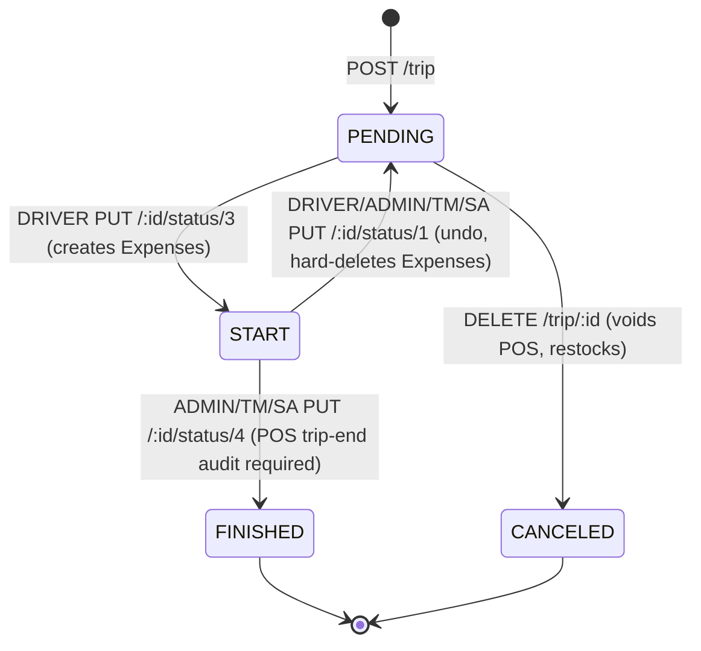

# Trip

Core module of the service. A **Trip** is a customer tour booking: dates, passengers, flight/pick-up/drop-off info, an ordered list of places (destinations), hotels and activities (optionally paid by the company), assigned driver(s) and vehicle(s), a driver pre-trip checklist, and a status lifecycle (PENDING → START → FINISHED, or PENDING → CANCELED). Starting a trip creates its `Expenses` header; cancelling voids its POS transaction and returns stock to inventory; marking a place as reached advances the vehicle odometer. Shared conventions (auth middleware, `CommonResponse`, roles, enums, cache) are in [README.md](./README.md).

## Files

| File | Responsibility |
|---|---|
| `src/modules/trip/trip.route.ts` | Express router, role guards per route |
| `src/modules/trip/trip.controller.ts` | All handlers (create/update/cancel, listing, assignment, status changes, checklist, places, print/QR, hotel & activity payments) |
| `src/modules/trip/trip.service.ts` | Mongoose queries on `Trip` (no caching) |
| `src/modules/trip/trip.model.ts` | `Trip` schema |
| `src/modules/trip/trip.validation.ts` | Joi schemas: `tripSchema`, `assignDriverVehicleSchema`, `checkListAnswerSchema`, `markPlaceSchema`, `tripHotelActivityPaymentSchema` (unused) |
| `src/modules/trip/trip.util.ts` | Model → DTO mappers |
| `src/modules/trip/dto/tripResponseDtos.ts` | DTO interfaces |

## Data model

### `Trip` (collection `trips`, model name `Trip`)
Options: `timestamps: true` (`createdAt`, `updatedAt`), `versionKey: false`. No indexes, hooks or virtuals defined.

| Field | Type | Required / default / ref | Meaning |
|---|---|---|---|
| `startDate` | Date | required | Trip start |
| `endDate` | Date | required | Trip end; month-end and reports key on this |
| `tripConfirmedNumber` | String | default `0` | Business booking number; unique among non-CANCELED trips (enforced in controller only) |
| `isPaymentCollected` | Boolean | default `false` | Customer payment collected flag |
| `dateCount` | Number | required | Number of days |
| `requestedVehicle` | String | default `''` | Free-text vehicle request |
| `totalCost` | Number | required | Price (foreign currency) |
| `totalCostLocalCurrency` | Number | required, default `0` | Price in LKR |
| `estimatedExpense` | Number | required | Trip expense budget. Increased by `expenseRequest` approvals |
| `specialRequirement` | String | maxlength 500 | |
| `paymentMode` | String | required, default `'Cash'` | Customer payment mode |
| `passengers[]` | subdoc | `name`, `nationality`, `age`(Number), `gender` all required | Passenger list |
| `arrivalInfo` | object | `arrivalDate`, `arrivalTime` (Date), `arrivalFlightNumber` (String) | |
| `departureInfo` | object | `departureDate`, `departureTime`, `departureFlightNumber` | |
| `pickUpInfo` | object | `pickupDate`, `pickupTime`, `pickupCity`, `pickupAddress` | |
| `dropOffInfo` | object | `dropOffDate`, `dropOffTime`, `dropOffCity`, `dropOffAddress` | |
| `activities[]` | subdoc | see below | Planned activities |
| `activities[].date` | Date | | |
| `activities[].description` | String | | |
| `activities[].adultCount` / `childCount` | Number | | |
| `activities[].totalCost` | Number | | |
| `activities[].isPaymentByCompany` | Boolean | default `false` | Company pays this activity |
| `activities[].isPaymentDone` | Boolean | default `false` | Set by `updateHotelActivityPayment` |
| `activities[].paymentAmount` | Number | default `0` | |
| `activities[].paymentDate` | Date | default `null` | |
| `activities[].paymentRemark` | String | default `''` | |
| `activities[].updatedBy` | ObjectId | ref `User`, default `null` | Who recorded payment |
| `activities[].paymentMode` | String | default `0` | Payment mode (number sent by client, stored as string) |
| `activities[].receiptImageUrl` | String | default `''` | |
| `places[]` | subdoc | see below | Ordered destinations |
| `places[].description` | String | required | Place name |
| `places[].dates` | [Date] | required | Dates at the place |
| `places[].isReached` | Boolean | default `false` | Set by driver via `markAsReached` |
| `places[].index` | Number | default `0` | 1-based order |
| `places[].reachedDate` | Date | default `null` | |
| `places[].calcDistance` | Number | default `0` | km driven since previous mark (0 for freelance vehicles) |
| `places[].startMilage` / `endMilage` | Number | default `0` | Odometer before / at arrival |
| `places[].location` | Object | default `null` | `{lat,lng}` |
| `places[].reachedBy` | ObjectId | ref `User`, default `null` | |
| `places[].updatedBy` | ObjectId | ref `User`, default `null` | |
| `hotels[]` | subdoc | see below | Hotel bookings |
| `hotels[].dates` | String | required | Comma-separated dates (sorted on update) |
| `hotels[].hotelName` | String | required | |
| `hotels[].city` | String | required | |
| `hotels[].isPaymentByCompany`, `isPaymentDone`, `paymentAmount`, `paymentDate`, `paymentRemark`, `updatedBy`, `paymentMode`, `receiptImageUrl` | — | same as activities | |
| `email` | String | required, maxlength 100, regex email validator | Customer email |
| `phoneNumber` | String | maxlength 20 | |
| `contactPerson` | String | maxlength 100 | |
| `drivers[]` | subdoc | `driver` (ObjectId ref `User`), `driverAssignedBy` (ref `User`), `isActive` (Boolean, default `true`) | Driver history; exactly one should be active |
| `vehicles[]` | subdoc | `vehicle` (ObjectId ref `Vehicle`, required, default `null`), `isActive` (default `true`), `vehicleAssignedBy` (ref `User`, default `null`) | Vehicle history |
| `checkListAnswers` | Object | default `null` | Driver pre-trip checklist (see validation) |
| `checkListCheckBy` | ObjectId | ref `User`, default `null` | Driver who submitted checklist |
| `status` | Number | required, default `WellKnownLeaveStatus.PENDING` (=1) | `WellKnownTripStatus` |
| `createdBy`, `updatedBy` | ObjectId | ref `User` | |
| `startedBy` | ObjectId | ref `User`, default `null` | Driver who started the trip |
| `endedBy` | ObjectId | ref `User`, default `null` | Admin who finished it |
| `isMonthEndDone` | Boolean | default `false` | Locked by month audit |
| `batchId` | Number | default `0` | Month-audit batch |

`WellKnownTripStatus`: `PENDING=1`, `CANCELED=2`, `START=3`, `FINISHED=4`, `REACHED=5`. `REACHED` is never stored; the value `5` is only reused as a list filter meaning "FINISHED and all driver salaries paid" (see `getAllTripsByRole`).

## Endpoints

Base: `/api/v1/trip`. "Any" = `authorize([])` (any authenticated, non-blocked user).

| Method | Path | Roles allowed | Validation | Handler |
|---|---|---|---|---|
| POST | `/api/v1/trip/` | TRIPMANAGER, SUPERADMIN, ADMIN, TRIPASSISTANT | `tripSchema` | `saveTrip` |
| GET | `/api/v1/trip/` | Any | — (query `status`, `startDate`, `endDate`) | `getAllTripsByRole` |
| GET | `/api/v1/trip/:id` | Any | — | `getTripById` |
| PUT | `/api/v1/trip/:id` | TRIPMANAGER, SUPERADMIN, ADMIN, TRIPASSISTANT | `tripSchema` (`allowUnknown: true`) | `updateTrip` |
| DELETE | `/api/v1/trip/:id` | TRIPMANAGER, SUPERADMIN, ADMIN, TRIPASSISTANT | — | `cancelTrip` |
| PUT | `/api/v1/trip/assignDriver/:id` | TRIPMANAGER, SUPERADMIN, ADMIN | `assignDriverVehicleSchema` | `assignDriverAndVehicle` |
| PUT | `/api/v1/trip/:id/status/:status` | TRIPMANAGER, SUPERADMIN, ADMIN, DRIVER | enum check | `changeTripStatus` |
| PUT | `/api/v1/trip/checkList/:id` | DRIVER | `checkListAnswerSchema` | `saveCheckListAnswers` |
| GET | `/api/v1/trip/checkList/:id` | Any | — | `getCheckListAnswers` |
| GET | `/api/v1/trip/places/:id` | Any | — | `getPlacesByTripId` |
| PUT | `/api/v1/trip/:tripId/markAsReached/:placeId` | DRIVER | `markPlaceSchema` | `markPlaceAsReached` |
| GET | `/api/v1/trip/tripForPrint/:id` | Any | — | `getTripForReport` |
| GET | `/api/v1/trip/tripForQrCode/:id` | **No auth** (`authorize([], true)`) | — | `getTripForQrCode` |
| GET | `/api/v1/trip/hotelsAndActivities/:id` | Any | — | `getTripHotelsAndActivities` |
| PUT | `/api/v1/trip/updateHotelActivityPayment/:id` | TRIPMANAGER, SUPERADMIN, ADMIN | **none** (schema exists but unused) | `updateHotelActivityPayment` |
| GET | `/api/v1/trip/destinationSummary/:id` | Any | — | `getDestinationSummaryPrint` |

`applicationRoutes.trip.undoTripStatus` (`/:id/undoStatus/:status`) is defined but not registered; "undo" is done via `PUT /:id/status/1`.

Route-order note: `PUT /:id` is registered before `PUT /assignDriver/:id`, `/checkList/:id` and `/updateHotelActivityPayment/:id`, but these have two path segments so they do not collide. `GET /:id` is registered before `GET /checkList/:id`, `/places/:id`, etc. — also two segments, no collision.

All errors below are `BadRequestError` (HTTP 400) unless stated.

## Endpoint logic

### POST `/` — `saveTrip`
**Body (`tripSchema`)**
- `tripConfirmedNumber` string, required
- `startDate`, `endDate` date, required
- `dateCount` number ≥ 1, required
- `contactPerson` string, required
- `totalCost`, `totalCostLocalCurrency`, `estimatedExpense` number, required
- `isPaymentCollected` boolean (default false)
- `specialRequirement`, `requestedVehicle` string, null/'' allowed
- `paymentMode` string, required
- `passengers` array, required, min 1; each `{_id: string required, name, nationality, age:number, gender}` all required
- `activities` array; each `{_id: string required, date, description, adultCount, childCount, totalCost, isPaymentByCompany: boolean default false}`
- `hotels` array; each `{_id required, dates: string required, hotelName required, city required, isPaymentByCompany}`
- `email` string email, required; `phoneNumber` string, required
- `arrivalInfo`, `departureInfo`, `pickUpInfo`, `dropOffInfo`: objects (fields as model), null allowed, optional
- `places` array, required; each `{_id: string required, description: required, dates: array required, isReached: boolean, index: number required}`

Clients send placeholder `_id` strings for new sub-items; they are stripped server-side.

**Logic**
1. Joi validate → `BadRequestError(error.message)`.
2. `tripService.isTripConfirmedNumberExists(tripConfirmedNumber, '')` (any non-CANCELED trip) → `'This trip confirmed number already used in another trip!'`.
3. Strip `_id` from passengers, activities, hotels. Places: sort by `index`, strip `_id`, set `updatedBy = auth.id`, re-number `index = 1..n`.
4. Build `new Trip({...})` with all body fields, `createdBy = updatedBy = auth.id` (status defaults to 1 PENDING).
5. `tripService.save(trip, null)`.

**Response** 201 `'Trip Created Successfully'`, `data` = saved Mongoose document.

### PUT `/:id` — `updateTrip`
**Body**: `tripSchema` with `allowUnknown: true`.

**Logic**
1. Joi validate.
2. Load trip with status in [PENDING, START, FINISHED] → `'Trip not found!'`. (No `isMonthEndDone` check.)
3. `isTripConfirmedNumberExists(tripConfirmedNumber, id)` (excludes self) → `'This trip confirmed number already used in another trip!'`.
4. Passengers: replaced wholesale, `_id`s stripped.
5. **Activities merge** (against `trip.activities`):
   - Deleted = saved activities whose `_id` is not in body. If any deleted one has `isPaymentDone` → `` `Cannot delete activity ${description}, because payment is already done!` ``; otherwise removed.
   - Matched by `_id`: if saved `isPaymentDone && isPaymentByCompany` and body `isPaymentByCompany` false → `` `Cannot update activity ${description} as not payment by company, because payment is already done!` ``. Otherwise copy `date, description, adultCount, childCount, totalCost, isPaymentByCompany` (payment fields kept).
   - Body items whose `_id` matches no saved item → `_id` stripped, appended.
   - Sorted ascending by `date`.
6. **Hotels merge** (same pattern):
   - Deleting a hotel with `isPaymentDone` → `` `Cannot delete hotel ${hotelName}, because payment is already done!` ``.
   - Turning off `isPaymentByCompany` on a paid company hotel → `` `Cannot update hotel ${hotelName} as not payment by company, because payment is already done!` ``. Otherwise copy `hotelName, dates, city, isPaymentByCompany`.
   - New → appended. Sorted by earliest date in the comma-separated `dates` string (split, trim, lexical sort, first).
7. **Places merge** — only if body `places.length > 0`:
   - Sort body by `index`, re-number 1..n, set `updatedBy`.
   - Removed = saved places whose `_id` is not in body. If any removed place `isReached` → `'Can not delete reached place!'`.
   - For each body place in order: if it matches a saved place and `description` or `JSON.stringify(dates)` differ → if saved `isReached` → `'Can not update reached place!'`, else `Object.assign(saved, place, {updatedBy})`. If unchanged → the saved subdoc is kept as is (its stored `index` is **not** updated). Unmatched → `_id` stripped, added as new.
   - Result order = body order.
   - If body `places` is `[]`, `places` stays `[]` and **all places are removed with no reached check**.
8. Overwrite scalars: `contactPerson, startDate, endDate, dateCount, totalCost, tripConfirmedNumber, specialRequirement, requestedVehicle, paymentMode, totalCostLocalCurrency, estimatedExpense, isPaymentCollected, passengers, activities, places, hotels, arrivalInfo, departureInfo, pickUpInfo, dropOffInfo, email, phoneNumber, updatedBy`.
9. `tripService.save(trip, null)` (no transaction).

**Response** 200 `'Trip Updated Successfully'`, `data` = saved document.

### DELETE `/:id` — `cancelTrip`
**Logic**
1. Load trip with status in [PENDING, START, FINISHED] → `'Trip not found!'`.
2. If status is START or FINISHED → `"Can't cancel started or finished trip!"`. Only PENDING trips can be cancelled.
3. Start Mongoose session + transaction.
4. `trip.status = CANCELED`, `updatedBy = auth.id`, save in session.
5. `posService.findByTripIdAndStatusInWIthProducts(id, [ACTIVE])` (populates `tripId` and `products.product`; filters `products` to ACTIVE in memory).
6. If a POS exists and it has ACTIVE products, for each product:
   - `productService.findByIdAndStatusIn(p.product, [ACTIVE])`; skip if not found.
   - Resolve unit code from `util/data/measureUnitData` (`measureUnit`): if product's unit `isSaveWithSiUnit` use the SI unit code of the same `categoryId`, else the unit's own `code`.
   - `product.inventory += p.quantityWithSiUnitOfMeasure`; push inventory log `{inventoryLogType: WellKnownGrnLogType.POS_TRANSACTION, inventoryLogDate: now, inventoryLogQuantity, beforeTransactionInventory, afterTransactionInventory, inventoryLogProductId, inventoryLogCreatedBy: auth.id, message: "Inventory updated: <qty><unit> added to product \"<name>\" via voiding POS transaction in trip \"<tripConfirmedNumber>\". (Trip Cancellation)"}`.
   - `productService.save(product, session)` (clears `PRODUCT` cache prefix).
   - Then POS `status = DELETED`, every (filtered) product `status = DELETED`, `updatedBy = auth.id`; `posService.save(pos, session)`.
   - If the POS exists but has no ACTIVE products it is left ACTIVE.
7. Commit; on error abort and rethrow; always `endSession`.

Expenses / expense requests are not touched (a PENDING trip normally has no `Expenses` header).

**Response** 200 `'Trip Canceled Successfully'`, `data: null`.

### GET `/:id` — `getTripById`
1. `findByIdAndStatusIn(id, [PENDING, START, FINISHED])` (no populate) → `'Trip not found!'`.
2. Response 200, `data` = raw trip document (CANCELED trips are not returned).

### GET `/` — `getAllTripsByRole`
**Query**: `status` (default `-1`), `startDate`, `endDate` (strings; used for ADMIN-type roles only).

**Status mapping**
| `status` | statuses queried | extra filter |
|---|---|---|
| `-1` (default) | PENDING, START, FINISHED | — |
| `1` | PENDING | — |
| `3` | START | — |
| `4` | FINISHED | only trips where `isDriverSalaryDone == false` |
| `5` | FINISHED | only trips where `isDriverSalaryDone == true` |
| anything else (e.g. `2`) | `[]` → empty result | — |

**Logic**
1. **ADMIN, TRIPMANAGER, SUPERADMIN, DRIVERASSISTANT, TRIPASSISTANT**:
   - `tripService.findAllByStatusIn(statusArr, startDate, endDate)` — trips whose `startDate` **or** `endDate` falls in `[startDate 00:00, endDate 23:59:59.999]`, populated, sorted by `startDate` asc. Month-end-done trips are included.
   - For each trip (in parallel, one query per trip): `isDriverSalaryDone = false`; if status START or FINISHED, load `Expenses` (`expensesService.findByTripIdAndStatusIn(tripId, [ACTIVE])`). If found and the trip has drivers, `isDriverSalaryDone = every trip.drivers[].driver._id is present in expense.driverSalaries[].driver` (all drivers ever assigned, not only the active one).
   - Apply the status 4/5 filter above.
2. **DRIVER**: `tripService.findAllByDriverIdAndStatusIn(auth.id, statusArr)` — trips where the driver appears anywhere in `drivers[]` (active or not), `isMonthEndDone: false`, no date filter. Each trip gets `isActiveDriver = (active driver's _id == auth.id)`. `isDriverSalaryDone` is not computed (status 4 and 5 both return all FINISHED trips).
3. **FINANCEOFFICER** (or any other role): returns `[]`.
4. `sortTrips`: stable sort by status priority PENDING(1) → START(2) → FINISHED(3), preserving `startDate` order within a group.
5. Map with `tripUtil.tripModelArrToTripResponseDtoGetAlls`.

**Response** 200, `data: TripResponseDtoGetAll[]`.

### PUT `/assignDriver/:id` — `assignDriverAndVehicle`
**Body**: `driverId` string (null/'' allowed), `vehicleId` string (null/'' allowed). Either or both.

**Logic**
1. Joi validate.
2. Load trip with status in [PENDING, START] → `'Trip not found!'`.
3. If `driverId`:
   - `userService.findById(driverId)` (ACTIVE user; role is **not** checked) → `'Driver not found!'`.
   - **PENDING trip**: `drivers = [{driver, driverAssignedBy: auth.id, isActive: true}]` (history discarded).
   - **START trip**: find the active driver; if it is a different user, set every entry `isActive = false` except an existing entry matching `driverId` (re-activated, `driverAssignedBy` updated); if none matched, push a new active entry. If the requested driver is already active, nothing changes. (See known issues: matching uses `===` against an ObjectId, so a new entry is always pushed.)
4. If `vehicleId`:
   - `vehicleService.findByIdAndStatusIn(vehicleId, [ACTIVE])` → `'Vehicle not found!'`.
   - Same PENDING-replace / START-history logic for `vehicles[]` with `vehicleAssignedBy`.
5. `tripService.save(trip, null)`.
6. No availability check (overlapping trips, leave, maintenance) is done here; the UI gets candidates from `user.service.findDriversByNotInInternalTripsAndNormalTrips` / `vehicle.service.findVehiclesBySheetCountAndNotInInternalTripsAndNormalTrips`.

**Response** 200, `data: null`, message `'Driver and vehicle assigned successfully!'` / `'Driver assigned successfully!'` / `'Vehicle assigned successfully!'` (the last one also when neither id is sent).

### PUT `/:id/status/:status` — `changeTripStatus`
**Params**: `id`, `status` (parsed int).

**Logic** (everything inside one session/transaction)
1. `helperUtil.isValueInEnum(WellKnownTripStatus, status)` → `'Invalid status!'`.
2. **DRIVER**
   - `status == START` (start trip):
     1. Trip must be PENDING → `'Trip not found or not in pending status!'`.
     2. `isMonthEndDone` → `'Trip is already month end done!'`.
     3. `status = START`, `startedBy = auth.id`.
     4. Create `Expenses` header `{tripId, createdBy, updatedBy, expenses: [], driverSalaries: []}` via `expensesService.save(…, session)` (clears `EXPENSES` cache prefix).
     - Not checked: that the caller is the assigned/active driver, that a vehicle is assigned, that the checklist was submitted, or that an `Expenses` header doesn't already exist.
   - `status == PENDING` (undo start): see **Undo rules** below; then `status = PENDING`, `startedBy = null`, `updatedBy = auth.id`, `checkListAnswers = null`, `checkListCheckBy = null`; `expensesService.findAndHardDeleteByTripId(tripId, session)` (hard-deletes the `Expenses` doc; clears `EXPENSES` cache prefix).
   - Any other status → `` "You'r not allowed to change status to " + <enum name> + '!' ``.
3. **ADMIN, TRIPMANAGER, SUPERADMIN**
   - `status == FINISHED`:
     1. Trip must be START → `'Trip not found or not in start status!'`.
     2. `isMonthEndDone` → `'Trip is already month end done!'`.
     3. If an ACTIVE POS exists for the trip (`posService.findByTripIdAndStatusIn`) and `!pos.isTripEndAuditDone` → `'Unable to finish trip because the trip end POS audit is not completed!'`.
     4. `status = FINISHED`, `endedBy = auth.id` (`updatedBy` not set).
     - Not checked: places reached, driver salaries paid, pending expense requests.
   - `status == PENDING` (undo start): same **Undo rules**; then `status = PENDING`, `updatedBy`, `startedBy = null`; hard-delete `Expenses`. Checklist is **not** cleared on this path.
   - Any other status → `"You'r not allowed to change status to <name>!"`.
4. `tripService.save(trip, session)`, commit. On any error abort + rethrow; `endSession` in `finally`.

**Undo rules (START → PENDING)**, identical for both role groups:
1. Trip must be START → `'Trip not found or not in start status!'`.
2. `isMonthEndDone` → `'Trip is already month end done!'`.
3. Any hotel or activity with `isPaymentDone` → `"Can't change status to pending after hotel or activity payment done!"`.
4. `Expenses` (ACTIVE) exists **and** has ≥1 ACTIVE expense line **and** `driverSalaries.length > 0` → `"Can't change status to pending after expense added or driver salary added!"`.
5. Any expense request for the trip with status PENDING(1) or APPROVED(2) (`expenseRequestService.findByTripIdAndStatusIn`, cached one week under `EXPENSES_REQUEST` prefix) → `"Can't change status to pending after expense request added!"`.
6. Any place `isReached` → `"Can't change status to pending after reached at least one place!"`.

The list DTO exposes `canUndo = status === START && no place reached` (it does not consider payments/expenses).

No transition exists out of FINISHED or CANCELED; CANCELED is only reachable via `DELETE /:id`.

**Response** 200, `data: null`, message `'Trip started successfully!'` / `'Trip finished successfully!'` / `'Trip pending successfully!'`.

### PUT `/checkList/:id` — `saveCheckListAnswers`
**Body (`checkListAnswerSchema`)**: keys `1`–`14` numbers (optional), `umbrellaCount` number, `isTermsConditionsChecked1` boolean required, `isTermsConditionsChecked2` boolean required, `vehicleDamageImages` array. Unknown keys rejected.

**Logic**
1. Joi validate.
2. Trip must be PENDING → `'Invalid trip or trip is not in pending status!'`.
3. `checkListAnswers = body`, `checkListCheckBy = auth.id`, save. Overwrites any previous answers. Caller is not checked against the trip's drivers.

**Response** 200 `'Answers saved successfully!'`, `data: null`.

### GET `/checkList/:id` — `getCheckListAnswers`
1. Trip with status in [PENDING, START, FINISHED, CANCELED] → `'Invalid trip!'`.
2. `checkListAnswers == null` → `'Checklist not completed yet!'`.
3. 200, `data` = `checkListAnswers` object.

### GET `/places/:id` — `getPlacesByTripId`
1. `findTripPlacesByTripIdAndStatusIn(id, [PENDING, START, FINISHED])` (populates `places.reachedBy` with `_id fullName userName`) → `'Invalid trip!'`.
2. 200, `data` = `TripModelArrToTripPlaceResponseDtos(trip.places)`.

### PUT `/:tripId/markAsReached/:placeId` — `markPlaceAsReached`
**Body (`markPlaceSchema`)**: `location {lat:number, lng:number}` optional; `currentMilage` number, required.

**Logic** (session/transaction)
1. Joi validate.
2. Trip must be START → `'Started trip not found!'`.
3. Active driver entry must exist → `'No active driver found!'`; must equal `auth.id` → `'Only active driver can update place as reached!'`.
4. Place `_id == placeId` → `'Place not found!'`; already reached → `'Place already reached!'`. Places may be reached in any order.
5. Active vehicle → `vehicleService.findByIdAndStatusIn(activeVehicle.vehicle, [ACTIVE])` → `'Selected vehicle not found!'`.
6. **Freelance vehicle** (`isFreelanceVehicle`): set `isReached = true`, `reachedDate = now`, `reachedBy`, `location`, `startMilage = vehicle.currentMileage`, `endMilage = body.currentMilage`, `calcDistance = 0`. Vehicle not updated; no mileage validation.
7. **Company vehicle**: if `vehicle.currentMileage >= currentMilage` → `'Current mileage should be greater than previous mileage!'`. `calcDistance = currentMilage - vehicle.currentMileage`; set place fields as above with `calcDistance`; `vehicle.currentMileage += calcDistance`; `vehicleService.save(vehicle, session)` (clears `VEHICLE` and `TRIP` cache prefixes).
8. Save trip in session; commit (abort + rethrow on error).

**Response** 200 `'Place marked as reached successfully!'`, `data: null`.

### GET `/tripForPrint/:id` — `getTripForReport`
1. Trip with status in [PENDING, START, FINISHED] (no populate).
2. If found **and** role ∈ {ADMIN, SUPERADMIN, TRIPMANAGER, FINANCEOFFICER}:
   - `trip.toObject()`; load ACTIVE `Expenses` (populated `tripId`).
   - If found: keep only ACTIVE expense lines; `tripExpensesAmount = expense.tripId.estimatedExpense`; `totalTripExpensesAmount = Σ amount`; `remainingTripExpensesAmount = tripExpensesAmount − total`; map with `expensesUtil.ExpensesModelToTripExpensesResponseDto` → `{_id, tripId, expenses, driverSalaries, isMonthEndDone, tripExpensesAmount, totalTripExpensesAmount, remainingTripExpensesAmount}`.
   - `trip.expenses = dto | null`.
3. Other roles get the trip without `expenses`. Not found → 200 with `data: null` (no error).

### GET `/tripForQrCode/:id` — `getTripForQrCode`
Public (no token). Same as `getTripForReport` but attaches `expenses` for every caller (no role check). Not found → 200 `data: null`.

### GET `/hotelsAndActivities/:id` — `getTripHotelsAndActivities`
1. Trip with status in [PENDING, START, FINISHED].
2. Response `{hotels: trip.hotels where isPaymentByCompany === true, activities: same filter}`; both `[]` if trip not found (no error).

### PUT `/updateHotelActivityPayment/:id` — `updateHotelActivityPayment`
**Body** (not validated; intended `tripHotelActivityPaymentSchema`): `type` (1 = hotel, 2 = activity, strict number), `objectId` (subdoc `_id`), `paymentAmount`, `paymentDate`, `paymentRemark`, `paymentMode`, `receiptImageUrl`.

**Logic**
1. Trip with status in [PENDING, START, FINISHED] → `'Trip not found!'`.
2. `isMonthEndDone` → `'Cannot update trip after month end!'`.
3. `type === 1`: hotel by `_id` → `'Hotel not found!'`; `isPaymentByCompany === false` → `'Selected hotel is not paid by company!'`. Set `isPaymentDone = true`, `paymentDate`, `paymentAmount`, `paymentRemark`, `paymentMode`, `receiptImageUrl`, `updatedBy`; save. Message `'Hotel payment updated successfully!'`.
4. `type === 2`: same for activity → `'Activity not found!'` / `'Selected activity is not paid by company!'`; message `'Activity payment updated successfully!'`.
5. Otherwise → `'Invalid request type!'`.
6. Payments can be re-recorded (overwritten) any number of times; there is no "undo payment". No `Expenses` record is created.

**Response** 200, `data: null`.

### GET `/destinationSummary/:id` — `getDestinationSummaryPrint`
1. `findTripPlacesByTripIdAndStatusIn(id, [PENDING, START, FINISHED])` → `'Invalid trip!'`.
2. 200, `data` = raw `trip.places` (with `reachedBy` populated `_id fullName userName`), including mileage fields (`startMilage`, `endMilage`, `calcDistance`) that the places DTO omits.

## Service layer (`trip.service.ts`)

No caching in this service (although `vehicle.service.save` clears the `trip-` prefix).

| Function | Query |
|---|---|
| `save(trip, session)` | `trip.save({session})` or `trip.save()` |
| `findByIdAndStatusIn(id, status[])` | `Trip.findOne({_id, status: {$in}})`, no populate |
| `findAllByStatusIn(status[], startDate, endDate)` | `Trip.find({status: {$in}, $or: [{startDate in range}, {endDate in range}]})`, range = startDate 00:00 → endDate 23:59:59.999 (server TZ); populate `createdBy updatedBy startedBy endedBy`, `drivers.driver` (User), `vehicles.vehicle` (Vehicle); sort `startDate` asc |
| `findAllByDriverIdAndStatusIn(driverId, status[])` | `Trip.find({'drivers.driver': driverId, status: {$in}, isMonthEndDone: false})`; same populates; sort `startDate` asc |
| `generateTripId()` | max `tripConfirmedNumber` + 1 (unused) |
| `findTripPlacesByTripIdAndStatusIn(tripId, status[])` | `findOne`, populate `places.reachedBy` (`_id fullName userName`) |
| `findAllByEndMonthAndStatusIn(endMonth, currYear, status[])` | trips with `endDate < first day of (currYear, endMonth)`, `isMonthEndDone: false`; same populates — used by month audit |
| `isTripConfirmedNumberExists(number, tripId)` | `findOne({tripConfirmedNumber, status: {$ne: CANCELED}, _id: {$ne: tripId}})` (the `_id` filter only if `tripId` is a valid ObjectId) |
| `findAllByStatusInAndOnlyFromEndDate(status[], startDate, endDate)` | like `findAllByStatusIn` but range on `endDate` only — used by dashboard |

The `match: {'drivers.isActive': true}` / `{'vehicles.isActive': true}` / `{'places.isReached': true}` options on populates filter the *populated* User/Vehicle docs by a path they don't have. With `mongoose.set('strictQuery', true)` (`config/database.config.ts:7`) those unknown paths are stripped, so the matches are no-ops and every driver/vehicle/user is populated.

## Utilities / DTOs (`trip.util.ts`, `dto/tripResponseDtos.ts`)

| Function | Input → output |
|---|---|
| `mapPassengerToPassengerDto` | passenger → `{id, name, nationality, age, gender}` (`id` = Mongoose virtual id) |
| `mapArrivalInfoToArrivalInfoDto` / `mapDepartureInfo…` / `mapPickUpInfo…` / `mapDropOffInfo…` | sub-object → same fields, `null` for missing |
| `mapActivityToActivityDto` | → `{id: _id, date, description, adultCount, childCount, totalCost}` (defaults `''`/0/null) |
| `mapVehicleToVehicleDto` | populated vehicle entry → `{vehicle: _id, registrationNumber, vehicleAssignedBy: _id, licenseRenewalDate, insuranceRenewalDate, isActive}` (throws if `vehicle.vehicle` is null) |
| `mapDriverToDriverDto` | populated driver entry → `{driver: _id, driverName: fullName, driverAssignedBy: _id, driverAssignedByName: fullName, isActive}` |
| `tripModelToTripResponseDto` / `tripModelArrToTripResponseDtos` | full trip → `TripResponseDto` (unused anywhere) |
| `tripModelToTripResponseDtoGetAll` | trip → `TripResponseDtoGetAll`: `id, startDate, endDate, dateCount, totalCost, requestedVehicle, totalCostLocalCurrency, paymentMode, isActiveDriver, isCheckListDone (checkListAnswers != null), isPaymentCollected, email, phoneNumber, status, passengersCount, statusName (enum name), tripConfirmedNumber, contactPerson, createdBy/updatedBy/startedBy/endedBy (_id), createdUser/updatedUser/startedUser/endedUser (fullName), isMonthEndDone, isDriverSalaryDone, canUndo (START && no place reached), createdAt, updatedAt, paidByCompanyCount (# hotels+activities with isPaymentByCompany), activeVehicleId, activeRegistrationNumber, activeDriverId, activeDriverName ("fullName (userName)"), drivers[] (DriverDto), vehicles[] (VehicleDto)` |
| `tripModelArrToTripResponseDtoGetAlls` | array map of the above. Also used by `monthAudit` and `tripSummary` |
| `TripModelArrToTripPlaceResponseDtos` | places → `{description, dates, isReached, index, updatedBy, _id, location, reachedBy: _id, reachedDate, reachedByUser: fullName}` |

## Business rules

- Only a DRIVER can start a trip; only ADMIN/TRIPMANAGER/SUPERADMIN can finish it. Anyone in those role groups can undo START → PENDING subject to the undo rules.
- Undo is blocked by: any hotel/activity payment, active expenses **with** driver salaries, PENDING/APPROVED expense requests, any reached place, month-end.
- No status change once `isMonthEndDone` (month audit sets it; it also locks hotel/activity payments). `updateTrip` is **not** locked by month-end.
- `tripConfirmedNumber` unique among non-CANCELED trips.
- CANCELED trips are invisible to every read endpoint except `GET /checkList/:id`.
- Only PENDING trips can be cancelled; cancelling returns POS stock and soft-deletes the POS.
- Driver/vehicle assignment allowed in PENDING (replaces) and START (keeps history, one active).
- Checklist can only be submitted while PENDING; driver undo clears it.
- Only the active driver may mark places reached; company vehicles require strictly increasing odometer and update `Vehicle.currentMileage`.
- Paid hotels/activities cannot be deleted, nor switched to "not paid by company"; reached places cannot be deleted or edited (description/dates).
- Driver salary "done" = every driver ever on the trip has an entry in `Expenses.driverSalaries`.

## Cross-module dependencies

**Trip reads/writes in other modules**
| Module | Usage |
|---|---|
| `expenses` | `Expenses` model created on start; `expensesService.findByTripIdAndStatusIn`, `findAndHardDeleteByTripId`, `save`; `expensesUtil.ExpensesModelToTripExpensesResponseDto` |
| `expenseRequest` | `expenseRequestService.findByTripIdAndStatusIn` (undo guard) |
| `pos` | `posService.findByTripIdAndStatusIn` (finish guard), `findByTripIdAndStatusInWIthProducts` + `save` (cancel) |
| `inventory/product` | `productService.findByIdAndStatusIn`, `save` (restock on cancel); `util/data/measureUnitData`; `WellKnownGrnLogType.POS_TRANSACTION` |
| `user` | `userService.findById` (assign driver) |
| `vehicle` | `vehicleService.findByIdAndStatusIn`, `save` (assign, mileage) |
| `util` | `helperUtil.isValueInEnum`, `getNameFromEnum` |

`leave`, `notification` and socket.io are **not** used by this module (`WellKnownLeaveStatus` is only reused for expense-request statuses and the Trip status default). No socket events are emitted.

**Who uses Trip**
| Caller | Usage |
|---|---|
| `tripSummary` | `tripService.findByIdAndStatusIn`, `tripUtil.tripModelToTripResponseDtoGetAll`, `Trip` model |
| `expenses.controller` | `tripService.findByIdAndStatusIn` (validates trip state for expenses/salaries) |
| `expenseRequest.controller` | `findByIdAndStatusIn([START])`, and on approval `trip.estimatedExpense += approvedAmount` + `tripService.save` |
| `pos.controller` | `findByIdAndStatusIn` (POS sales/void/audit) |
| `monthAudit.controller` | `findAllByEndMonthAndStatusIn`, sets `isMonthEndDone`, `batchId`, `updatedBy` and saves; `tripModelArrToTripResponseDtoGetAlls` |
| `dashboard.controller` | `findAllByStatusIn`, `findAllByStatusInAndOnlyFromEndDate` |
| `notification.service` | `Trip.find` — PENDING trips starting within 3 days with no/inactive driver or vehicle (`findTripsBy3DaysBefore`) |
| `user.service` / `vehicle.service` | `Trip.find` overlapping PENDING/START trips to compute free drivers / vehicles |
| `internalTrip.service` | `Trip.find` overlapping PENDING/START/FINISHED trips using a vehicle |
| `report.service` | `Trip.find` by `endDate` month |

## Known issues / notes

1. **Undo deletes expenses** — `trip.controller.ts:881` and `:990` use `&&`: the guard fires only when there are active expense lines **and** driver salaries. A trip with expenses but no salaries (or salaries but no expenses) can be undone, and `findAndHardDeleteByTripId` (`:919`, `:1026`) then permanently deletes those records. Message says "expense added **or** driver salary added".
2. **Empty `places` wipes all places** — `trip.controller.ts:352` only runs the merge (and reached-place check) when `places.length > 0`; `[]` is assigned at `:428`, deleting reached places and their mileage data.
3. **QR endpoint is public** — `trip.route.ts:135` `authorize([], true)` returns the full trip (passengers, contact, costs) and expenses/driver salaries to anyone with the id.
4. **`updateHotelActivityPayment` has no validation** — `tripHotelActivityPaymentSchema` (`trip.validation.ts:363`) is never called (`trip.controller.ts:1424`). Any body is written to the subdoc.
5. **Driver re-activation never matches** — `trip.controller.ts:730` and `:778` compare an ObjectId with a string using `===`; always false, so re-assigning a previous driver/vehicle on a START trip pushes a duplicate entry instead of reactivating.
6. `assignDriverAndVehicle` on a START trip with no active driver/vehicle crashes on `activeDriver.driver` / `activeVehicle.vehicle` (`trip.controller.ts:728`, `:776`) → 500. Driver id is not checked to have the DRIVER role; no overlap/leave/maintenance check.
7. `markPlaceAsReached` crashes with 500 if there is no active vehicle (`trip.controller.ts:1202`). Place lookup uses loose `place._id == placeId` (`:1187`); `.equals()` / `toString()` would be explicit.
8. Driver start (`trip.controller.ts:831-859`) does not verify the caller is the trip's active driver, that a vehicle is assigned, or that the checklist is done; it creates a new `Expenses` header without checking for an existing one. Driver undo (`:860`) likewise has no ownership check. `saveCheckListAnswers` (`:1076`) has no driver ownership check.
9. Inconsistent undo: driver path clears `checkListAnswers`/`checkListCheckBy` (`:915-916`), admin path does not (`:1021-1023`). Admin FINISHED doesn't set `updatedBy` (`:967-968`); driver START doesn't either (`:847-848`).
10. Cancel POS handling: `posService.findByTripIdAndStatusInWIthProducts` reassigns `pos.products` to the ACTIVE subset (`pos.service.ts:37`); saving it at `trip.controller.ts:536` persists the filtered array, dropping previously voided product lines from the POS document. If `measureUnit.find` returns undefined (`:499-501`) the handler throws. A POS with no active products stays ACTIVE (`:488`).
11. `updateTrip` (`:148`) allows edits of FINISHED and month-end-locked trips and runs without a transaction.
12. Place change detection compares `JSON.stringify(saved.dates)` (Date objects) to raw body strings (`:393`); any format difference (e.g. no milliseconds/timezone) is treated as a change and throws `'Can not update reached place!'` for reached places. Unchanged saved places keep their old `index` even when reordered (`:402`).
13. `updateTrip` activity/hotel deletion splices the array inside `forEach` over the same array (`:214-225`, `:285-297`).
14. `getAllTripsByRole`: FINANCEOFFICER gets `[]` (`:596-602`); unrecognised `status` (e.g. 2) → empty `statusArr` → no trips (`:580-592`); missing `startDate`/`endDate` produce Invalid Date query values (`trip.service.ts:31-34`); one `Expenses` query per trip (N+1, `:609-636`). For drivers, `status=4` and `status=5` both return all FINISHED trips.
15. `WellKnownTripStatus.REACHED = 5` is never stored; `5` is overloaded as a list filter (`:590`). `helperUtil.isValueInEnum` accepts 5 and 2, which then fall through to "not allowed".
16. `getTripForReport` / `getTripForQrCode` / `getTripHotelsAndActivities` return 200 with null/empty data for unknown ids instead of an error.
17. Model: `status` default uses `WellKnownLeaveStatus.PENDING` (`trip.model.ts:447`) — same value (1) but wrong enum. `tripConfirmedNumber` is String with numeric default `0` (`:18-21`). Hotel/activity `paymentMode` String with default `0` (`:206`, `:338`) while the (unused) Joi schema expects a number. No index on `tripConfirmedNumber`, `status`, `drivers.driver`, `startDate`/`endDate`.
18. Populate `match` on `drivers.isActive` / `vehicles.isActive` / `places.isReached` is a no-op under `strictQuery` (`trip.service.ts:49,71,76,101,140,187`).
19. `findAllByEndMonthAndStatusIn` (`trip.service.ts:126-129`) calls `setMonth` on today's date before rebuilding day 1; on the 29th–31st it can overflow into the next month and shift the cutoff.
20. Dead code: `generateTripId` (`trip.service.ts:81`), `tripModelToTripResponseDto`/`tripModelArrToTripResponseDtos` (`trip.util.ts`), `undoTripStatus` route key (`applicationRoutes.ts:83`), unused imports `commonUtil`, `number` from joi (`trip.controller.ts:12,21`), `start` from `repl` (`trip.service.ts:1`), `truncate` (`trip.util.ts:16`). Every handler wraps logic in `try { … } catch (e) { throw e }`, which is a no-op.
