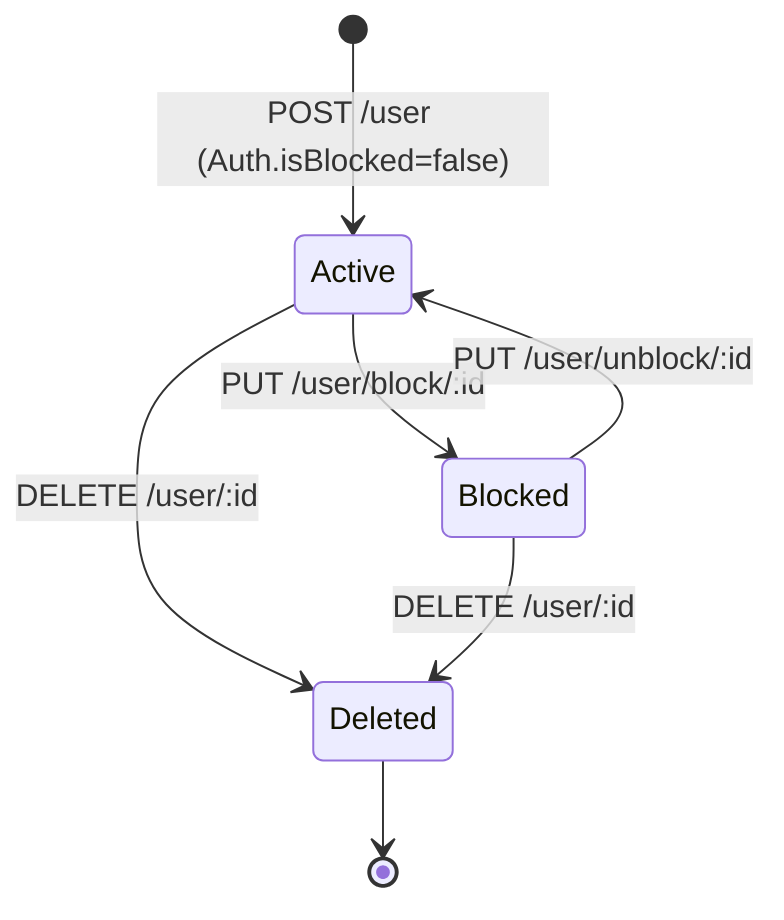

# User module

Staff/user master data: create, update, soft-delete, block/unblock users, list/lookup users, uniqueness checks, and lookup of drivers that are free for a date range (used by the trip screens). Every `User` has exactly one `Auth` record (credentials + role + blocked flag) created/updated in the same transaction — see [auth.md](auth.md). Shared plumbing (auth middleware, CommonResponse, error middleware, cache util, roles) is described in [README.md](README.md); this file only says how the module uses it.

## Files

| File | Responsibility |
|---|---|
| `src/modules/user/user.router.ts` | Route registration + role guards (`UserRouter`, mounted at `/api/v1/user`). |
| `src/modules/user/user.controller.ts` | Handlers: `saveUser`, `updateUser`, `blockUser`, `unblockUser`, `getAllUsers`, `getUserById`, `checkUserName`, `deleteUser`, `getAllUsersByRole`, `getDriversForTrip`. |
| `src/modules/user/user.service.ts` | Mongoose queries on `User` (+ `Auth`, `Trip`, `InternalTrip` for availability) and cache handling. |
| `src/modules/user/user.model.ts` | `User` schema. |
| `src/modules/user/user.util.ts` | `User` document → `UserResponseDto` mapping. |
| `src/modules/user/dto/userResponseDto.ts` | `UserResponseDto` interface. |

There is **no Joi validation file** for this module; input is validated only by the Mongoose schema (on save) and the uniqueness/role/gender checks in the controller.

## Data model

### `User` → collection `users` (`user.model.ts`)

Schema options: `timestamps: true` (`createdAt`, `updatedAt`), `versionKey: false`. No indexes (no unique index on `userName`/`email`/`nic` — uniqueness is enforced only in application code). No hooks or virtuals.

| Field | Type | Constraints | Meaning |
|---|---|---|---|
| `fullName` | String | required ("Full Name is required"), maxlength 120 | Display name. |
| `userName` | String | required, maxlength 50 | Login name; copied into `Auth.userName`. |
| `gender` | ObjectId | ref `Gender` | Resolved from the numeric gender `id` sent by the client. |
| `dateOfBirth` | Date | — | |
| `address` | String | maxlength 200 | |
| `phoneNumber1` | String | — | |
| `phoneNumber2` | String | — | |
| `email` | String | required, maxlength 100, regex email validator (`"<value> is not a valid email"`) | |
| `isFreelanceDriver` | Boolean | default `false` | Driver is freelance vs permanent; shown in `roleName`. |
| `profileImageUrl` | String | — | URL returned by [store](store.md) upload (type 1). |
| `nic` | String | required, maxlength 20 | National ID number. |
| `nicImageUrl` | String | — | Upload type 2. |
| `gsCertificateUrl` | String | — | Upload type 3. |
| `drivingLicenseUrl` | String | — | Upload type 4. |
| `sltdaCertificateUrl` | String | — | Upload type 5. |
| `policeReportUrl` | String | — | Upload type 6. |
| `bankName` | String | maxlength 100 | |
| `bankId` | Number | **required** ("Bank Id is required") | Bank id (matches `util/data/bankdata.ts` ids, though that file is not imported anywhere). |
| `branch` | String | maxlength 100 | |
| `accountNumber` | String | maxlength 50 | |
| `accountHolderName` | String | maxlength 120 | |
| `accountHolderAddress` | String | maxlength 200 | |
| `basicSalary` | Number | — | HR info. |
| `leaveCount` | Number | — | Yearly leave entitlement; used by [leave](leave.md) limit checks for ADMIN/FINANCEOFFICER/TRIPMANAGER. |
| `languages` | [String] | — | |
| `role` | ObjectId | ref `Role` | Resolved from numeric role `id`; duplicated on `Auth.role`. |
| `status` | Number | required, default `WellKnownStatus.ACTIVE` (1) | 1 ACTIVE / 3 DELETED used here. |
| `createdBy` | ObjectId | ref `User` | |
| `updatedBy` | ObjectId | ref `User` | |

`Auth` (owned by the auth module, see [auth.md](auth.md#data-model)) holds `userName`, `password`, `isBlocked`, `user`, `role`, `status`.

## Endpoints

| Method | Path | Roles allowed | Validation | Handler |
|---|---|---|---|---|
| GET | `/api/v1/user/getDriversForTrip` | SUPERADMIN, ADMIN, TRIPMANAGER | none | `getDriversForTrip` |
| POST | `/api/v1/user/` | SUPERADMIN | none (schema only) | `saveUser` |
| PUT | `/api/v1/user/:id` | SUPERADMIN | none (schema only) | `updateUser` |
| PUT | `/api/v1/user/block/:id` | SUPERADMIN | none | `blockUser` |
| PUT | `/api/v1/user/unblock/:id` | SUPERADMIN | none | `unblockUser` |
| GET | `/api/v1/user/validateUser` | SUPERADMIN | none | `checkUserName` |
| GET | `/api/v1/user/` | SUPERADMIN | none | `getAllUsers` |
| GET | `/api/v1/user/:id` | any authenticated user (`authorize()`) | none | `getUserById` |
| DELETE | `/api/v1/user/:id` | SUPERADMIN | none | `deleteUser` |
| GET | `/api/v1/user/userByRole/:id` | SUPERADMIN, ADMIN, TRIPMANAGER | none | `getAllUsersByRole` |

Route order matters: `/getDriversForTrip` and `/validateUser` are registered before `/:id`, so they are not captured as ids.

## Endpoint logic

All `:id` params are **User `_id`s** (not Auth ids). A malformed ObjectId produces a Mongoose `CastError`, which the error middleware turns into 404 `No item found with ID "<value>"!`.

### POST `/user/` — `saveUser` (`user.controller.ts:22`)

Request body: `fullName, userName, gender (numeric Gender.id), dateOfBirth, address, phoneNumber1, phoneNumber2, email, profileImageUrl, nic, nicImageUrl, gsCertificateUrl, drivingLicenseUrl, sltdaCertificateUrl, policeReportUrl, bankName, bankId, branch, accountNumber, accountHolderName, accountHolderAddress, basicSalary, leaveCount, languages, role (numeric Role.id), isFreelanceDriver`. Any other field is ignored.

1. Uniqueness checks among **ACTIVE** users: `validateUserData(1,userName)`, `(2,email)`, `(3,nic)`. First hit wins: `BadRequestError('User Name already exists!')` → `'Email already exists!'` → `'NIC already exists!'`.
2. `roleService.findByCustomId(role)` (cached, key `role-<role>`), `commonService.findGenderByCustomId(gender)` (cached, key `gender-<gender>`).
3. No role → `BadRequestError('Valid Role is required!')`; no gender → `BadRequestError('Valid Gender is required!')`.
4. Start Mongoose session + transaction.
5. Build `User` with body fields, `gender = genderData._id`, `role = roleData._id`, `createdBy = updatedBy = req.auth.id`.
6. Hash the hard-coded default password with `passwordHashUtil.hashPassword` (bcrypt, `SALT_ROUNDS` env, default 10). The literal is in `user.controller.ts:119` (not reproduced here).
7. Build `Auth { userName, password: hash, user: user._id, role: roleData._id, createdBy, updatedBy }`.
8. `userService.Save(user, session)` → **clears every cache prefix** in `constants.CACHE.PREFIX` (whole app cache) then saves. Schema validation errors → 400 with the first validator message.
9. `authService.save(auth, session)` → clears prefix `auth-`, saves.
10. Commit; on any error abort and rethrow; always `endSession()`.

Response: 201, message `User created successfully!`, `data` = raw saved `User` document (not the DTO).

### PUT `/user/:id` — `updateUser` (`user.controller.ts:155`)

Request: `:id` = user id; body = same fields as create (all are overwritten — fields omitted from the body are set to `undefined`).

1. Uniqueness checks excluding self (`validateUserDataForUpdate(type, value, id)`, ACTIVE only); same error messages as create.
2. Role / gender lookup and the same two `BadRequestError`s.
3. Start transaction.
4. `userService.findById(id)` (ACTIVE only) → missing → `NotFoundError('User not found!')`.
5. Overwrite every field listed above, `gender`, `role`, `updatedBy = req.auth.id`; `userService.Save(user, session)` (clears all cache prefixes).
6. `authService.findByUserId(id)` (ACTIVE auth) → missing → `BadRequestError('User not found!')` (transaction aborted, user change rolled back).
7. Set `auth.userName`, `auth.role`, `auth.updatedBy`; `authService.save(auth, session)` (clears `auth-`).
8. Commit / abort / end session.

Response: 200, `User updated successfully!`, `data` = raw saved `User` document.

Note: the password is never touched; a role change takes effect for authorization only after the user logs in again (JWT carries `role`).

### PUT `/user/block/:id` — `blockUser` (`user.controller.ts:297`)

1. `authService.findByUserId(id)` → missing → `NotFoundError('User not found!')`.
2. Already blocked → `BadRequestError('User already blocked!')`.
3. `auth.isBlocked = true`, `updatedBy = req.auth.id`; `authService.save(auth, null)` (no transaction; clears `auth-` cache so the auth middleware sees the block on the next request).

Response: 200, `User blocked successfully!`, `data: null`. Effect: every subsequent authorized request from that user fails with 401 `Your account is blocked, Please contact admin!`; login fails with 400 (see [auth.md](auth.md)). The user list cache (`user-findAllWithGenderRole`) is **not** cleared here — see Known issues.

### PUT `/user/unblock/:id` — `unblockUser` (`user.controller.ts:321`)

Mirror of block: `NotFoundError('User not found!')`; not blocked → `BadRequestError('User already unblocked!')`; sets `isBlocked = false`, saves without session. Response 200 `User unblocked successfully!`, `data: null`.

### GET `/user/validateUser` — `checkUserName` (`user.controller.ts:379`)

Query: `id` (optional user id — edit mode), `userName`, `email`, `nic`.

1. If `id` given → `validateUserDataForUpdate` for each type (excludes that user); else `validateUserData`.
2. First conflict sets `result=false` with message: `Username already exists, please try another username!` / `Email already exists, please try another email!` / `NIC already exists, please try another NIC!`.

Response: always 200, `isSuccessful: true`, `message` = conflict message or `''`, `data` = boolean (`true` = all free). Missing query values are passed as `undefined`, which Mongoose drops from the filter, so the check then matches **any** active user (see Known issues).

### GET `/user/` — `getAllUsers` (`user.controller.ts:346`)

1. `userService.findAllWithGenderRole()` (cached).
2. Remove the caller (`user._id !== req.auth.id`).
3. Map with `userModelToUserResponseDtos`.

Response: 200, `data` = `UserResponseDto[]` (sorted `createdAt` desc), `[]` if none.

### GET `/user/:id` — `getUserById` (`user.controller.ts:363`)

1. `findByIdWithGenderRole(id)` (ACTIVE) → missing → `NotFoundError('User not found!')`.
2. Map with `userModelToUserResponseDto`.

Response: 200, `UserResponseDto`. `isBlackListed` is always `false` here because `isBlock` is only attached in `findAllWithGenderRole`.

### DELETE `/user/:id` — `deleteUser` (`user.controller.ts:435`)

1. `authService.findByUserId(id)` and `userService.findById(id)` (both ACTIVE); either missing → `NotFoundError('User not found!')`.
2. Transaction: `auth.status = user.status = WellKnownStatus.DELETED (3)`, `updatedBy = req.auth.id`; `userService.Save` (clears all cache) then `authService.save`.

Response: 200, `User deleted successfully!`, `data: null`. Soft delete only. Since `Auth.status` becomes DELETED, `authService.findById` returns null and the middleware rejects the user's existing tokens with 401 `Authentication invalid!`. The username/email/NIC become reusable (uniqueness checks look at ACTIVE only).

### GET `/user/userByRole/:id` — `getAllUsersByRole` (`user.controller.ts:480`)

`:id` = **numeric role id** (e.g. `3` for DRIVER), not an ObjectId.

1. `roleService.findByCustomId(id)`; if not found → respond `[]`.
2. Else `userService.findAllByRoleId(role._id)`.

Response: 200, `data` = array of raw `User` documents (not DTO) of active, non-blocked users with that role. **Currently throws on every cache miss** — see Known issues.

### GET `/user/getDriversForTrip` — `getDriversForTrip` (`user.controller.ts:493`)

Query: `startDate`, `endDate` (strings passed straight to Mongo), `tripId` (optional; the trip being edited, so its own drivers are not excluded).

1. `roleService.findByCustomId('3')` (DRIVER).
2. `findDriversByNotInInternalTripsAndNormalTrips(role._id, startDate, endDate, tripId)` (see Service layer).

Response: 200, `data` = raw `User` documents of active, unblocked drivers not booked in the range. Leaves are **not** considered (a driver on approved leave is still returned).

## Service layer (`user.service.ts`)

| Function | Query / behaviour |
|---|---|
| `Save(user, session)` | `cacheUtil.clearCacheByPrefixs(<all CACHE.PREFIX values joined>)` (flushes every module's cached keys), then `user.save({ session })`. Both branches of the `if (session)` are identical. |
| `validateUserData(type, data)` | type 1 → `User.find({ userName: data, status: ACTIVE })`; 2 → `email`; 3 → `nic`; other → `[]`. |
| `validateUserDataForUpdate(type, data, id)` | Same but adds `_id: { $ne: id }`. |
| `findById(id)` | `User.findOne({ _id: id, status: ACTIVE })`. Also used by [leave](leave.md) and the trip controller (`trip.controller.ts:707`). |
| `findByIdWithGenderRole(id)` | Same filter, populates `gender` & `role` (`_id name id`), `createdBy` & `updatedBy` (`_id fullName`). |
| `findAll()` | `User.find({ status: ACTIVE })`. Unused. |
| `findAllWithGenderRole()` | Cache key `user-findAllWithGenderRole` (TTL `ONE_WEEK`). On miss: `User.find({status: ACTIVE})` with the 4 populates, sort `createdAt: -1`; then, per user, `Auth.findOne({ user, status: ACTIVE })` (N+1) and sets `element.isBlock = auth.isBlocked`. Caches only if non-empty. |
| `findAllByRoleId(roleId)` | Cache key `user-<roleObjectId>` (TTL `ONE_WEEK`). On miss: `Auth.find({ role: roleId, status: ACTIVE, isBlocked: false }).populate('user')` → maps to `auth.user`. Caches if non-empty. Also called by the dashboard (`dashboard.controller.ts:74`). |
| `findDriversByNotInInternalTripsAndNormalTrips(roleId, startDate, endDate, tripId)` | Only if both dates given: (a) `InternalTrip.find({ $or: [start∈[s,e)), end∈[s,e)), start≤s && end≥e], status: ACTIVE }).select('driver')` → driver ids; (b) `Trip.find({ same $or, _id: { $ne: tripId }, status ∈ {PENDING, START} }).select('drivers.driver drivers.isActive')` → ids of `drivers[]` entries with `isActive`. Then `Auth.find({ role: roleId, status: ACTIVE, isBlocked: false, user: { $nin: excluded } }).populate('user')` → `auth.user`. Not cached. |

Cache summary: reads `user-findAllWithGenderRole`, `user-<roleObjectId>`, `role-<n>`, `gender-<n>`; every `Save` clears **all** prefixes; `authService.save` clears `auth-`.

## Utilities / DTOs

`user.util.ts`:

- `userModelToUserResponseDto(user)` → `UserResponseDto`: copies `_id, fullName, userName, dateOfBirth, address, phoneNumber1/2, email, profileImageUrl, nic, nicImageUrl, gsCertificateUrl, drivingLicenseUrl, sltdaCertificateUrl, policeReportUrl, bankName, bankId, branch, accountNumber, accountHolderName, accountHolderAddress, basicSalary, leaveCount, languages, createdAt, updatedAt`; plus
  - `gender` = `user.gender?.id` (numeric), `genderName` = `user.gender.name` (throws if gender not populated/null);
  - `role` = `user.role.id` (numeric), `roleName` = role name, and for DRIVER (3) suffixed ` (Freelance)` or ` (Permanent)` by `isFreelanceDriver`;
  - `isBlackListed` = `!!user.isBlock`; `isFreelanceDriver` = boolean;
  - `createdBy`/`updatedBy` = populated `_id`, `createdUser`/`updatedUser` = their `fullName`.
- `userModelToUserResponseDtos(users)` → `users.map(userModelToUserResponseDto)`.

`dto/userResponseDto.ts` declares exactly those fields.

## Business rules

- One `User` ↔ one `Auth`; created, updated and soft-deleted together in a transaction. Block/unblock touch only `Auth`.
- New users always get the hard-coded default password; SUPERADMIN can reset to it via `PUT /auth/resetPassword/:id`.
- `userName`, `email`, `nic` must be unique among ACTIVE users (application-level only).
- `role` and `gender` are sent as numeric seed ids (`Role.id`, `Gender.id`) and stored as ObjectIds.
- Deleting is a soft delete (`status = 3`) and frees identifiers for reuse.
- A user cannot see themselves in `GET /user/`.
- Driver availability = not assigned (active) to a PENDING/START trip nor to an ACTIVE internal trip overlapping the range.

## Cross-module dependencies

- Uses: `auth.service` / `Auth` model ([auth.md](auth.md)), `role.service` & `common.service` ([common.md](common.md)), `passwordHash.util`, `Trip` model (trip module), `InternalTrip` model (internalTrip module), cache util.
- Used by: `trip.controller.ts` (`userService.findById` for driver assignment), `dashboard.controller.ts` (`findAllByRoleId` for available-driver counts), [leave](leave.md) (`findById`, `findByIdWithGenderRole`), [monthAudit](monthAudit.md) (`findByIdWithGenderRole`). `User` is the `ref` target of `createdBy/updatedBy` in almost every collection.
- No audit logs, no socket events.

## Known issues / notes

1. **`findAllByRoleId` crashes on cache miss** — `user.service.ts:158-159`: `cached` is `undefined` on a miss and `cached.length` throws `TypeError`, so the cache is never filled and `GET /user/userByRole/:id` (for an existing role) and the dashboard's available-driver count (`dashboard.controller.ts:74`) always return 500. Fix: `if (cached) return cached;`.
2. `findAllWithGenderRole` — `user.service.ts:140-145`: if any ACTIVE user has no ACTIVE `Auth`, `auth.isBlocked` throws and the whole user list fails. Also an N+1 query loop.
3. User list cache is stale after block/unblock: `blockUser`/`unblockUser` save only `Auth` (`authService.save` clears only `auth-`), so `user-findAllWithGenderRole` keeps the old `isBlackListed` until another `User` save or TTL (1 week) — `user.controller.ts:310,335`.
4. `userService.Save` clears **every** cache prefix in the app (`user.service.ts:11-12`), and does so before the transaction commits, so a concurrent read can re-cache pre-commit data.
5. `Save` has identical `if/else` branches (`user.service.ts:14-18`) — dead branch.
6. No request validation (no Joi): `updateUser` overwrites every field with whatever is in the body, so a partial body wipes the omitted fields (`user.controller.ts:236-262`).
7. Uniqueness is not enforced by DB indexes; concurrent creates can produce duplicates. `Auth.userName` uniqueness relies on the `User` check only.
8. `checkUserName` with a missing query param (e.g. only `userName`) runs `User.find({ email: undefined, status: ACTIVE })`; Mongoose strips `undefined`, so it matches any active user and returns a false "Email already exists" (`user.controller.ts:395-418`).
9. `GET /user/:id` is open to every authenticated role and returns bank details, salary and documents of any user (`user.router.ts:66-70`).
10. `getUserById` never sets `isBlock`, so `isBlackListed` is always `false` (`user.controller.ts:368`, `user.util.ts:32`).
11. `getDriversForTrip` with dates but no `tripId` sends `_id: { $ne: '' }`; casting `''` to ObjectId is expected to raise a `CastError` (→ 404) (`user.controller.ts:496`, `user.service.ts:205`). Verify against the client, which may always send a tripId.
12. `getDriversForTrip` ignores approved leaves (`user.service.ts:178-235`).
13. `findAll` is unused (`user.service.ts:103`); `UserResponseDto` import in controller unused (`user.controller.ts:17`).
14. `userModelToUserResponseDto` dereferences `user.gender.name` and `user.role.id` without optional chaining — a user with no gender/role crashes the list (`user.util.ts:10,33`).
15. Default password is a hard-coded literal in two places (`user.controller.ts:119`, `auth.controller.ts:105`).
