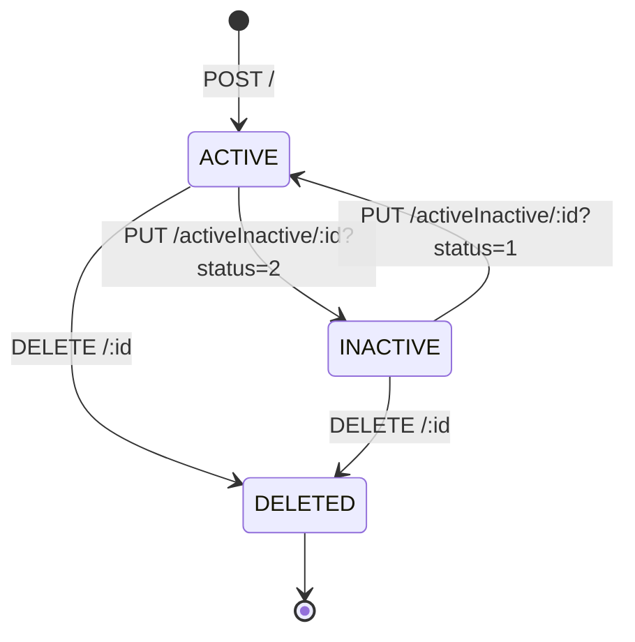

# Vehicle

Master data for the fleet: company vehicles, freelance vehicles and rental vehicles. Holds registration/GPS identity, seat capacity, the running odometer (`currentMileage`, advanced by trips and internal trips), and the license/insurance renewal dates that the notification module turns into "renewal due" alerts. Also exposes the availability lookup (`/passengerCount/:count`) used when assigning a vehicle to a trip.

Shared infrastructure (auth middleware, `CommonResponse`, error middleware, cache util, enums, `util/data`) is described in [README.md](./README.md).

## Files

| File | Responsibility |
|---|---|
| `src/modules/vehicle/vehicle.model.ts` | Mongoose schema/model `Vehicle` |
| `src/modules/vehicle/vehicle.route.ts` | Express router, role guards |
| `src/modules/vehicle/vehicle.validation.ts` | Joi `vehicleSchema` (used for both create and update) |
| `src/modules/vehicle/vehicle.controller.ts` | Request handlers |
| `src/modules/vehicle/vehicle.service.ts` | DB queries, cache read/write/clear, availability lookup |
| `src/modules/vehicle/vehicle.util.ts` | Model → `VehicleResponseDto` mapping |
| `src/modules/vehicle/dto/vehicleResponseDto.ts` | Response DTO interface for list endpoint |

## Data model

### `Vehicle` (collection `vehicles`)

Options: `timestamps: true` (`createdAt`, `updatedAt`), `versionKey: false`. No indexes defined (no unique index on `registrationNumber` or `gpsTracker`; uniqueness is enforced only in the controller). No hooks/virtuals.

| Field | Type | Required / default / ref / enum | Meaning |
|---|---|---|---|
| `vehicleType` | Number | required (message wrongly says `'Start Date is required'`) | Id from `vehicleTypes` in `util/data/commonData.ts`: 1 Car, 2 Van, 3 Bus, 4 SUV |
| `vehicleOwner` | String | required | Owner name (free text) |
| `registrationNumber` | String | required | Plate number; always stored upper-cased by controller |
| `gpsTracker` | String | – | GPS tracker id; unique among non-deleted company vehicles (controller check) |
| `capacity` | Number | required | Total capacity |
| `availableSeats` | Number | required | Passenger seats; used by passenger-count lookup |
| `licenseRenewalDate` | Date | – | Revenue license expiry; read by notification module |
| `insuranceRenewalDate` | Date | – | Insurance expiry; read by notification module |
| `gearOil` | String | maxlength 200 | Maintenance spec note |
| `airFilter` | String | maxlength 200 | Maintenance spec note |
| `oilFilter` | String | maxlength 200 | Maintenance spec note |
| `initialMileage` | Number | required, default 0 | Odometer at registration |
| `currentMileage` | Number | default 0 | Running odometer. Set = `initialMileage` on create; increased by trip "mark as reached" and internal trips; decreased when an internal trip is deleted |
| `description` | String | maxlength 500 | Notes |
| `isFreelanceVehicle` | Boolean | default false | Freelance (outsourced) vehicle |
| `rentalFor30Days` | Number | default 0 | Rental fee per 30 days (freelance/rental vehicles); used by report `vehicleMonthlyPaymentMaintance` |
| `isRentalVehicle` | Boolean | default false | Rented vehicle |
| `status` | Number | required, default `WellKnownLeaveStatus.PENDING` (=1) | `WellKnownStatus`: 1 ACTIVE, 2 INACTIVE, 3 DELETED. Controller always sets ACTIVE on create |
| `createdBy` | ObjectId | ref `User` | Creator |
| `updatedBy` | ObjectId | ref `User` | Last updater |

"Company vehicle" = `!isFreelanceVehicle && !isRentalVehicle` (this term is used by vehicleMaintenance DTOs, reports and dashboard).

## Endpoints

Base: `/api/v1/vehicle`

| Method | Path | Roles allowed | Validation schema | Handler |
|---|---|---|---|---|
| POST | `/api/v1/vehicle/` | SUPERADMIN (1) | `vehicleSchema` | `saveVehicle` |
| PUT | `/api/v1/vehicle/:id` | SUPERADMIN (1) | `vehicleSchema` | `updateVehicle` |
| GET | `/api/v1/vehicle/:id` | any authenticated (`authorize([])`) | – | `getVehicleById` |
| GET | `/api/v1/vehicle/` | any authenticated | – | `getAllVehicles` |
| DELETE | `/api/v1/vehicle/:id` | SUPERADMIN (1) | – | `deleteVehicleById` |
| PUT | `/api/v1/vehicle/activeInactive/:id` | SUPERADMIN (1) | – (manual check of `status` query) | `activeInactiveVehicle` |
| GET | `/api/v1/vehicle/passengerCount/:count` | any authenticated | – | `getVehiclesByPassengersCount` |

## Endpoint logic

Joi validation is run with `schema.validate(req.body)`; only `error` is used, the converted value is discarded, so the controller works with the raw body (Joi defaults such as `isFreelanceVehicle: false` are NOT applied). Any Joi error → `BadRequestError(error.message)` (400). Invalid ObjectIds in params surface as Mongoose `CastError` → 404 `No item found with ID "<value>"!` via error middleware.

### POST `/api/v1/vehicle/` — `saveVehicle` (controller.ts:20)

Request body (`vehicleSchema`):

| Field | Rule |
|---|---|
| `vehicleType` | number, required (`Vehicle Type is required!` / `Vehicle Type is invalid!`) |
| `vehicleOwner` | string, required |
| `registrationNumber` | string, required |
| `capacity` | number, required |
| `availableSeats` | number, required |
| `gpsTracker` | string, null or `''` allowed |
| `description` | string, null/`''` allowed, max 500 (messages say "Reason") |
| `licenseRenewalDate`, `insuranceRenewalDate` | date, null/`''` allowed |
| `gearOil`, `airFilter`, `oilFilter` | string, null/`''` allowed, max 200 |
| `initialMileage` | number, required |
| `isFreelanceVehicle`, `isRentalVehicle` | boolean (default false in Joi only) |
| `rentalFor30Days` | number; required when `isFreelanceVehicle === true` or `isRentalVehicle === true` |

Steps:
1. Validate body → 400 on error.
2. `findByRegistrationNumAndStatusIn(registrationNumber.toUpperCase(), [ACTIVE, INACTIVE])`; if found → `BadRequestError('Vehicle already exists with this registration number!')`.
3. If neither freelance nor rental: `findByGpsTrackerAndStatusIn(gpsTracker, [ACTIVE, INACTIVE])`; if found → `BadRequestError('Vehicle already exists with this GPS Tracker!')`. (Matches any non-deleted vehicle, including freelance/rental ones, with the same tracker value.)
4. Build `Vehicle` with all body fields, `registrationNumber` upper-cased, `currentMileage = initialMileage`, `status = ACTIVE`, `createdBy = updatedBy = auth.id`.
5. `vehicleService.save(vehicle, null)` → clears cache prefixes `vehicle-` and `trip-`, then saves.
6. Response 201 `Vehicle created successfully!`, `data` = saved raw document.

### PUT `/api/v1/vehicle/:id` — `updateVehicle` (controller.ts:111)

Request: `:id` vehicle id; body as create.

Steps:
1. Validate body → 400.
2. `findByIdAndStatusIn(id, [ACTIVE, INACTIVE])` (populates `createdBy updatedBy`); missing → `BadRequestError('Vehicle not found!')`.
3. `findByRegNumAndStatusInAndIdNot(id, regNo.toUpperCase(), [ACTIVE, INACTIVE])`; found → `BadRequestError('Vehicle already exists with this registration number!')`.
4. If neither freelance nor rental: `findByIdNotAndGpsTrackerAndStatusIn(id, gpsTracker, [ACTIVE, INACTIVE])`; found → `BadRequestError('Vehicle already exists with this GPS Tracker!')`.
5. Overwrite: `vehicleType`, `registrationNumber` (upper), `gpsTracker`, `capacity`, `availableSeats`, `description`, `vehicleOwner`, both renewal dates, `gearOil`, `airFilter`, `oilFilter`, `isFreelanceVehicle`, `isRentalVehicle`, `rentalFor30Days`, `updatedBy = auth.id`.
6. If `vehicle.initialMileage != initialMileage` → set both `initialMileage` and `currentMileage` to the new `initialMileage` (accumulated mileage is discarded).
7. `vehicleService.save` (clears `vehicle-`, `trip-`).
8. Response 200 `Vehicle updated successfully!`, `data` = saved document (with populated users).

### GET `/api/v1/vehicle/:id` — `getVehicleById` (controller.ts:213)

1. `findByIdAndStatusIn(id, [ACTIVE, INACTIVE])` with `createdBy updatedBy` populated.
2. Missing → `BadRequestError('Vehicle not found!')`.
3. Response 200, message `''`, `data` = raw populated document (all model fields, not the DTO).

### GET `/api/v1/vehicle/` — `getAllVehicles` (controller.ts:229)

Query: `withInactive` (any truthy string → include inactive).

1. `withInactive` → `findAllAndStatusIn([ACTIVE, INACTIVE])`, else `findAllAndStatusIn([ACTIVE])`.
   - Cache key `vehicle-[1,2]` or `vehicle-[1]`; on miss: `Vehicle.find({status:{$in}}).populate('createdBy updatedBy').sort({createdAt:-1})`, cached for `ONE_WEEK`.
2. Map with `vehicleModelArrToVehicleResponseDtos`.
3. Response 200, `data` = `VehicleResponseDto[]` (empty array if none).

### DELETE `/api/v1/vehicle/:id` — `deleteVehicleById` (controller.ts:252)

1. `findByIdAndStatusIn(id, [ACTIVE, INACTIVE])`; missing → `BadRequestError('Vehicle not found!')`.
2. Soft delete: `status = DELETED`, `updatedBy = auth.id`, `vehicleService.save` (clears `vehicle-`, `trip-`).
3. Response 200 `Vehicle deleted successfully!`; `data` is the `updateVehicle` function reference (serialises to nothing — see Known issues).

No check for the vehicle being assigned to active trips/internal trips.

### PUT `/api/v1/vehicle/activeInactive/:id?status=<1|2>` — `activeInactiveVehicle` (controller.ts:283)

1. `status` query must loosely equal `1` (ACTIVE) or `2` (INACTIVE); else `BadRequestError('Invalid status value!')`.
2. `findByIdAndStatusIn(id, [ACTIVE, INACTIVE])`; missing → `BadRequestError('Vehicle not found!')`.
3. Message: `Vehicle activated successfully!` (status 1) or `Vehicle inactivated successfully!`.
4. `vehicle.status = status == 1 ? ACTIVE : INACTIVE`, `updatedBy = auth.id`, save (clears `vehicle-`, `trip-`).
5. Response 200 with the message; `data` = `updateVehicle` function reference (same bug as delete).

### GET `/api/v1/vehicle/passengerCount/:count` — `getVehiclesByPassengersCount` (controller.ts:329)

Request: `:count` (seats needed; `'0'` if empty); query `startDate`, `endDate` (optional, both needed to apply exclusion), `tripId` (optional, the trip being edited; default `''`).

1. `findVehiclesBySheetCountAndNotInInternalTripsAndNormalTrips(+count, startDate, endDate, tripId)`:
   - If `startDate && endDate`:
     - Internal trips overlapping the range (`status: ACTIVE`) → their `vehicle` ids.
     - Trips overlapping the range, `_id != tripId`, `status in [PENDING(1), START(3)]` → ids of entries in `vehicles[]` with `isActive: true`.
     - Overlap condition (both collections): `startDate ∈ [start, end)` OR `endDate ∈ [start, end)` OR (`startDate <= start` AND `endDate >= end`).
   - Return `Vehicle.find({availableSeats: {$gte: count}, status: ACTIVE, _id: {$nin: excluded}}).lean()`. Not cached.
2. Each result gets `typeName` from `vehicleTypes` (`''` if unknown).
3. Response 200, `data` = array of lean vehicle documents + `typeName`.

## Service layer (`vehicle.service.ts`)

| Function | Query / behaviour |
|---|---|
| `save(vehicle, session)` | `cache.clearCacheByPrefixs('vehicle-,trip-')`, then `vehicle.save({session})` or `vehicle.save()` |
| `findByRegistrationNumAndStatusIn(regNo, status[])` | `Vehicle.findOne({registrationNumber, status:{$in}})` |
| `findByRegNumAndStatusInAndIdNot(id, regNo, status[])` | `findOne({_id:{$ne:id}, status:{$in}, registrationNumber})` |
| `findByIdAndStatusIn(id, status[])` | `findOne({_id:id, status:{$in}}).populate('createdBy updatedBy')` |
| `findAllAndStatusIn(status[])` | Cached (key `vehicle-` + `JSON.stringify(status)`, TTL ONE_WEEK); `find({status:{$in}}).populate('createdBy updatedBy').sort({createdAt:-1})` |
| `findByGpsTrackerAndStatusIn(gps, status[])` | `findOne({gpsTracker, status:{$in}})` |
| `findByIdNotAndGpsTrackerAndStatusIn(id, gps, status[])` | `findOne({_id:{$ne:id}, gpsTracker, status:{$in}})` |
| `findVehiclesBySheetCountAndNotInInternalTripsAndNormalTrips(count, start, end, tripId)` | See passenger-count endpoint |

## Utilities / DTOs

`vehicleModelToVehicleResponseDto(vehicle) → VehicleResponseDto`:

| DTO field | Source |
|---|---|
| `_id`, `vehicleType`, `registrationNumber`, `gpsTracker`, `capacity`, `availableSeats`, `currentMileage`, `description`, `status`, `vehicleOwner`, `isFreelanceVehicle`, `isRentalVehicle`, `rentalFor30Days`, `createdAt`, `updatedAt` | same-named model field |
| `vehicleTypeName` | `vehicleTypes.find(id === vehicleType).name` or `''` |
| `statusName` | `WellKnownStatus[status]` (e.g. `ACTIVE`) |
| `createdBy` / `updatedBy` | populated user `_id` |
| `createdUser` / `updatedUser` | populated user `fullName` or `''` |

Not in DTO: `licenseRenewalDate`, `insuranceRenewalDate`, `gearOil`, `airFilter`, `oilFilter`, `initialMileage` (clients must call GET `/:id` for those).

`vehicleModelArrToVehicleResponseDtos(vehicles[])` → maps each.

## Business rules

- Registration number is unique (case-insensitive via upper-casing) among ACTIVE+INACTIVE vehicles. Deleted vehicles free the number.
- GPS tracker is unique among ACTIVE+INACTIVE vehicles, checked only when the vehicle being saved is a company vehicle.
- `rentalFor30Days` is mandatory for freelance or rental vehicles.
- Mileage: create sets `currentMileage = initialMileage`; changing `initialMileage` on update resets `currentMileage` to it. Other modules move `currentMileage` (see below).
- Availability: a vehicle is available for a date range if ACTIVE, `availableSeats >= count`, and not on an overlapping ACTIVE internal trip or as an active vehicle on an overlapping PENDING/START trip.
- Renewal notifications (notification module, `notification.service.ts:15`): vehicles with `insuranceRenewalDate <= today+7 days (00:00)` or `licenseRenewalDate <= today+7`, `isFreelanceVehicle: false`, `isRentalVehicle: false`, `status != DELETED` (INACTIVE included). One notification row per expiring date. No lower bound, so already-expired dates keep notifying until updated.

## Cross-module dependencies

Reads: `InternalTrip` (internalTrip module) and `Trip` (trip module) models for the availability lookup; `vehicleTypes` static data.

Cache: every `vehicleService.save` clears `vehicle-*` and `trip-*` keys (so trip lists are refreshed after mileage/vehicle changes).

Callers of this module:

| Caller | Use |
|---|---|
| `trip/trip.controller.ts:752` | assign vehicle: `findByIdAndStatusIn(vehicleId, [ACTIVE])` |
| `trip/trip.controller.ts:1201-1240` | mark place reached: loads active vehicle, increases `currentMileage` by distance (non-freelance), `save(vehicle, session)`; requires new mileage > current |
| `trip/trip.util.ts:67` | exposes `licenseRenewalDate`/`insuranceRenewalDate` in trip DTO |
| `internalTrip/internalTrip.controller.ts` | mileage increase on create/update, decrease on delete (in transactions) |
| `vehicleMaintain/vehicleMaintenance.controller.ts` | existence check `[ACTIVE, INACTIVE]` |
| `report/report.controller.ts:323` | `findByIdAndStatusIn` for monthly vehicle payment; requires freelance or rental |
| `dashboard/dashboard.controller.ts:73` | `findAllAndStatusIn([ACTIVE])` (shares the `vehicle-[1]` cache) for available-vehicle count |
| `notification/notification.service.ts:15` | renewal alerts (direct `Vehicle.find`) |
| `vehicleMaintenance`, `internalTrip`, `trip` models | `ref: 'Vehicle'` |

No socket events emitted; no audit log entries.

## Known issues / notes

- `vehicle.controller.ts:275` and `:322` — responses pass `updateVehicle` (the controller function) as `data` instead of the vehicle; JSON serialisation drops it, so `data` is absent.
- `vehicle.service.ts:113` — `_id: { $ne: tripId }` with the default `tripId = ''` throws a Mongoose `CastError` (verified with Mongoose 8.5.0), so `GET /passengerCount/:count?startDate=..&endDate=..` without `tripId` (e.g. when creating a new trip) returns 404 `No item found with ID ""!`. Same pattern in `user.service.ts` (driver lookup, other module).
- `vehicle.controller.ts:337` — non-numeric `:count` gives `NaN` → `CastError` → 404.
- `vehicle.controller.ts:59-71`, `:160-173` — GPS uniqueness query uses the raw `gpsTracker`; Joi allows `''`/`null`. A second company vehicle with an empty/null tracker collides with any other non-deleted vehicle whose tracker is `''`/null/missing (`{gpsTracker: null}` matches missing fields).
- `vehicle.controller.ts:193-196` — changing `initialMileage` overwrites `currentMileage`, discarding mileage accumulated by trips/internal trips.
- `vehicle.controller.ts:230` — `withInactive` is truthy for any value, including `?withInactive=false`.
- `vehicle.controller.ts:252-280` — delete has no check for active trip/internal-trip assignment; referenced trips keep pointing to a DELETED vehicle (`trip.controller.ts:1201` then fails with `Selected vehicle not found!`).
- `vehicle.model.ts:9` — `vehicleType` required message is `'Start Date is required'` (copy-paste).
- `vehicle.model.ts:93` — `status` default uses `WellKnownLeaveStatus.PENDING` (1) instead of `WellKnownStatus.ACTIVE` (also 1, so behaviour is accidentally correct).
- `vehicle.validation.ts:56-59` — `oilFilter` messages say "Air Filter"; `description` messages say "Reason".
- `vehicle.validation.ts:19`, `:61` — `.required().default(0)`: default never applies because the field is required.
- `vehicle.controller.ts:14-15`, `:8` — unused imports (`VehicleResponseDto`, `leaveService`, `startSession`, `constants`).
- `vehicle.service.ts:131-136` — availability lookup ignores INACTIVE vehicles (fine) but does not exclude trips in REACHED status (5), so a vehicle on a REACHED trip shows as available.
- No unique DB index on `registrationNumber`/`gpsTracker`; concurrent creates can bypass the controller check.
- `findAllAndStatusIn` caches Mongoose documents (not lean) for a week; consumers that mutate them mutate the cached copy.
- `notification.service.ts:21-29` — renewal query has no lower bound; expired vehicles notify indefinitely.
- `vehicle.validation.ts:69-83` — for a freelance vehicle with no `rentalFor30Days`, the response is `Rental For 30 Days is required for rental vehicles` (the rental branch's message), not the freelance message on line 74. Confirmed by running the project's Joi schema.
