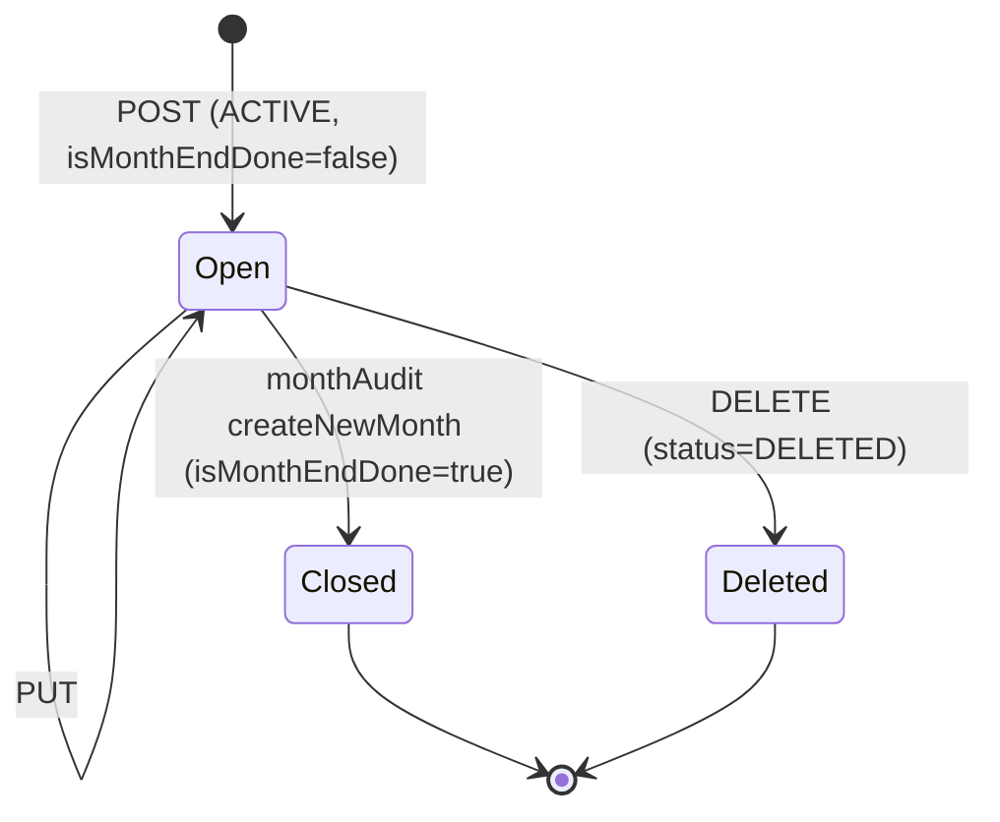

# Vehicle Maintenance

Records maintenance/repair work done on a vehicle at a garage (part, date, cost, notes, bill images). Records can only be created/edited for dates inside the company's current working month and are locked once the month-end audit flags them (`isMonthEndDone`). Costs feed the monthly expenses report, the dashboard expense total and the monthly freelance/rental vehicle payment report. The "invoice" endpoint returns a printable view of one record.

Shared infrastructure (auth middleware, `CommonResponse`, error middleware, cache util, enums, multer/store uploads) is described in [README.md](./README.md).

## Files

| File | Responsibility |
|---|---|
| `src/modules/vehicleMaintain/vehicleMaintenance.model.ts` | Mongoose schema/model `VehicleMaintenance` |
| `src/modules/vehicleMaintain/vehicleMaintenance.route.ts` | Router + role guards (`ACCESS_ROLES`) |
| `src/modules/vehicleMaintain/vehicleMaintenance.validation.ts` | Joi `saveVehicleMaintenanceSchema` (create and update) |
| `src/modules/vehicleMaintain/vehicleMaintenance.controller.ts` | Handlers |
| `src/modules/vehicleMaintain/vehicleMaintenance.service.ts` | Queries, cache, month-end query |
| `src/modules/vehicleMaintain/vehicleMaintenance.util.ts` | DTO mappers, `isDateInWorkingMonth` |
| `src/modules/vehicleMaintain/dto/vehicleMaintenanceResponseDto.ts` | List DTO |
| `src/modules/vehicleMaintain/dto/vehicleMaintenanceInvoiceResponseDto.ts` | Invoice DTO |

## Data model

### `VehicleMaintenance` (collection `vehiclemaintenances`)

Options: `timestamps: true`, `versionKey: false`. No indexes, hooks or virtuals.

| Field | Type | Required / default / ref | Meaning |
|---|---|---|---|
| `vehicle` | ObjectId | required, ref `Vehicle` | Maintained vehicle |
| `maintenancePart` | String | required, maxlength 100 | Part / work description |
| `garage` | ObjectId | required, ref `Garage` | Garage that did the work |
| `maintenanceDate` | Date | required | Date of work; must be in current working month |
| `cost` | Number | required, default 0 | Cost |
| `note` | String | maxlength 500 | Free note |
| `isMonthEndDone` | Boolean | default false | Set true by month-end audit; record becomes read-only |
| `billImageUrls` | [String] | default `[]` | URLs of bill/invoice images (uploaded beforehand via the store module) |
| `batchId` | Number | default 0 | Month-audit batch that closed it |
| `status` | Number | required, default ACTIVE (1) | `WellKnownStatus` 1 ACTIVE, 2 INACTIVE, 3 DELETED |
| `createdBy` / `updatedBy` | ObjectId | ref `User` | Audit users |

## Endpoints

Base: `/api/v1/vehicleMaintenance`. `ACCESS_ROLES` = ADMIN(2), SUPERADMIN(1), TRIPMANAGER(5), FINANCEOFFICER(4), DRIVERASSISTANT(6), TRIPASSISTANT(7) (everyone except DRIVER).

| Method | Path | Roles allowed | Validation schema | Handler |
|---|---|---|---|---|
| POST | `/api/v1/vehicleMaintenance/` | ACCESS_ROLES | `saveVehicleMaintenanceSchema` | `saveVehicleMaintenance` |
| PUT | `/api/v1/vehicleMaintenance/:id` | ACCESS_ROLES | `saveVehicleMaintenanceSchema` | `updateVehicleMaintenance` |
| DELETE | `/api/v1/vehicleMaintenance/:id` | ACCESS_ROLES | – | `deleteVehicleMaintenance` |
| GET | `/api/v1/vehicleMaintenance/:id` | any authenticated | – | `getVehicleMaintenanceById` |
| GET | `/api/v1/vehicleMaintenance/` | any authenticated | – | `getAllVehicleMaintenances` |
| GET | `/api/v1/vehicleMaintenance/maintainInvoice/:id` | any authenticated | – | `getVehicleMaintenanceInvoice` |

Invoice/bill files: there is no upload or delete endpoint in this module. Clients upload images through `POST /api/v1/store/upload` or `/api/v1/store/uploadMultiple` (store module, multer) and send the resulting URLs in `billImageUrls`. "Deleting" a bill image means sending an update without that URL; the array is replaced wholesale and the stored file is never removed.

## Endpoint logic

Joi errors → `BadRequestError(error.message)` (400). Joi converted values are discarded; raw body is used. Invalid ObjectIds → `CastError` → 404 via error middleware.

### Request body (`saveVehicleMaintenanceSchema`)

| Field | Rule / messages |
|---|---|
| `vehicle` | string, required (`Vehicle is required` / `Vehicle is invalid`) |
| `maintenancePart` | string, max 100, required |
| `garage` | string, required |
| `maintenanceDate` | date, required |
| `cost` | number, required |
| `note` | string, max 500, null/`''` allowed |
| `billImageUrls` | array of strings, null allowed |

### POST `/` — `saveVehicleMaintenance` (controller.ts:17)

1. Validate body.
2. `companyWorkingInfoService.getCompanyWorkingInfo()` (cached under `companyWorkingInfo`); none → `BadRequestError('No active company information found!')`.
3. `isDateInWorkingMonth(maintenanceDate, workingYear, workingMonth)` false → `BadRequestError('Vehicle maintenance date is not in working month!')`.
4. `vehicleService.findByIdAndStatusIn(vehicle, [ACTIVE, INACTIVE])`; missing → `BadRequestError('Invalid vehicle. Vehicle does not exist!')`.
5. `garageService.findByIdAndStatusIn(garage, [ACTIVE, INACTIVE])`; missing → `BadRequestError('Invalid garage. Garage does not exist!')`.
6. New document with body fields, `createdBy = updatedBy = auth.id` (status defaults ACTIVE).
7. `vehicleMaintainService.save(doc, null)` → clears cache prefix `vehicleMaintenance-`, saves.
8. Response 201 `Vehicle maintenance record created successfully`, `data` = saved document (unpopulated).

### PUT `/:id` — `updateVehicleMaintenance` (controller.ts:88)

1. Validate body.
2. `findByIdAndStatusIn(id, [ACTIVE, INACTIVE])`; missing → `BadRequestError('Invalid vehicle maintenance!')`.
3. `isMonthEndDone` → `BadRequestError('Cannot update vehicle maintenance, Month end process already done!')`.
4. If `vehicle` changed (`stored.toString() !== body.vehicle`): vehicle existence check as in create (`Invalid vehicle. Vehicle does not exist!`).
5. If `maintenanceDate` "changed" (always true, see Known issues): load company info (`No active company information found!`) and check working month (`Vehicle maintenance date is not in working month!`).
6. If `garage` changed: garage existence check (`Invalid garage. Garage does not exist!`).
7. Overwrite `vehicle`, `maintenancePart`, `garage`, `maintenanceDate`, `cost`, `note`, `billImageUrls`, `updatedBy = auth.id`.
8. Save (clears `vehicleMaintenance-`).
9. Response 200 `Vehicle maintenance updated successfully`, `data` = updated document.

### DELETE `/:id` — `deleteVehicleMaintenance` (controller.ts:172)

1. `findByIdAndStatusIn(id, [ACTIVE, INACTIVE])`; missing → `BadRequestError('Invalid vehicle maintenance!')`.
2. `isMonthEndDone` → `BadRequestError('Cannot delete vehicle maintenance, Month end process already done!')`.
3. Soft delete: `status = DELETED`, `updatedBy = auth.id`, save (clears `vehicleMaintenance-`).
4. Response 200 `Vehicle maintenance deleted successfully`, `data: null`.

No working-month check on delete (a record from an earlier, not-yet-closed month can be deleted).

### GET `/:id` — `getVehicleMaintenanceById` (controller.ts:202)

1. `findByIdAndStatusIn(id, [ACTIVE, INACTIVE])` (no populate).
2. Response 200, `data` = raw document or `null` (no not-found error).

### GET `/?startDate=&endDate=` — `getAllVehicleMaintenances` (controller.ts:217)

1. `findAllByMaintenanceDateAndStatusIn([ACTIVE], startDate, endDate)`:
   - Cache key `vehicleMaintenance-` + `startDate` + `endDate` + `"[1]"`.
   - On miss: `startDate` → 00:00:00.000, `endDate` → 23:59:59.999 (server local time); `find({status:{$in:[1]}, maintenanceDate:{$gte, $lte}}).populate('vehicle garage createdBy updatedBy').sort({maintenanceDate:1})`; cached ONE_WEEK.
2. Map with `mapmodelArrToVehicleMaintenanceResponseDtos`.
3. Response 200, `data` = `VehicleMaintenanceResponseDto[]`.

Both query params are effectively required: missing → `Invalid Date` → `CastError` → 404.

### GET `/maintainInvoice/:id` — `getVehicleMaintenanceInvoice` (controller.ts:239)

1. `findByIdAndStatusInWithData(id, [ACTIVE])` (populates `vehicle garage createdBy updatedBy`).
2. Found → `modelTovehicleMaintainInvoiceResponseDto`; else `null`.
3. Response 200, `data` = invoice DTO or `null`.

## Service layer (`vehicleMaintenance.service.ts`)

| Function | Query / behaviour |
|---|---|
| `save(doc, session)` | `clearCacheByPrefixs('vehicleMaintenance-')`; `doc.save({session})` or `doc.save()` |
| `findByIdAndStatusIn(id, statuses)` | `findOne({_id, status:{$in}})` |
| `findByIdAndStatusInWithData(id, statuses)` | same + `.populate('vehicle garage createdBy updatedBy')` |
| `findAllByMaintenanceDateAndStatusIn(statuses, start, end)` | cached date-range query (see GET `/`) |
| `findAllByEndMonthAndStatusIn(endMonth, year, status)` | Month-end query used by monthAudit: `endDate = new Date(); setFullYear(year); setMonth(endMonth)` then first day of that month at 23:59:59.999; `find({maintenanceDate:{$lt:endDate}, status:{$in}, isMonthEndDone:false}).sort({startDate:1})`. Called with the 1-based `workingMonth`, so `setMonth` lands on the following month. Not cached |

## Utilities / DTOs

`mapmodelToVehicleMaintenanceResponseDto(model)` (expects populated `vehicle`, `garage`, users):

| DTO field | Source |
|---|---|
| `id` | `_id` |
| `vehicleId`, `vehicleNumber` | `vehicle._id`, `vehicle.registrationNumber` |
| `isCompanyVehicle` | `!vehicle.isRentalVehicle && !vehicle.isFreelanceVehicle` |
| `isRentalVehicle`, `isFreelanceVehicle` | vehicle flags (`|| false`) |
| `garageId`, `garageName` | `garage._id`, `garage.name` |
| `maintenancePart`, `maintenanceDate`, `cost`, `note`, `billImageUrls`, `isMonthEndDone`, `createdAt`, `updatedAt` | same |
| `createdBy`/`updatedBy` | user `_id` |
| `createdUser`/`updatedUser` | user `userName` or `''` |

`mapmodelArrToVehicleMaintenanceResponseDtos(models[])` → maps each.

`modelTovehicleMaintainInvoiceResponseDto(model)` → same as above plus `vehicleOwnerName = vehicle.vehicleOwner`; `createdUser`/`updatedUser` use `fullName` (not `userName`).

`isDateInWorkingMonth(date, workingYear, workingMonth)` → `new Date(date)`; invalid → `console.warn` + `false`; else `getFullYear() === workingYear && getMonth()+1 === workingMonth` (server local time, `workingMonth` 1-based).

## Business rules

- Create/update only for `maintenanceDate` inside the active `companyWorkingInfo` year/month.
- Vehicle and garage must exist with status ACTIVE or INACTIVE.
- Records with `isMonthEndDone = true` cannot be updated or deleted.
- Month end (monthAudit `createNewMonth`, in its transaction): all ACTIVE, not-closed records dated before the computed end date get `isMonthEndDone = true`, `batchId`, `updatedBy` (`monthAudit.controller.ts:241-262`).
- Cost treatment downstream (report/dashboard):
  - Company vehicle: counted as company expense.
  - Freelance vehicle: excluded from company expense; fully deducted from freelance payment (`effectiveMaintenanceCost`).
  - Rental vehicle: cost <= 5000 counted as company expense; cost > 5000 excluded from expense and deducted from the rental payment.
- No INACTIVE transition exists in this module (status is ACTIVE or DELETED in practice).

## Cross-module dependencies

Reads: `vehicle.service.findByIdAndStatusIn`, `garage.service.findByIdAndStatusIn`, `companyWorkingInfo.service.getCompanyWorkingInfo` (cache key `companyWorkingInfo`).

Cache: own prefix `vehicleMaintenance-` cleared on every save. Does not clear vehicle/garage caches.

Callers:

| Caller | Use |
|---|---|
| `monthAudit/monthAudit.controller.ts:241` | `findAllByEndMonthAndStatusIn(workingMonth, workingYear, [ACTIVE])` + `save(..., session)` to close records |
| `dashboard/dashboard.controller.ts:209` | `findAllByMaintenanceDateAndStatusIn([ACTIVE], start, end)` for expense total (shares this cache) |
| `report/report.service.ts:82-101` | direct model queries for monthly expenses report and vehicle monthly payment report |

No socket events; no audit log entries.

## Known issues / notes

- `vehicleMaintenance.controller.ts:127` — `vehicleMaintain.maintenanceDate !== maintenanceDate` compares a `Date` object to a string, so it is always true; the working-month check runs on every update.
- `vehicleMaintenance.controller.ts:221` / `vehicleMaintenance.service.ts:32-40` — missing `startDate`/`endDate` gives `Invalid Date` → `CastError` → 404 instead of a validation error. No Joi schema for the query.
- `vehicleMaintenance.service.ts:56-67` — month-end end date: `setMonth` on today's date can overflow (e.g. run on the 31st into a 30-day month skips a month); the bound is the 1st of the next month at 23:59:59.999, so records dated on the 1st of the next month are also closed. `sort({startDate:1})` sorts on a non-existent field.
- `vehicleMaintenance.controller.ts:202-215` — GET by id returns 200 with `null` when not found; no populate.
- `vehicleMaintenance.controller.ts:243` — invoice only finds ACTIVE; GET by id finds ACTIVE+INACTIVE (inconsistent, though INACTIVE is never set).
- `vehicleMaintenance.util.ts:22-24` vs `:52-54` — list DTO uses `userName`, invoice DTO uses `fullName`.
- `vehicleMaintenance.controller.ts:172-200` — delete has no working-month check, unlike create/update.
- `billImageUrls` replacement never deletes the old files from storage.
- `vehicleMaintenance.validation.ts` — `vehicle`/`garage` not validated as ObjectId; `cost` allows negatives.
- `vehicleMaintenance.service.ts:28` — cache key concatenates raw query strings; different date formats for the same day create separate entries.
- Route roles: DRIVERASSISTANT and TRIPASSISTANT can create/update/delete maintenance; GET endpoints are open to every authenticated role including DRIVER.
